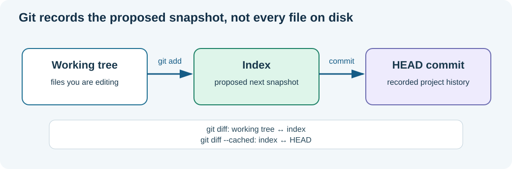

# Chapter 182 — Git's working tree, staging area and recorded history

**Bits to Banking · Version-control track · Umicom Foundation**  
**Tools:** Git and a PowerShell terminal (commands only; no scripts).  
**Prerequisite:** [Chapter 16 — Git basics](16-git.md).

## Why version control belongs in engineering education

A software repository contains much more than the current files. It records **which changes were accepted, in which order, and with what explanation**. This is essential when an Umicom Framework module is reused by Studio, Trader, Bank or OS. A change that looks correct in the current editor may still have removed a previous behaviour. Git allows us to inspect the actual difference instead of relying on memory.

Start with three places where a file can exist:



**Working tree** is the set of files currently on disk. **Index** (or staging area) is Git's proposed next snapshot. **HEAD** usually names the commit you have checked out. A branch such as `main` is a movable reference to a commit; a commit is not a folder copy but an object referencing a tree and parent commit(s).

## First practice: a safe local repository

Use a **new practice directory**, not `C:\umicom\umicomOS` or your real Framework checkout:

```powershell
New-Item -ItemType Directory -Force "$HOME\UmicomLearning\git-evidence" | Out-Null
Set-Location "$HOME\UmicomLearning\git-evidence"
git init -b main
git status --short --branch
```

If Git is not installed, `git --version` fails. Install the Git command-line client using the official installer or your package manager before continuing. Set your own public commit identity (do not paste passwords or tokens):

```powershell
git config user.name "YOUR_DISPLAY_NAME"
git config user.email "YOUR_EMAIL_FOR_COMMITS"
```

Create a small but meaningful record about the work, instead of an artificial 'hello world' program:

```powershell
Set-Content -LiteralPath ".\BANK_RECONCILIATION.md" -Value "# Bank reconciliation evidence"
git status --short
git add BANK_RECONCILIATION.md
git diff --cached --check
git diff --cached --stat
git commit -m "docs: establish bank reconciliation evidence"
```

`git status --short` originally displayed `?? BANK_RECONCILIATION.md`. After `git add`, it displays `A  BANK_RECONCILIATION.md`; after the commit, a clean status is expected. The file's content did not suddenly change when staged. Only Git's **index** changed.

## Observe unstaged and staged changes separately

```powershell
Add-Content -LiteralPath ".\BANK_RECONCILIATION.md" -Value "Each exception needs an owner and evidence."
git diff -- BANK_RECONCILIATION.md
git diff --cached -- BANK_RECONCILIATION.md
```

The first command should show the new sentence; the second should show no staged patch. Now stage it:

```powershell
git add BANK_RECONCILIATION.md
git diff -- BANK_RECONCILIATION.md
git diff --cached -- BANK_RECONCILIATION.md
```

The situation reverses. The new sentence is now in the proposed snapshot. `git diff` without `--cached` compares the working tree with the index. `git diff --cached` compares the index with `HEAD`. This distinction explains why `git commit` can record only some of your edits.

Finish the practice:

```powershell
git diff --cached --check
git commit -m "docs: describe reconciliation exception ownership"
git log --oneline --decorate -5
git status --short
```

## Read a commit as evidence

```powershell
git show --stat --oneline HEAD
git show --format=fuller --no-patch HEAD
git ls-files
```

`git show --stat` names changed paths; `--format=fuller` displays authorship and time metadata; `git ls-files` shows tracked paths. Do not confuse author/committer metadata with verified provenance: a Git commit is not automatically cryptographically signed. The project may use branch protection, CI, signed releases and other controls in addition to commit history.

## What could go wrong?

A contributor accidentally stages an unrelated generated file, a secret or an entire build directory. Before committing, check `git diff --cached --stat` and `git diff --cached`. Remove an unwanted path from the index with `git restore --staged <path>`; that retains its working-tree bytes. Avoid destructive resets while learning. Never commit `.env` credentials, private keys or build artefacts.

## Exercises and answers to check

1. A modified tracked file appears in `git status` but not in `git diff --cached`. Where is the change? **Working tree only.**
2. What does `git add` do? **Copies the selected content into the index**; it is not a remote upload.
3. What does `git commit` record? **The current staged snapshot**, not every file visible in the editor.
4. What is the difference between `git status` and `git log`? **Current working/index state** versus **committed history**.
5. Why review the staged patch? Because an accidental deletion can otherwise enter a perfectly valid Git commit.

**Next:** [The daily Umicom Git workflow](183-daily-umicom-git-workflow.md).
