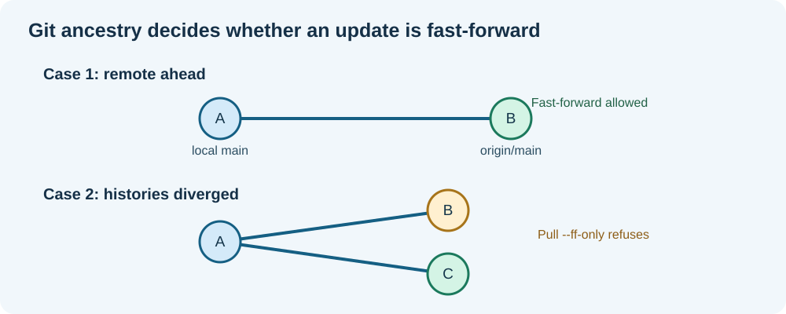

# Chapter 184 — Git remotes, fetch, pull and non-fast-forward rejections

**Bits to Banking · Version-control track · Umicom Foundation**  
**Tools:** Git, GitHub and PowerShell commands.  
**Prerequisite:** Chapter 183.

## Why a correct local commit may still be rejected

Consider two copies of Umicom Framework. Your local `main` refers to commit `A`, but another approved Framework update has already moved GitHub's `main` to `B`. If you attempt to push `A` as though it were the newest state, Git may reject your push: the remote has history your branch does not include. This is a **non-fast-forward** rejection, not a compiler failure.



Git's job is to protect commit ancestry, not to decide which source is best. A local file can look newer by modification time while the remote contains a different, already published commit. Never use file timestamps to determine commit order or history preservation.

## Four commands that do different things

| Command | Action | Does it change your working checkout? |
|---|---|---|
| `git fetch origin main` | Download and record the remote's latest commit references and required objects. | No. |
| `git merge --ff-only origin/main` | Advance your checked-out branch to an ancestor-compatible remote commit. | Yes, if successful. |
| `git pull --ff-only origin main` | Fetch and integrate only when a fast-forward is possible. | Yes, if successful. |
| `git push origin main` | Ask the remote to update `main` to your local `main` tip. | Not locally; may be rejected. |

Always check the **active branch** before assuming a command refers to the commit visible in `HEAD`. In a detached HEAD, `git push origin main` still pushes your local `main` branch, not your detached current commit.

## Diagnose before acting

Run read-only commands inside the **specific** repository:

```powershell
git status --short --branch
git branch -vv
git remote -v
git fetch origin main
git log --graph --decorate --oneline -15
git log --oneline --left-right HEAD...origin/main
git merge-base --is-ancestor HEAD origin/main
```

The last command's **exit code** is useful: zero means local `HEAD` is an ancestor of `origin/main`; one means it is not. In PowerShell, view the process exit code using `$LASTEXITCODE`. It is not a human-readable true/false line printed by Git.

If `HEAD` is an ancestor and the working tree is clean, `git pull --ff-only origin main` can advance `main`. If the ancestry is reversed, your local branch has unpublished commits and a push may be appropriate after review. If neither is an ancestor, history has diverged. **Stop, inspect the commits on each side and decide how to integrate them without discarding work**. A fast-forward-only pull will correctly refuse.

## A concrete Umicom example

You saw this failure while working inside the OS Framework submodule:

```text
fatal: You are not currently on a branch.
! [rejected] main -> main (non-fast-forward)
```

The first message describes `HEAD`: the submodule checkout is at a specific commit. The second describes the branch argument passed to push: local `main` is not an acceptable advancement of remote `main`. The two messages can happen together because **HEAD and the local `main` pointer are not the same thing**.

Do not jump from this observation to a blind `git switch main`, because the detached commit may contain unpublished work. First inspect:

```powershell
git log --oneline origin/main..HEAD
git status
git stash list
```

If the range is nonempty, tag and preserve the detached commit before changing checkouts; Chapter 186 explains that safeguard. If the working tree has modifications, preserve them before pulling. Only after those checks should you fast-forward a clean `main`.

## Protect the shared repository

A force push rewrites the remote reference and can make approved work temporarily unreachable by its normal branch name. **Do not use `git push --force` or `--force-with-lease` as a routine repair for a rejected Umicom push.** A maintainer should first establish exactly which commits exist on each side, then merge or reapply them in a reviewed manner consistent with project policy.

## Exercise

Draw a graph where remote `main` advanced from A to B while your local `main` still points to A. Identify the expected result of `fetch`, `pull --ff-only` and `push`. Repeat with two independent successor commits B and C from A; explain why `pull --ff-only` refuses that diverged case.

**Next:** [Umicom submodules and detached HEAD](185-umicom-git-submodules-and-detached-head.md).
