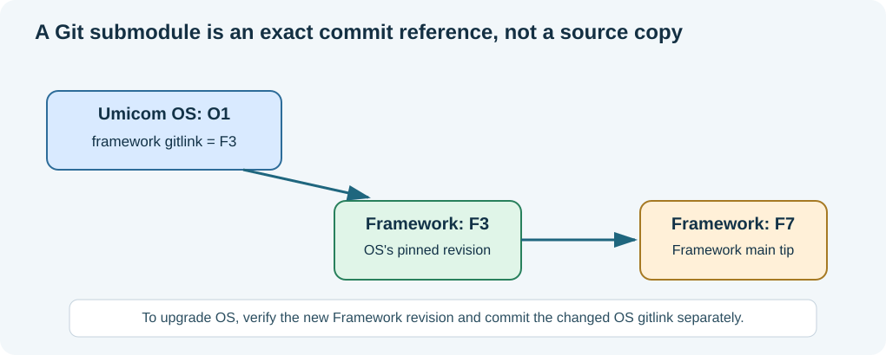

# Chapter 185 — Git submodules and detached HEAD in Umicom OS

**Bits to Banking · Version-control track · Umicom Foundation**  
**Tools:** Git and PowerShell commands · **Prerequisite:** Chapter 184.

## Two repositories, two histories

Umicom OS depends on Umicom Framework. It records that dependency through a Git **submodule**: its `framework/` directory points to an exact commit in the separate Framework repository. The OS project records a *gitlink*, not a copy of all Framework source files in the OS Git history.



There are two different questions. “What Framework revision was this Umicom OS commit designed to use?” is answered by the **parent's pinned submodule commit**. “What is the latest Framework revision on GitHub today?” is answered by **Framework remote `main`**. They are not guaranteed to match and should not be confused. For reproducible builds, pinning is a feature.

## Check both identities

```powershell
Set-Location "C:\umicom\umicomOS"
git rev-parse --show-toplevel
git status
git submodule status framework
git -C ".\framework" rev-parse --show-toplevel
git -C ".\framework" branch --show-current
git -C ".\framework" log -1 --oneline
```

A blank `branch --show-current` means detached HEAD. That is **normal after `git submodule update`**. Detached HEAD does not mean the source is corrupted, and it does not require force pushing. It means `HEAD` points to a commit directly instead of through the local `main` branch.

## Pinned checkout versus deliberate upgrade

```powershell
git submodule update --init framework
```

This checks out the **exact commit recorded by the parent Umicom OS repository**. It is the reproducible baseline for the parent. By contrast:

```powershell
git submodule update --init --remote framework
```

This deliberately selects the tracked remote branch for Framework, which may be newer than the parent's pinned commit. That is a dependency upgrade and may require rebuilding and updating the parent's gitlink. It is **not** the best command for every ordinary OS build.

Both commands may refuse to proceed if local changes would be overwritten. Read and preserve those changes; do not use `--force` to bypass protection. Submodule updates are not a license to delete educational comments, app fixes or untracked new source files.

## Publish Framework work before the parent reference

If the change includes new Framework functionality, work first in the **authoritative independent Framework checkout** at `C:\umicom\Umicom-Applications\framework`. The OS's nested checkout is a dependency reference, not the preferred editing workspace. **Do not switch an OS submodule away from detached HEAD while it contains unpublished commits or uncommitted changes.** Once your separate Framework checkout is on `main` and its work is preserved:

```powershell
Set-Location "C:\umicom\Umicom-Applications\framework"
git branch --show-current
git pull --ff-only origin main
git status
```

After reviewing changes and running Framework tests, stage, commit and push Framework **from that authoritative repository**:

```powershell
git add -A
git diff --cached --check
git diff --cached --stat
git commit -m "feat(framework): describe the reviewed shared capability"
git push origin main
```

Then return to the **OS parent**. First ensure its nested Framework work is clean or safely preserved (Chapter 186). Deliberately move that submodule to the reviewed remote revision, run the OS acceptance tests and commit the updated gitlink:

```powershell
Set-Location "C:\umicom\umicomOS"
git submodule update --init --remote framework
git status
git diff --submodule=log -- framework
git add framework
git diff --cached --submodule=log
git diff --cached --check
git commit -m "chore(os): synchronise Framework submodule reference"
git push origin main
```

The order matters. Do not publish an OS gitlink pointing to a Framework commit that has not been pushed and cannot be fetched by other contributors.

## What must be verified before `git switch main`?

The command may change the checkout. Inspect `git status`, `git log --oneline origin/main..HEAD`, `git branch -vv` and `git stash list`. If `origin/main..HEAD` shows unpublished commits, add a reviewable protective tag at `HEAD` and decide how to integrate those commits. A tag is not a new branch and preserves the commit object while you reconcile; [Chapter 186](186-stash-preserve-and-recover-work.md) demonstrates the approach.

## Exercise

On paper, draw OS commit O1 pointing to Framework F3 while Framework `main` has advanced to F7. Explain which command restores F3 and which attempts F7. Explain why committing only Framework F7 **does not** change the OS gitlink, and why committing only the OS gitlink does **not** publish the Framework source.

**Next:** [Stash and recover local work safely](186-stash-preserve-and-recover-work.md).
