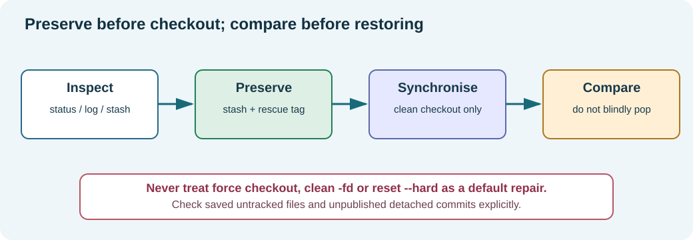

# Chapter 186 — Preserve local changes, use stash and recover deliberately

**Bits to Banking · Version-control track · Umicom Foundation**  
**Tools:** Git and interactive PowerShell commands · **Prerequisite:** Chapter 185.

## The actual safety problem

Git may refuse a submodule checkout because an incoming revision would overwrite modified tracked files **or untracked new files**. This is valuable protection. A source file can contain several days of Framework work that have not yet been committed. A missing commit does not mean the work has no value. Our policy is to protect existing code, comments and behaviour before making history or checkout changes.



## Step 1 — Inspect, do not guess

Start from the parent, but inspect its nested Framework repository explicitly:

```powershell
Set-Location "C:\umicom\umicomOS"
git -C ".\framework" status --short --branch
git -C ".\framework" branch -vv
git -C ".\framework" log -1 --oneline
git -C ".\framework" stash list
git -C ".\framework" log --oneline origin/main..HEAD
```

The last command needs a reasonably current `origin/main`; run `git -C ".\framework" fetch origin main` first if remote knowledge is stale. Determine whether you have **uncommitted files**, **unpublished commits**, or both. They require distinct safeguards.

## Step 2 — Preserve uncommitted tracked and untracked work

After reviewing the inventory, use:

```powershell
git -C ".\framework" stash push --include-untracked -m "backup: before Umicom OS Framework synchronisation"
git -C ".\framework" stash list
git -C ".\framework" status --short
```

The stash stores staged and unstaged changes in tracked files and additionally stores ordinary untracked files because of `--include-untracked`. **Ignored files are not included**; inspect ignored build outputs or local data separately if they matter. If the stash reports an error or the working tree is not clean, stop instead of proceeding with a destructive command.

A stash is a recovery aid, not a substitute for a verified backup. For critical untracked data, also use your regular protected backup system. Do not publish secrets in a stash or Git repository you share.

## Step 3 — Preserve unpublished detached commits

A stash does **not** automatically preserve the meaning of a detached commit by moving a named branch to it. If this command lists commits:

```powershell
git -C ".\framework" log --oneline origin/main..HEAD
```

protect the current commit with a unique, reviewable tag **before changing checkout**:

```powershell
git -C ".\framework" tag backup/os-framework-detached-20261012 HEAD
git -C ".\framework" show --no-patch --oneline backup/os-framework-detached-20261012
```

Use a unique tag name for your actual date; if that tag already exists, choose a different name rather than overwriting it. The tag is local unless you deliberately push it. Do not push rescue tags without reviewing what they reference. Creating a tag is not creating a new branch; it preserves a named reference to the commit for careful comparison.

## Step 4 — Synchronise, then compare before restoring

Once preservation is confirmed and the working tree is clean, you can perform the deliberate submodule update from the parent. Afterward, **do not immediately `stash pop`**. The remote version may already contain some of the changes in the stash.

```powershell
Set-Location "C:\umicom\umicomOS"
git submodule update --init --remote framework
git -C ".\framework" stash list
git -C ".\framework" stash show --include-untracked --stat 'stash@{0}'
git -C ".\framework" stash show --include-untracked --patch 'stash@{0}'
```

Quotes around `'stash@{0}'` matter in PowerShell because braces have special syntactic meaning in some contexts. Inspect tracked and saved untracked files **against the updated revision**. If every change is already present upstream, do not reapply old code. If some changes are missing, restore those deliberately, with Beyond Compare where appropriate. The stash may be retained as a local safety copy until validation is complete.

`git stash apply` reapplies the selected saved change without automatically discarding the stash, but it may produce conflicts and may refuse to restore untracked files that now exist. Do not interpret a conflict as permission to overwrite the upstream file. Resolve one file at a time and rerun tests. `git stash drop` discards the stored reference; use it only after confirming nothing is needed.

## Step 5 — Recover without erasing history

Use `git reflog` to inspect recent movements of local refs and HEAD. Use `git show <commit>` to read a candidate; use `git diff <old> <new>` to compare. If a published commit introduced a defect, `git revert <commit>` creates a new inverse commit rather than rewriting everyone else's history. Reverts still need review: they can conflict and may undo later dependencies.

**Do not use** `git reset --hard`, `git clean -fd`, `git checkout -f`, `git submodule update --force` or `git push --force` as a shortcut for a rejected checkout or push. Their immediate convenience is not worth losing uncommitted features, research or educational comments.

## Controlled recovery exercise

Use only a **practice repository** for this exercise. Create two commits, modify the first file without committing, create a second untracked file, and run `git stash push -u -m "practice backup"`. Verify that both changes are saved with `git stash show --include-untracked`. Apply the stash only after inspecting it. Explain why a saved untracked path colliding with a newly tracked upstream path needs a manual review.

**Next:** [GitHub, Git installation and remote repositories](187-github-cli-setup-and-repository-creation.md).
