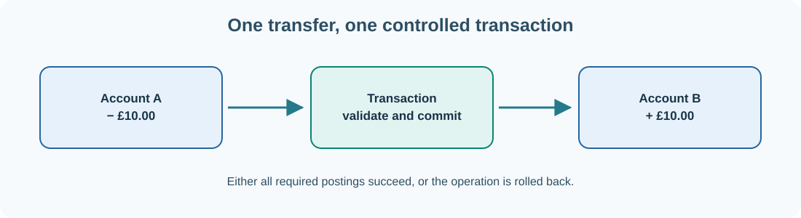

# 19. Databases: store tasks, accounts and transactions

Our Python notes program stores a list in a JSON file. That is a reasonable starting point for one user. As a project grows, we may need to search hundreds of tasks, update one item without rewriting the whole file and prevent two processes from overwriting each other's changes. A **database management system** provides tools for these requirements.

A **relational database** organises information into tables. A row represents one record, and a column represents one field. **SQL** (Structured Query Language) is commonly used to define, read and change relational data.

## Create a task table

For this exercise, Python already includes the `sqlite3` module, which can create a small SQLite database stored in a local file. Create **`tasks_db.py`**:

```python
import sqlite3

connection = sqlite3.connect("tasks.db")
try:
    connection.execute("""
        CREATE TABLE IF NOT EXISTS tasks (
            id INTEGER PRIMARY KEY,
            title TEXT NOT NULL,
            status TEXT NOT NULL
        )
    """)

    with connection:
        connection.execute(
            "INSERT INTO tasks (title, status) VALUES (?, ?)",
            ("Review Umicom Studio", "todo")
        )

    for row in connection.execute(
        "SELECT id, title, status FROM tasks ORDER BY id"
    ):
        print(row)
finally:
    connection.close()
```

Run:

```powershell
python .\tasks_db.py
```

The program prints an inserted task and leaves a file named `tasks.db`. Run it again and you will see another row: this example intentionally adds one new task on every execution.

## Keys, queries and transactions

`id INTEGER PRIMARY KEY` identifies each task. A **primary key** must distinguish records. A `SELECT` query reads rows; `INSERT` adds rows; `UPDATE` changes existing rows and `DELETE` removes them. In serious applications, deletion and retention rules must be deliberate.

The `?` placeholders are **query parameters**. The database driver binds user-provided values separately from SQL syntax. This is safer than building SQL strings by concatenating task text and helps prevent SQL injection.

The `with connection:` block creates a **transaction** boundary for its work. A transaction groups changes so they can be committed together or rolled back when an error occurs. Transactions are vital when an application changes related records that must remain consistent.

## Model a financial transfer carefully

Suppose an account has £50 and another has £20. A fictional internal transfer of £10 should reduce one balance and increase the other. The total remains £70. Updating only one account would create an inconsistent result.

A serious ledger typically records balanced **journal postings** rather than treating mutable display balances as its only source of truth. It also ensures that the transfer has a unique identifier and cannot be posted twice if a request is retried. We study double-entry accounting in a later chapter.



## One authoritative data service

Umicom Framework applies a **Data Server authority** principle: Framework consumers should use controlled data contracts rather than reaching into arbitrary database tables. That keeps storage details, migrations, permissions and transaction policy behind an explicit boundary. SQLite may serve a local embedded configuration, while other database adapters can serve different deployment requirements.

This is not a rule that every application must use SQL. It is a rule about **ownership of persistent state**. The service responsible for a record should validate and update it through defined operations.

## Try it

Add a fourth column named `priority` to a new database table. Insert two tasks with different priorities and write a `SELECT` query that shows high-priority tasks first. Use an independent practice database rather than changing Umicom production data.

**Next:** [Understand system administration](20-system-administration.md).
