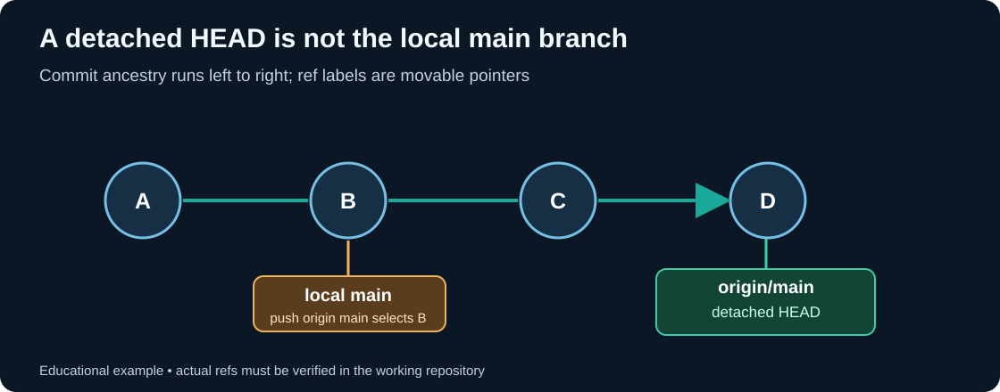

# Chapter 192 — Fetch, compare and resolve divergent history safely

**Bits to Banking · Version control · Umicom Foundation**
**Prerequisites:** [Remote repositories](184-git-remotes-fetch-pull-and-non-fast-forward.md), Chapter 191.

## A rejected push is valuable evidence

A non-fast-forward rejection means the remote branch no longer has your requested new tip as a descendant of its present tip. Git declines to rewrite shared history. In the Umicom OS incident, a different detail also mattered: a detached Framework checkout and the local `main` branch referred to different commits. `git push origin main` pushed the **local branch reference**, not the detached checkout.

The first principle is to separate **observation** from **integration**. `fetch` updates remote-tracking references (such as `origin/main`) and object storage. It does not replace your local source files, switch your branch or automatically merge work. A successful `fetch` does not itself mean local `main` is current.

## Step 1 — inspect the three pointers

```powershell
Set-Location "C:\umicom\umicomOS\framework"
git status --short --branch
git branch -vv
git log -1 --oneline HEAD
git log -1 --oneline main
git fetch origin main
git log -1 --oneline origin/main
```

`HEAD` is where the checkout currently points. `main` is your local named branch. `origin/main` is Git's last fetched record of the remote branch. They are permitted to be different. A submodule often checks out a fixed commit with detached `HEAD`; this does not automatically indicate a fault.

## Step 2 — inspect graph relationships

```powershell
git log --graph --decorate --oneline --all -20
git log --oneline origin/main..main
git log --oneline main..origin/main
git rev-list --left-right --count main...origin/main
```

`origin/main..main` enumerates commits reachable from **local main** but not the fetched remote main. The reverse expression enumerates commits reachable from the remote but not the local. `A...B` is the symmetric difference; its left and right counts help diagnose divergence. An empty output for one side does not establish that the working tree is clean: inspect `git status` separately.



## Four possible results

| Relationship of local `main` to `origin/main` | Meaning | Safe next decision |
|---|---|---|
| Equal | Same commit | No sync action required. |
| Behind | Remote contains newer commits | When clean and on `main`, a fast-forward pull may advance local `main`. |
| Ahead | Local branch contains unpublished commits | Review commits, tests and permissions before pushing. |
| Diverged | Each side contains unique commits | Stop the automatic workflow; review intentional integration and provenance. |

If **behind only** and your working tree is clean, from local `main`:

```powershell
git switch main
git pull --ff-only origin main
```

`--ff-only` refuses unexpected history integration. It does not repair a dirty worktree, detach state or merge conflict. If the working tree has changes, preserve and review them first.

If **ahead only**, review new commits with `git log --oneline origin/main..main` and ensure that they have been built and tested before publishing `git push origin main`. If **diverged**, do not substitute a force push. Determine why both lines changed and whether the local commits should be replayed or a reviewed merge is appropriate. The project's no-new-branches policy does not override source preservation.

## Checkpoint exercise

Draw four small commit graphs with labels A, B, C and D. For each, decide whether a fast-forward from local main to remote main is possible, whether a push of local main would be a graph-level fast-forward, and whether the checkout might still contain unsaved files. Then compare the results with the native [C23 graph laboratory](202-model-git-ancestry-in-c23.md).

**Next:** [Submodules and the authoritative Framework](193-umicom-framework-submodule-integration.md).
