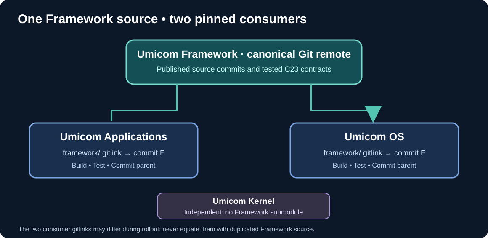

# Chapter 193 — Git submodules: update Umicom Framework without duplicating it

**Bits to Banking · Umicom repository engineering · Umicom Foundation**
**Prerequisites:** Chapter 192 and [the introductory submodule lesson](185-umicom-git-submodules-and-detached-head.md).

## A Framework checkout is not a copied folder

Umicom Framework is a separate Git repository, reused by both `Umicom-Applications` and `umicomOS`. Each parent records a **gitlink**: a mode-160000 entry naming an exact Framework commit. The parent history records *which* child revision it expects, not all the child source files. Updating Framework inside one parent does not update the other's pointer.

The Framework's published policy calls for one canonical source owner: develop Framework from the Applications checkout, verify and push that repository, then synchronise the OS checkout and update the OS gitlink. Avoid manually copying the entire Framework folder between parent repositories. The Umicom Kernel remains independent; it does not have to adopt a Framework submodule.



## Step 1 — inspect without updating

From the OS repository root:

```powershell
Set-Location "C:\umicom\umicomOS"
git status
git submodule status framework
git ls-files --stage framework
git -C ".\framework" status --short --branch
git -C ".\framework" log -1 --oneline
```

The entry produced by `git ls-files --stage framework` begins with `160000` for a properly registered Git submodule. The commit listed there belongs to the **parent index**. The result of `git -C .\framework log -1` belongs to the **child checkout**. Those SHAs may differ during a deliberate upgrade.

## Step 2 — preserve any unpublished work

Do not use a forced checkout. Before updating:

```powershell
git -C ".\framework" fetch origin main
git -C ".\framework" log --oneline origin/main..HEAD
git -C ".\framework" status
git -C ".\framework" stash list
```

If there are working-tree edits, preserve them before changing the child checkout. `git stash push --include-untracked` is one option, but only after checking that the stash succeeded and that the needed files are represented. Ignored files are not included. If `origin/main..HEAD` contains unpublished commits, **stop**: a stash does not preserve commits that exist only at the detached checkout tip. Record and reconcile those commits independently before switching.

## Step 3 — fetch and choose the integration strategy

For the OS checkout, **once clean and safe**, update to the intended Framework revision:

```powershell
Set-Location "C:\umicom\umicomOS"
git submodule update --init --remote framework
git -C ".\framework" log -1 --oneline
git submodule status framework
```

`--remote` intentionally changes to the configured remote branch's tip. For a reproducible build of the pinned revision already recorded by the parent, omit `--remote`:

```powershell
git submodule update --init framework
```

These are alternative actions for different goals, **not** commands to run sequentially. The pinned update may restore an older Framework commit; the remote update may introduce new APIs that require OS rebuilds.

## Step 4 — check the Framework-owned repository commands

For Umicom repositories using the Framework native command, run the **read-only** `umicom repo verify .` before `umicom repo lock .`. The latter stages gitlinks and never pushes or commits. These commands are part of the existing Framework, not a reason to build another PowerShell helper. Use the executable installed or built in your actual environment; check its existence and version before executing.

Review OS changes, build both headless and GTK profiles as appropriate, and record the parent pointer only after tests pass:

```powershell
git status
git add framework
git diff --cached --check
git diff --cached --submodule=log
git commit -m "chore(os): synchronise Umicom Framework submodule"
git push origin main
```

If unrelated parent files changed, inspect them before staging. The final command publishes the OS **pointer**, not Framework's source history. Ensure the referenced child commit is already available from the Framework remote.

## Exercises

1. Explain why a clean Framework child directory can still appear as `modified: framework (new commits)` in its parent.
2. Explain why updating OS Framework first, before Framework `main` is published, risks a parent referencing an unavailable commit.
3. Compare `git submodule update --init framework` with `--remote framework` using the same parent gitlink.
4. Locate Framework's `docs/SHARED_FRAMEWORK_SUBMODULE_UPDATE_POLICY.md` and describe what `umicom repo lock .` deliberately does **not** do.

**Next:** [Detached HEAD does not mean the commit is lost](194-detached-head-and-push-identity.md).
