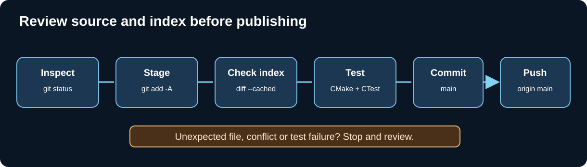

# Chapter 196 — Audit `git add -A`, commit precisely and push to `main`

**Bits to Banking · Everyday engineering · Umicom Foundation**
**Prerequisites:** Chapters 182–195.
**Scope:** The exact repository named in the current `Set-Location` command.

## Why `git add -A` requires inspection

`git add -A` stages all currently detectable additions, modifications and deletions within the repository scope. It is convenient for a reviewed batch, but it is not a quality filter. If generated build output is accidentally tracked, a source file was removed, or an unrelated change is present, Git can stage those changes too. Git also stages a submodule's **commit pointer** in its parent, not the child contents. Our safety policy therefore separates: inspect → stage → inspect the **index** → test → commit → push.



## The normal Bits2Banking check-in

From the educational repository after reviewing and merging a batch:

```powershell
Set-Location "C:\umicom\Umicom-Bits2Banking"
git status
git branch --show-current
git diff --check
git add -A
git diff --cached --check
git diff --cached --stat
git diff --cached --name-status
git commit -m "feat(learning): extend Git recovery and C23 ancestry lessons"
git push origin main
git status
```

The `git commit` and `git push` commands are **conditional**: proceed only when you are on `main`, your staged file list is correct, required tests pass and the local branch is synchronised. If a non-fast-forward rejection occurs, go back to Chapter 192 instead of forcing the push.

## Three distinct inspections

`git diff` shows tracked changes in the working tree relative to the index. `git diff --cached` shows the exact staged changes relative to HEAD. `git status` summarises tracked, untracked and staged state but is not a substitute for content review. For a submodule pointer change, `git diff --cached --submodule=log` is especially valuable: a one-line parent modification may incorporate hundreds of Framework child-file changes.

Before committing a multi-repository Umicom batch, separate changes in each repository. A `git add -A` performed in `Umicom-Bits2Banking` cannot commit the OS or Framework working trees. For Framework, commit and push Framework first; for an application or OS parent, stage the tested, published Framework gitlink last.

## What a commit message should communicate

Use a concise scope and verb, such as `feat(learning): add Git graph tests` or `docs(git): explain detached HEAD recovery`. Do not claim to have fixed a live failure when only a tutorial was changed. A useful commit describes the engineering outcome and can be read by another contributor during code review or incident analysis.

## Quality exercise

Run `git status --short` in a **practice** repository containing (a) an intended Markdown edit, (b) an unintended test binary, and (c) a deliberately renamed source file. Stage all, inspect `git diff --cached --name-status`, and explain why the correct response is to review and unstage unwanted changes rather than commit everything automatically. Never use mass clean or hard reset as a substitute for review.

**Next:** [Recover historical work with the reflog](197-reflog-and-lost-commit-recovery.md).
