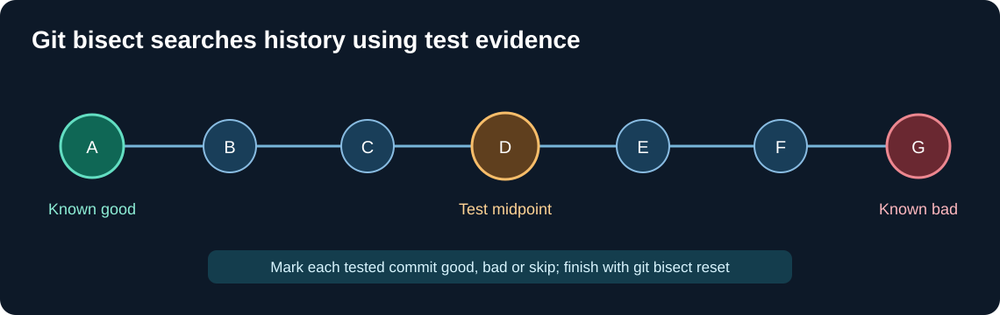

# Chapter 198 — Locate a C23 regression with `git bisect`

**Bits to Banking · Debugging and verification · Umicom Foundation**
**Prerequisites:** [Compilers and tests](18-build-and-tests.md), Chapter 197.

## Search a history, not individual guesses

A regression is a behaviour that worked in an earlier commit but fails in a later one. Imagine the C23 `work-dispatch` laboratory passed all CTest cases last week, but a recent change now causes cancellation to lose a completion record. Running the whole application while randomly editing source does not identify the introduction point. **Git bisect** uses reachability in the commit graph to narrow down the first bad change through repeated tests.

Bisect is an investigative workflow. It checks out commits in a detached state and can alter tracked files. Start only in a **clean, disposable clone or reviewed worktree**, not a checkout containing uncommitted Framework changes. Do not do a bisect during an ongoing conflict or submodule update.



## Run manually without writing a script

First identify a known good and a known bad commit. Check that the good commit is an ancestor of the bad one and that the same test can run at both revisions. In a clean practice clone:

```powershell
git status
git log --oneline -15
git bisect start
git bisect bad
git bisect good <KNOWN_GOOD_COMMIT>
```

Git checks out a candidate midpoint. Configure and run the appropriate CMake/CTest commands for that commit. Classify the result with **one** command:

```powershell
git bisect good
```

or, if the test reproduces the defect:

```powershell
git bisect bad
```

Use `git bisect skip` only if that commit cannot be tested for a documented reason. A build failure that is unrelated to the suspected regression may need a skip, but repeated skips reduce confidence. When Git reports the first bad commit, inspect its diff and the surrounding history. Always finish with:

```powershell
git bisect reset
git status
```

`git bisect reset` returns to the original checkout when possible. Confirm the returned commit and working-tree status rather than assuming the workspace is identical.

## Improve test quality

A bisect result is only as good as the pass/fail condition. A test that occasionally fails because of network latency can point at the wrong commit. Prefer a deterministic native C23 test: initialise the same queue, exercise cancellation, assert all ownership invariants, and return a reproducible exit code. Record toolchain version, CMake options and test name because changes in the build environment can mimic regressions.

## Worked decision

If a test fails with `BTB_DISPATCH_BACKPRESSURE`, that return may be **correct** when the bounded completion queue is full. An automated test should not label it a regression unless it violated the expected contract. The acceptance condition should test that no request was silently lost and that later `Receive` and `Step` calls recover, not merely that every call returns `OK`.

## Practice questions

1. Why must the first good commit truly predate the defect?
2. Why is bisect inappropriate on a dirty Umicom Framework submodule?
3. When should a commit be skipped rather than marked bad?
4. Which tests could distinguish a real memory-ownership bug from an expected capacity refusal?

**Next:** [Tag and publish a reviewed release](199-annotated-tags-and-release-evidence.md).
