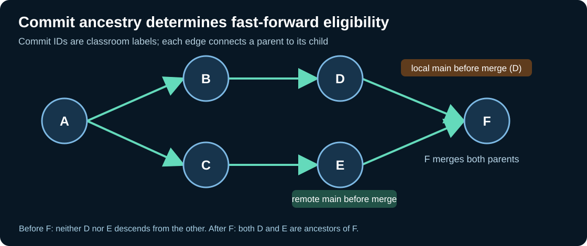

# Chapter 202 — Model Git commit ancestry and fast-forward rules in C23

**Bits to Banking · Native programming and version control · Umicom Foundation**
**Laboratory:** `labs/native/git-history`
**Prerequisites:** C23 arrays, structures, pointers and Chapters 192–194.

## Why a small C23 model helps

Git commits form a directed acyclic graph (DAG): each commit records zero, one or more parents. In normal work, a first commit has no parent, most commits have one parent and a merge commit may have two or more. Our bounded classroom model intentionally supports **at most two parents**, which is sufficient to teach ordinary fast-forward, divergence and a simple merge. It is **not** a Git object database and does not parse actual commit SHA hashes.

The model answers a narrow question: *Given a local `main` tip and a fetched remote `main` tip, is either tip an ancestor of the other?* It does not fetch a repository, rewrite history, resolve conflicts, stage files, authenticate or decide whether a push is authorised. Those responsibilities already belong to Git and the existing Umicom Framework VCS interfaces.

## Read the contract first

Open `labs/native/git-history/graph.h`. `BtbGitGraph` holds at most 64 immutable-parent nodes in caller-owned storage. `BtbGitCommit` has a classroom `id`, `firstParent` and `secondParent`. `BtbGitGraphAdd` validates parents before appending. An attempted duplicate ID, missing parent or full capacity returns a typed error **without changing the graph**.

`BtbGitGraphClassify` takes two labels (`localMain`, `remoteMain`) and assigns exactly one relation: **EQUAL**, **LOCAL_BEHIND**, **LOCAL_AHEAD**, or **DIVERGED**. These labels are about reachability, not timestamp, commit-number magnitude or filename similarity. A new commit created tomorrow can be unrelated to yesterday's remote and therefore diverged.



## A worked ancestry graph

```text
       A -- B -- D  (local main)
        \
         C -- E    (origin/main)
```

Here B and C share ancestor A, but neither D nor E is an ancestor of the other. This is diverged. Adding merge commit F with parents D and E makes **both** D and E ancestors of F. Consequently D→F and E→F are valid ancestry relationships. The C23 code checks parent links without recursively calling itself, using a fixed-size `seen` array to avoid repeated exploration at merges.

## Investigate the detached HEAD issue

In `graph_demo.c`, local `main` is at ID 2, remote `origin/main` at ID 4, and the checked-out detached HEAD is at ID 4. The model correctly concludes that **the branch named `main` is behind**. A `git push origin main` attempts to push branch tip 2, not the detached HEAD at 4. This distinction explains the earlier Umicom OS rejection without suggesting that detached HEAD is intrinsically wrong.

`BtbGitGraphAssess` also records whether the simulated worktree is dirty, whether a detached commit belongs to neither named main line and whether a human review is required. These are **advisory flags**; real checkout may have different file-collision outcomes, and even an ancestry-compatible push can be refused by credentials or branch protection.

## Build and test

```powershell
Set-Location "C:\umicom\Umicom-Bits2Banking"
$env:Path = "C:\msys64\ucrt64\bin;$env:Path"
cmake -S ".\labs\native\git-history" -B ".\output\learning-build\git-history" -G Ninja -DCMAKE_C_COMPILER="C:\msys64\ucrt64\bin\gcc.exe" -DBUILD_TESTING=ON
cmake --build ".\output\learning-build\git-history" --parallel 2
ctest --test-dir ".\output\learning-build\git-history" --output-on-failure
& ".\output\learning-build\git-history\btb-git-history-demo.exe"
```

The expected native suite has **11 tests**. It checks equality, ahead, behind, divergence, merge ancestry, dirty state, detached heads, invalid/malformed input, bounded capacity, 20,000 deterministic classifications and the demonstration. Test results on your Windows toolchain remain to be established separately.

## Extend carefully

As an exercise, add a graph where two independent roots have no common history. Explain why Git rejects their automatic fast-forward. Do **not** extend this classroom code into an OS repository manager or write another Git process wrapper. Umicom Framework already provides `UmiVcsWorkingTreeRead`, a Git CLI provider, gitlink parsing and native submodule-lock services. Study those interfaces to see how production code treats process execution, raw paths and repository authority.

**Next:** [Run the laboratory and compare predictions with real Git](203-verify-git-graph-and-framework-contracts.md).
