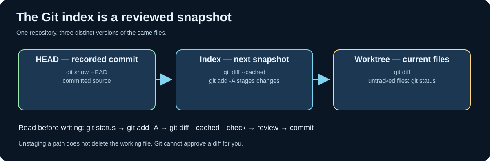

# Chapter 204 — Observe Git repositories through Umicom Framework

**Bits to Banking · Engineering track · Umicom Foundation**  
**Prerequisites:** Chapters [193](193-umicom-framework-submodule-integration.md), [203](203-verify-git-graph-and-framework-contracts.md).  
**Engineering languages:** C23 and Assembly first; PowerShell appears only as interactive terminal commands.

## The engineering problem

Consider a developer opening Umicom Studio after a long development session. The editor shows a modified `build.c`, a newly added GTK4 panel, and a Framework submodule with different commits. The user wants to commit safely. A naive application might run `git status`, search for English phrases such as “modified”, and enable a Commit button whenever any file is mentioned. That approach is unreliable: Git can format output differently, a path can contain spaces or newlines, and a submodule can have both commit-pointer changes and its own uncommitted files.

Umicom Framework already supplies a native **read-only working-tree observation** capability. Bits2Banking must teach and reuse it instead of introducing a second parser, a new PowerShell script, or application-local Git logic. The source is in `framework/include/umicom/vcs/working_tree.h` and the corresponding Framework implementation. The interface has distinct operations for reading an observation, obtaining a summary, and accessing individual entries.




## Learning objectives

Explain the distinction between Git evidence and permission to perform an action. Identify the Framework source-of-truth API and its ownership contracts. Recognise why a clean local working tree does not prove that a remote push will succeed. Design an application that shows a truthful result without using an unreviewed script.

## Observe actual repository state

From the existing checkout, these commands *read* state; they do not stage, commit, or push:

```powershell
Set-Location "C:\umicom\Umicom-Applications"
git status
git branch --show-current
git diff --name-status
git diff --cached --name-status
git submodule status
```

`git diff` describes changes in the worktree relative to the index. `git diff --cached` describes index changes relative to HEAD. Those are different sets. `git submodule status` reports the child checkout and indicates whether it differs from the parent’s recorded gitlink. The submodule's own untracked files require a separate inspection inside that child.

For a native application, consult the Framework interface rather than parsing these human-readable commands. The header describes `UmiVcsWorkingTreeRequest`, an opaque `UmiVcsWorkingTree`, `UmiVcsWorkingTreeRead`, `UmiVcsWorkingTreeDescribe`, `UmiVcsWorkingTreeEntryAt`, and `UmiVcsWorkingTreeDestroy`. A request includes an explicit repository root and a bounded timeout. The observer does not stage files or fetch from a remote.

## Ownership and C23 integration

The following is **an illustrative call-site fragment**, not an additional delivered implementation. Confirm build-target and status-code conventions against your current Framework checkout before integrating it:

```c
UmiVcsWorkingTreeRequest request = {
    .repository_root = repositoryRoot,
    .git_program = NULL,
    .timeout_ms = 30000U,
    .cancellation = NULL
};
UmiVcsWorkingTree *tree = NULL;
UmiVcsWorkingTreeSummary summary = {0};

UmiStatus status = UmiVcsWorkingTreeRead(&request, &tree);
if (status == UMI_STATUS_OK) {
    status = UmiVcsWorkingTreeDescribe(tree, &summary);
}
if (status == UMI_STATUS_OK) {
    /* Copy summary values into an application-owned view model. */
}
UmiVcsWorkingTreeDestroy(tree);
```

The `tree` owns the observation and its entries. `UmiVcsWorkingTreeEntryAt` returns a borrowed entry; do not retain that pointer after destruction. An application should transfer only bounded values to its GUI view model. The model must not contain `GtkWidget` pointers.

The summary distinguishes `detached`, `unborn`, `divergence_known`, `ahead`, `behind`, `staged`, `conflicts`, `untracked` and dirty child counts. A value of zero is not the same as *unknown*: `behind = 0` with `divergence_known = 0` cannot establish a safe fast-forward. A submodule can report a changed child commit without indicating a dirty child worktree, or vice versa.

## Failure modes and truthful user interfaces

If Git cannot start, the observation times out, records exceed the bounded parser limit, or output is incomplete, the Framework call should report failure. The UI should show **“Repository status unavailable”**, not **“Clean working tree”**. To validate remote ancestry, a separate `git fetch` and ref comparison is required. A Commit button should also consider staged scope, conflicts, testing and explicit user approval; an observer alone never authorises a write.

For example, Umicom OS could be clean while its Framework gitlink still references an old but valid commit. The OS is not automatically “broken”; its dependency is reproducible but perhaps outdated. Conversely, checking out the latest child commit does not publish a new parent pin until the OS repository commits the gitlink.

## Guided exercise

Open the Framework header and enumerate the fields that correspond to staged work, untracked files, conflicts and detached HEAD. Then open the Umicom OS `framework/` submodule and compare `git -C .\framework status --short` with the parent `git status`. Explain why they differ. Record whether remote ancestry is known; do not assume it. Complete the exercise without modifying any repository.

## Knowledge check

1. Why must a native consumer not parse the human-readable output of `git status`?
2. When does a borrowed `UmiVcsWorkingTreeEntryAt` pointer become invalid?
3. Why can `behind = 0` still be insufficient evidence?
4. Which repository owns a child Framework commit, and which owns a gitlink?

**Answers:** Machine-oriented status records can contain paths and data that defeat line-based parsing; the entry borrow ends when the observation is destroyed; divergence must first be known through refreshed references; Framework owns its commit while the parent owns its gitlink.

**Next:** [Chapter 205 — Working tree, index and staged review](205-review-index-and-working-tree-evidence.md).
