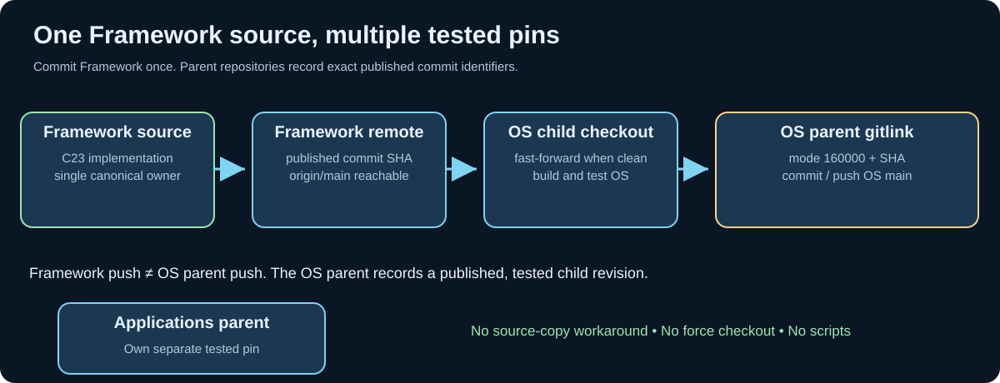

# Chapter 207 — Publish a tested Umicom Framework gitlink

**Bits to Banking · Integration and Git track · Umicom Foundation**  
**Prerequisites:** Chapters [193](193-umicom-framework-submodule-integration.md), [206](206-fast-forward-without-rewriting-history.md).  
**Policy:** Shared C23 functionality has one Framework source owner. Parent projects record tested commits; they do not copy Framework files.

## Two repositories, two kinds of commits

A Framework source change creates a commit in `umicom-foundation/umicom-framework`. An Umicom OS dependency update creates a separate commit in `umicom-foundation/umicom-os`. The OS commit contains a **gitlink**: a reference to an exact Framework commit, not Framework's source. The same relationship applies to `Umicom-Applications/framework`. This is how two consuming applications can build reproducibly against different Framework revisions while Framework development proceeds in one canonical repository.

The Framework documentation `docs/SHARED_FRAMEWORK_SUBMODULE_UPDATE_POLICY.md` establishes the workflow: source changes are made and published through the shared Applications Framework checkout, then the OS checkout is synchronised from the published commit. Native `umicom repo verify .` and `umicom repo lock .` manage the parent gitlink; no PowerShell version-lock script is needed.




## Phase A — publish Framework source once

Work inside the canonical development checkout and **only when the build and focused tests have passed**:

```powershell
Set-Location "C:\umicom\Umicom-Applications\framework"
git status
git branch --show-current
git add -A
git diff --cached --check
git diff --cached --stat
git diff --cached
git commit -m "feat(framework): qualify native VCS and repository contracts"
git push origin main
```

The commit message is an **example**. Do not create this commit if the staged changes do not match that description. A submodule checkout may be detached; `git commit` in that state creates a commit not named by local `main`. Always check branch identity and protect any unpublished commits before switching.

## Phase B — synchronise the clean OS child

```powershell
Set-Location "C:\umicom\umicomOS"
git -C ".\framework" status
git -C ".\framework" branch --show-current
git -C ".\framework" fetch origin main
git -C ".\framework" log --oneline origin/main..HEAD
```

If the OS Framework checkout contains modified or untracked files, save and review them **before** switching commits. If the last command shows local-only commits, do not discard them. Only when clean and no unpublished commits are at risk:

```powershell
git -C ".\framework" switch main
git -C ".\framework" merge --ff-only origin/main
git -C ".\framework" log -1 --format=%H
```

These are interactive commands, not a saved PowerShell script. They assume the existing local `main` branch can safely fast-forward. Stop if the command refuses. The alternative `git submodule update --remote` intentionally checks out a commit that may leave the child detached; that is not the same as maintaining local `main`.

## Phase C — verify publication and identity

Verify that the chosen SHA exists in the Framework remote-tracking branch:

```powershell
git -C ".\framework" merge-base --is-ancestor HEAD origin/main
```

Exit code zero means the selected commit is reachable from the last fetched `origin/main`. Because remotes can move, this is evidence of your latest fetch, not a perpetual guarantee. For a newly published commit, verify that `git push origin main` succeeded in Framework before pinning it elsewhere.

## Phase D — test and stage the parent pin

Configure, build and test Umicom OS using the presets declared in its own `CMakePresets.json`:

```powershell
Set-Location "C:\umicom\umicomOS"
$env:Path = "C:\msys64\ucrt64\bin;$env:Path"
cmake --preset headless-debug
cmake --build --preset headless-debug --parallel 2
ctest --preset headless-debug --output-on-failure
```

Use the **Framework-owned native command** from the Applications build, if available:

```powershell
$UmicomCli = "C:\umicom\Umicom-Applications\build\windows-ucrt64-all-debug\bin\umicom.exe"
& $UmicomCli repo verify .
& $UmicomCli repo lock .
git diff --cached --submodule=log
```

`repo verify` previews the intended lock without changing the index. `repo lock` stages the current child HEAD; it **does not fetch**, compile, commit or push. Therefore a successful lock is not proof that the selected commit exists on GitHub.

## Phase E — publish the OS parent

Check `git status`, confirm the parent is on `main`, verify that only intended changes are staged, and run the OS build/tests again if necessary. The requested standard commands are:

```powershell
git add -A
git diff --cached --check
git diff --cached --submodule=log
git diff --cached --stat
git commit -m "chore(os): pin qualified Umicom Framework revision"
git push origin main
```

Use `git add -A` only after confirming that the worktree contains no unrelated modifications. The parent commit now names the tested Framework revision. Repeat the parent-pin process independently in Umicom Applications when needed; no source duplication is permitted.

## Why sequencing matters

A parent published before its child risks an unresolvable dependency. A child rebuilt without the parent pin risks an unrecorded environment. A clean build without tests does not qualify a release. An updated child on disk without a parent commit is local only. This five-phase sequence enforces *source → build → test → publish child → publish parent*.

## Review questions

What does mode `160000` mean? Which command checks that the selected child SHA is reachable from a known remote branch? Why is `repo lock .` not equivalent to `git push`? Why should OS testing happen after selecting the new child commit? Explain each answer before performing an actual update.

**Next:** [Chapter 208 — Conflicts, cherry-picks and author intent](208-resolve-integration-without-losing-intent.md).
