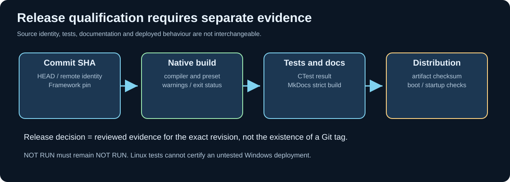

# Chapter 210 — Qualify releases with tests, tags and provenance

**Bits to Banking · Release engineering · Umicom Foundation**  
**Prerequisites:** [Chapter 199](199-annotated-tags-and-release-evidence.md) and [Chapter 207](207-publish-a-tested-framework-gitlink.md).

## Why a successful Git push is not a release qualification

Publishing a commit proves that Git accepted a reference update. It does not prove that the application compiles with MSYS2 UCRT64, that GTK4 is packaged correctly, that the intended tests ran, that the Framework ABI is compatible, or that an Umicom OS image boots. A high-quality release record must distinguish **source identity**, **build evidence**, **test evidence**, **deployment evidence** and **approval**.

For example, Umicom OS has separate user-space and diskless-kernel build paths. A successful native `ctest` run does not prove the QEMU image boots. Likewise, generating a valid MkDocs navigation tree does not prove the published website is reachable. Claims must match the evidence actually collected.




## A release evidence register

| Evidence | Example content | What it does *not* prove |
|---|---|---|
| Source revision | Full 40-hex SHA and remote | Successful compilation |
| Framework pin | Parent gitlink SHA | Child is published or tested |
| Build | Compiler version, preset, exit status | Functional correctness |
| Tests | CTest summary, failed case names, platform | Untested platforms or hardware |
| Documentation | Strict MkDocs build, link audit | Public deployment succeeded |
| Packaging | Checksums, install and startup inspection | A customer environment matches test host |
| Approval | Reviewer, scope, date and rationale | Remote cannot change later |

An evidence register should be stored as a human-reviewable document, not as a secret-bearing build log. Do not publish tokens, credentials, private customer records or personal data in Git history.

## Reproducible native verification

For the Update 32 laboratory, run the configured GCC build, tests and executable demonstration. Record commands, tool versions and exit codes. On Windows, inspect `gcc --version`, `cmake --version`, `ninja --version`, `git --version`, then preserve the relevant CTest summary. Compiler warnings are errors in this laboratory; a “test passed” claim must still be limited to the environment where the command actually ran.

For Umicom OS, use its own named presets and, where applicable, QEMU boot acceptance. For Umicom Framework, run the parent Applications CMake profile and focused VCS tests. Do not quietly substitute one project's test suite for another project's acceptance criteria.

## Annotated tags after validation

After a candidate commit has passed review and all required tests, the maintainer can create an annotated tag using a **real approved release identifier**. In a disposable practice repository, the sequence is:

```powershell
git status
git log -1 --format=%H
git tag -a learning-release-example -m "Verified learning release example"
git show --no-patch --decorate learning-release-example
```

The tag names a commit, and annotation records a message, tagger and date. It does not build software. To publish an approved tag from the intended repository:

```powershell
git push origin learning-release-example
```

Do not execute this example against a real Umicom repository using the sample tag name. Real release tags must follow the project's release naming, approval and publication policy. Avoid moving published tags: changing a release identifier undermines provenance.

## Content hashes and manifests

A ZIP checksum verifies that downloaded bytes match the manifest entry when both are obtained from a trusted origin. It does not prove source authenticity on its own. A reliable batch manifest records repository-relative file paths and SHA-256 digests, avoiding timestamps and absolute build paths. The human release report identifies the source revision and which checks were completed, failed or not run.

Update 32 includes a package checksum and per-file SHA-256 manifest, generated for the delivered files. The C23 release-gate laboratory is deliberately read-only; it does not implement code signing, checksum-based remote attestation or unattended publication.

## Practical assessment

Prepare a four-column release note for a fictional Umicom Bank change: evidence, expected state, observed state, reviewer decision. Include a unit-test result, a failed GUI smoke test, a Framework pin and the Git commit SHA. Explain why the release must remain blocked despite a green unit test. Include a specific recovery action and distinguish “not run” from “passed”.

**Next:** [Chapter 211 — Investigate failed CI safely](211-investigate-ci-without-replacing-code.md).
