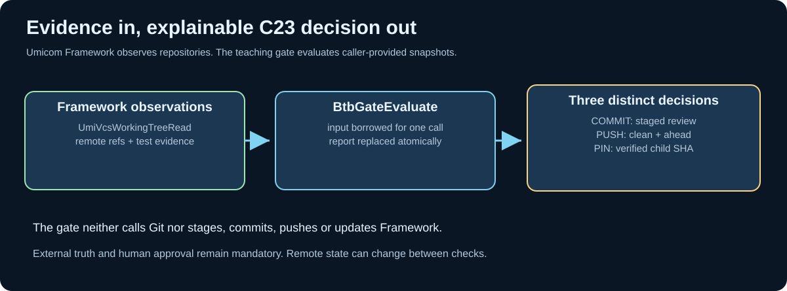

# Chapter 213 — Build a native C23 release-evidence model

**Bits to Banking · Native engineering · Umicom Foundation**  
**Laboratory:** `labs/native/git-release-evidence/`  
**Prerequisites:** [Chapter 204](204-observe-git-through-umicom-framework.md), [Chapter 210](210-release-tags-provenance-and-qualification.md).

## Why this C23 laboratory exists

A maintainer wants to stage, commit, push or update an Umicom OS Framework pin. The Git repository contains observable facts: current branch, index conflicts, ahead/behind counts, file status, test results and the selected Framework commit. Those facts should be collected by approved services; a release decision is a separate question. **Observation describes the world; policy decides what the organisation permits.**

The new laboratory models only that second responsibility. It is deliberately *not* a Git client, a subprocess runner, a second Framework VCS service or an unattended release tool. Its inputs are explicitly provided by a caller. In production, an authorised Framework observer and test coordinator would supply the evidence; the lab never executes a command or mutates a repository.




## Contract, ownership and data types

Read `labs/native/git-release-evidence/gate.h`. The main records are:

| Type | Meaning | Ownership |
|---|---|---|
| `BtbGateSnapshot` | Caller-supplied evidence for one decision | Caller owns |
| `BtbGateAction` | `COMMIT`, `PUSH` or `PIN` | Value |
| `BtbGateProof` | `NOT_RUN`, `PASSED` or `FAILED` | Value |
| `BtbGateReport` | Result and all blocked reasons | Caller owns |
| `BtbGateStatus` | `INVALID`, `READY`, `BLOCKED` | Value |

The evaluation function does not allocate dynamic memory, retain pointers, read global variables or execute Git. On valid input, it replaces the caller's complete report. On structurally invalid input, the report is left unchanged. That last property is **failure atomicity**: a damaged new observation cannot erase a previously valid report.

C23 call site:

```c
BtbGateSnapshot evidence = {
    .action = BTB_GATE_ACTION_COMMIT,
    .observationId = 25U,
    .expectedObservationId = 25U,
    .onMain = 1,
    .remoteChecked = 1,
    .divergenceKnown = 1,
    .staged = 3U,
    .stagingReviewed = 1,
    .buildProof = BTB_GATE_PROOF_PASSED,
    .testsProof = BTB_GATE_PROOF_PASSED,
    .docsProof = BTB_GATE_PROOF_PASSED
};
BtbGateReport report = {0};
BtbGateStatus result = BtbGateEvaluate(&evidence, &report);
```

The example yields `READY` under the *teaching policy* because the index is reviewed, remote ancestry is known, no conflicting/untracked/unstaged files remain and required quality evidence is recorded as passed. It does **not** prove that a build ran or that the remote state remains unchanged; whoever supplies the evidence must establish those facts independently.

## Why a bitmask is useful

A single Boolean `ready` hides the reason for refusal. The evaluator instead sets one bit for each failed gate. A snapshot could be both detached and behind remote while also containing untracked files. The report retains all three issues. `BtbGateIssueName` maps an individual issue bit to an explanatory string, making the failure inspectable without dynamic string construction.

Some inputs are simply **invalid** rather than ordinary blocked conditions: an unknown action, a Boolean containing a value other than 0 or 1, an impossible proof enumeration, a zero snapshot identifier or a malformed 40-character child SHA. Such evidence is rejected without publishing any new report.

## Three decisions, different evidence

**COMMIT** needs a non-empty reviewed index and no unintended unstaged/untracked files. **PUSH** needs an empty index, a clean worktree, a local outgoing commit and known remote ancestry. **PIN** needs one reviewed staged gitlink in the parent, a clean published child, passing child tests and an exact match between the requested and tested Framework commit. It does not automatically perform any of those operations.

This distinction mirrors Umicom's repository ownership: a Framework source commit and an OS parent gitlink are two separate publications. Never treat a child commit as already recorded in the parent.

## Build the model

```powershell
Set-Location "C:\umicom\Umicom-Bits2Banking"
$env:Path = "C:\msys64\ucrt64\bin;$env:Path"
cmake -S ".\labs\native\git-release-evidence" -B ".\output\learning-build\git-release-evidence" -G Ninja -DCMAKE_C_COMPILER="C:\msys64\ucrt64\bin\gcc.exe" -DBUILD_TESTING=ON
cmake --build ".\output\learning-build\git-release-evidence" --parallel 2
ctest --test-dir ".\output\learning-build\git-release-evidence" --output-on-failure
```

The demonstration prints a `READY` verdict and then a `BLOCKED` verdict after the modelled remote state changes. No Git operation runs. Read the demo's explanatory comments before using the model in a more advanced exercise.

## Guided exercise and discussion

Open `gate.c` and follow `BtbGateEvaluate`. Identify where validation returns without updating the output, where the evaluator accumulates evidence failures, and where it publishes the completed report. Add a new *test case*, not a production feature, for a push with an unreviewed remote state. Explain why the evaluator should block even when the local working tree is clean.

**Next:** [Chapter 214 — Test fail-closed gate behaviour](214-test-fail-closed-release-gates.md).
