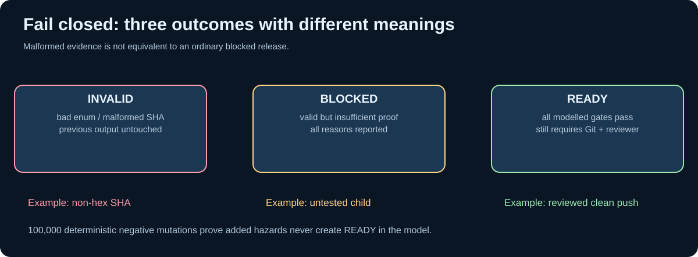

# Chapter 214 — Verify fail-closed release gates and deterministic decisions

**Bits to Banking · Native C23 testing · Umicom Foundation**  
**Laboratory:** `labs/native/git-release-evidence/`  
**Prerequisites:** [Chapter 213](213-build-a-native-release-evidence-model.md).

## A safety model must be tested against refusals

Tests that only demonstrate successful commits do not establish correctness. A release policy must also reject a detached HEAD, an unknown remote, an unreviewed staging area, a failed build, a failed documentation check, an unpublished Framework child and an unmatched tested SHA. The most valuable tests make an unsafe condition explicit and check that the result remains blocked.

`test_gate.c` contains independent named scenarios registered with CTest. They execute entirely in process, using caller-owned structures. No network, Git executable, PowerShell script, sleep or environment-dependent repository state is required. This makes the laboratory reproducible on GCC and Clang and permits sanitiser testing of the core C23 logic.




## Positive and negative evidence

| Scenario | Requested decision | Expected |
|---|---|---|
| `commit_ready` | Commit reviewed staged files | `READY` |
| `push_ready` | Publish clean, tested local commit | `READY` |
| `pin_ready` | Record tested, published Framework child | `READY` |
| `detached` | Commit from detached HEAD | `BLOCKED` |
| `behind` | Commit while known to be behind remote | `BLOCKED` |
| `unknown_remote` | Claim push safety without ancestry evidence | `BLOCKED` |
| `untracked` | Commit while unseen new files remain | `BLOCKED` |
| `push_index` | Push while the index is non-empty | `BLOCKED` |
| `unpublished_child` | Pin a Framework commit not known remotely | `BLOCKED` |
| `mismatch_sha` | Pin a different SHA from the tested child | `BLOCKED` |
| `malformed_input` | Supply impossible evidence | `INVALID`, report preserved |

The current build registers **34 CTest cases** in all, including 100,000 deterministic negative mutations. The mutation test starts from a safe push snapshot, changes one field at a time (for example, adds a conflict or marks tests `NOT_RUN`), and requires the result to change from `READY` to `BLOCKED`. It also compares repeated evaluations and verifies that input snapshots were not mutated.

## What failure atomicity proves

Consider a GUI displaying an earlier valid release report. New evidence arrives, but its SHA field is malformed. If the evaluator wrote its output incrementally, the GUI could receive a mixture of old and new state. Instead, structural input validation happens first. If invalid, the result is `BTB_GATE_INVALID` and the previous report bytes remain unchanged. The application must still mark that observation as unusable; retaining the old report is not permission to reuse it indefinitely.

The test `failure_atomic` verifies this behaviour with a sentinel report. The separate `malformed_sha` test exercises invalid input in a Framework gitlink qualification. This is a common C23 pattern in banking software: validate complete requests before replacing a customer, transfer or accounting record.

## Adversarial limitations

The policy model cannot know whether `git fetch` actually ran. It trusts the caller's `remoteChecked` evidence. A real runtime must verify the source of that evidence and the observation lifetime. No simulated test can prove that GitHub will accept the next push: the remote could change between a fetch and push. Nor can a passing CTest suite alone prove a GUI works, an OS boots or a website is publicly deployed.

The educational standard is to state exactly which boundary was exercised. Here, the proof is **policy decision correctness for supplied snapshots**, not production repository enforcement.

## Reproduce and inspect specific tests

```powershell
Set-Location "C:\umicom\Umicom-Bits2Banking"
ctest --test-dir ".\output\learning-build\git-release-evidence" --output-on-failure
ctest --test-dir ".\output\learning-build\git-release-evidence" -R "release_gate.mismatch_sha" --output-on-failure
ctest --test-dir ".\output\learning-build\git-release-evidence" -R "release_gate.failure_atomic" --output-on-failure
```

For a Clang sanitiser investigation, configure a separate build directory and pass supported flags to CMake through `CMAKE_C_FLAGS`, then rerun the same CTests. Do not assume that a Windows GCC host can run Linux sanitiser flags unchanged.

## Exercise: write a nontrivial assertion

Extend the practice test to request a PIN decision with `childCommitPublished = 1` and `childTestsProof = PASSED`, but set `validatedChildCommit` to a different valid 40-hex SHA. Expect `BTB_GATE_CHILD_SHA_MISMATCH`. Then change the SHA to contain a non-hex character and expect `BTB_GATE_INVALID` **without changing the earlier report**. Explain why these two outcomes differ: a meaningful but unsafe request versus malformed evidence.

**Next:** [Chapter 215 — Complete Framework and OS release capstone](215-complete-umicom-release-qualification-capstone.md).
