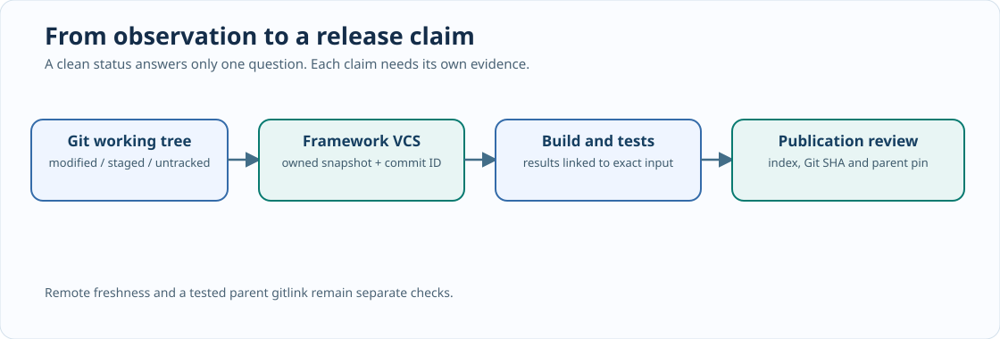

# Chapter 216 — From `git status` to trustworthy engineering evidence

**Bits to Banking · Advanced engineering · Umicom Foundation**  
**Author:** Sammy Hegab · **Native language:** C23 · **Prerequisites:** Chapters 204–215.

## Why this matters

A contributor says, “Git reports that the project is clean, so I can push.” The conclusion does not follow. A clean working tree means Git sees no uncommitted changes in that checkout. It does not prove that the branch points to `main`, that the remote was checked recently, that a Framework submodule points to a tested revision, or that the newest commit built successfully. These are separate pieces of evidence. A professional engineering decision identifies the specific claim and the observations that support it.

In Umicom OS, the parent repository can be clean while `framework/` is checked out at an old commit. In Umicom Applications, Framework can be current while Studio tests are failing. In Bits2Banking, native tests can pass while `mkdocs.yml` has an unresolved navigation reference. These situations demand distinct diagnoses.

## Learning objectives

Explain the working tree, index, local HEAD, remote-tracking references, submodule gitlinks and build/test results as **independent evidence domains**. Inspect them without modifying source, then explain which claim each command can and cannot support.

## Mental model — an evidence record has four dimensions

An observation should identify (1) *which repository* it concerns, (2) *which revision* was observed, (3) *which command or Framework API* produced it, and (4) *which question* that observation answers. For instance, `git status --short` answers which paths have changed relative to Git's current comparison base. It does not establish that remote `main` is up to date. `ctest` answers which registered tests ran against the configured build. It does not prove the executable was built from the SHA you later published unless that relationship is preserved.



## Guided PowerShell inspection — read only

Use the existing repository; the commands do not create scripts or alter the working tree:

```powershell
Set-Location "C:\umicom\umicomOS"
git status
git branch --show-current
git rev-parse HEAD
git ls-files --stage framework
git submodule status framework
git -C ".\framework" status --short
git -C ".\framework" log -1 --oneline
```

Record the parent HEAD separately from the child HEAD. The `160000` mode in `git ls-files --stage framework` is a Git **gitlink**: the parent stores a child commit identity, not a copy of Framework source. A leading `+` in `git submodule status` means the child working copy is at a different revision from the commit recorded by the parent. That can be intentional during integration; it must still be reviewed before the parent commit.

To inspect your remote-tracking state, run `git remote -v` and `git log -1 --oneline origin/main`. A local `origin/main` is only your last fetched view of the remote. Fetching is a separate action. Record whether and when it happened rather than silently assuming freshness.

## The existing native Framework contract

Open `include/umicom/vcs/working_tree.h` in your **actual** Framework checkout. `UmiVcsWorkingTreeRead` observes a repository and `UmiVcsWorkingTreeDescribe` copies a structured summary. The summary distinguishes staged entries, conflicts, untracked paths, changes inside submodules and detached HEAD. `UmiVcsWorkingTreeDestroy` releases the owned observation after consumers finish borrowing entries. This is a better production integration boundary than parsing English `git status` output in every application.

The Update 33 teaching laboratory uses **caller-supplied** summaries to model the next step. It deliberately does not reimplement the Framework's Git provider, execute commands or scan repositories. When a module needs real observations, use the Framework API.

## Failure and recovery

Suppose the parent status reports `modified: framework (new commits)`. First inspect `git submodule status framework` and the child `git log -1 --oneline`. Do **not** run `git add -A` simply to make the warning disappear. The pointer may refer to a Framework commit that has not been pushed or validated. Likewise, a detached child does not mean the source is lost: examine `git log --oneline origin/main..HEAD` before considering a checkout change.

## Assessment

1. What does a clean parent working tree prove about a submodule's remote publication? **Nothing by itself.**
2. Which Git command shows the parent-pinned child SHA? `git ls-files --stage framework`.
3. Why can a test result become stale when the source SHA changes?
4. Why must `remoteFresh` be supplied separately in the Update 33 laboratory?
5. Which Framework function frees the owned working-tree observation?

**Next:** [Chapter 217 — Understanding Git's structured working-tree records](217-structured-git-status-without-duplicate-parsers.md).
