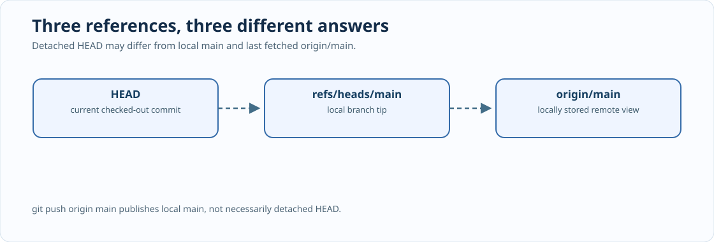

# Chapter 218 — Detached HEAD, local `main` and push identity

**Bits to Banking · Professional Git · Umicom Foundation**  
**Author:** Sammy Hegab · **Prerequisites:** Chapters 191–194 and 216–217.

## Why this matters

Inside `C:\umicom\umicomOS\framework`, `git push` may report **“You are not currently on a branch.”** A subsequent `git push origin main` may report **non-fast-forward**. Those errors are compatible: the first command concerns the *checked-out HEAD*, while the second pushes the *local branch named `main`*. The two may point to different commits. Neither error proves your source has vanished.



## Mental model: three pointers, not one

`HEAD` identifies the currently checked-out commit or refers to the active branch. `refs/heads/main` is a locally movable branch reference. `refs/remotes/origin/main` is Git's locally stored record of a remote branch, updated when a suitable fetch occurs. `git push origin main` normally publishes local `main`; it does not automatically publish detached HEAD. A submodule checkout created by the parent frequently has detached HEAD because the parent pins an exact child commit.

Use these inspection commands before changing anything:

```powershell
Set-Location "C:\umicom\umicomOS\framework"
git status
git branch -vv
git log -1 --oneline HEAD
git log -1 --oneline main
git log -1 --oneline origin/main
git log --oneline origin/main..HEAD
git log --oneline origin/main..main
```

The final two commands answer different questions. The first examines commits reachable from the checked-out HEAD but not the last fetched remote reference. The second examines commits reachable from local `main` but not that remote reference. If either lists commits, preserve those commit identities before switching or updating the checkout.

## Diagnose before recovery

Assume the remote Framework is at `0d40b2d` but OS pins `e59533f`. Those abbreviated IDs are an **illustrative historical checkpoint**, not a command to downgrade. The important distinction is whether the parent pin or current child HEAD differs from the canonical published Framework revision. Read the actual SHAs from your current checkout.

If local-only commits or untracked files exist, **stop** before `git switch main`, `git pull` or `git submodule update`. Preserve the work. A stash can temporarily protect tracked and untracked files, but it does not automatically protect local commits or ignored files. This difference becomes significant in a large Framework tree containing generated artefacts, new C23 source and multiple active workstreams.

When the checkout is clean and no unpublished commits need protection, the approved Umicom process is to update the single canonical Framework source repository first. Consumer checkouts then align to the published Framework revision. The parent Umicom OS repository records the new gitlink only after integration tests pass.

## C23 connection

`BtbReviewObservation` has separate `detached`, `branchKnown`, `onMain` and `divergenceKnown` fields. Conflating them into one “good/bad” Boolean would hide the reason for a failed publication attempt. The native triage function recommends `git log --oneline origin/main..HEAD` when detached HEAD is observed. It **does not** run a checkout or push command.

## Exercises

1. Without executing a write operation, explain why `git push origin main` can reject while `git log -1 HEAD` shows a newer commit.
2. Explain what a blank `git branch --show-current` output means.
3. Identify which checkout stores a Framework source commit, and which parent stores only its reference.
4. Describe a situation where switching to `main` would obscure an unpublished detached commit.
5. Explain why a detached HEAD is not itself evidence of source corruption.

**Next:** [Chapter 219 — Submodule divergence and gitlinks](219-review-umicom-framework-gitlinks.md).
