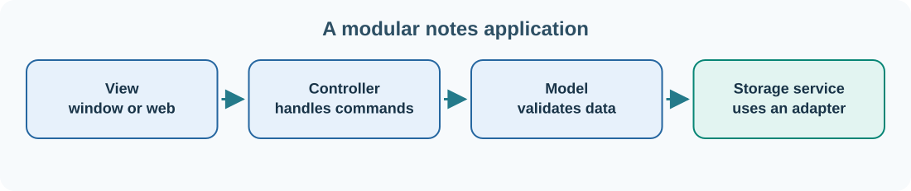

# 22. Modules, interfaces and software design patterns

A small program can fit in one file. A larger application needs an architecture: a deliberate arrangement of responsibilities that makes the code understandable and safe to change.

Consider the growing note-taking application. It has to accept input, validate text, store notes and display them. If every screen directly reads and writes the database, the program becomes difficult to test and change. Instead, we can give each responsibility a clear boundary.

## Separate concerns



A useful model is:

| Component | Responsibility |
| --- | --- |
| View | Shows notes, forms and buttons |
| Controller | Receives user actions and coordinates operations |
| Model | Represents notes and their rules |
| Storage service | Saves and retrieves records through a defined contract |
| Adapter | Connects the contract to a file, database or external service |

This is closely related to **Model–View–Controller (MVC)**. Other applications use **Model–View–ViewModel (MVVM)**, which separates presentation state from UI toolkit details. Neither pattern should be treated as a requirement to create unnecessary classes. The purpose is to keep responsibilities clear.

## What is an interface or contract?

A contract describes which operations a component supports and what the caller may expect. A note-storage contract might say:

```text
SaveNote(note) -> saved identifier or error
GetNote(identifier) -> note or not-found
ListNotes() -> collection of notes
```

The user interface does not need to know whether `SaveNote` uses SQLite, a JSON file or a remote API. The storage implementation can change while the contract remains stable. That separation is valuable when software is tested on a computer without a production database.

## Commands, queries and events

The words sound similar but mean different things:

- **Command:** request that the system perform an action, such as `MarkTaskDone`.
- **Query:** ask for information without changing authoritative state, such as `GetOpenTasks`.
- **Event:** report something that already happened, such as `TaskCompleted`.

A command might fail because the task does not exist or the user lacks permission. An event should describe a completed fact and can be published for other components to process. For example, a reporting service might subscribe to `TaskCompleted` without controlling the task board's user interface.

## Reusability without duplication

Suppose Umicom Studio, a task board and an accounting application all need logging, settings and file dialogs. Reimplementing these features in each product creates repeated bugs and inconsistent behaviour. Umicom Framework aims to provide those common capabilities once, behind stable contracts, so products can reuse them.

The same principle has limits. A generic Framework module should not contain the business rule for a specific trading venue or an individual organisation's bespoke workflow. A shared component is useful when its responsibility and supported behaviour are genuinely reusable.

## Test through the boundary

For our note service, a test can supply an in-memory storage adapter. It calls `SaveNote`, then `GetNote`, and checks that the same content and identifier are returned. This proves the service contract works without opening a graphical window.

Later, when you inspect the Umicom source, search for public headers, their implementations and tests before altering application-specific code. A clean boundary is only valuable when its behaviour is documented and verified.

**Next:** [Explore the Umicom architecture](../06-umicom/23-introducing-umicom.md).
