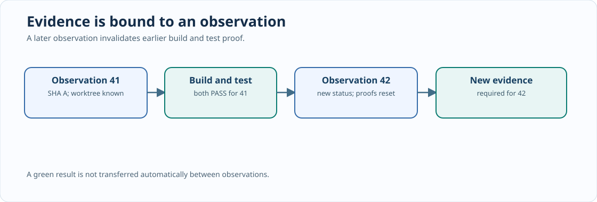

# Chapter 222 — Design a C23 Git observation timeline

**Bits to Banking · C23 application architecture · Umicom Foundation**  
**Author:** Sammy Hegab · **Laboratory:** `labs/native/git-review-timeline`.

## Why this matters

Release evidence can be correct when collected and wrong when reused. Imagine that Umicom Framework passed all native tests at commit A. Someone then changes the source or checks out commit B. A report that says “tests passed” without identifying the tested revision can wrongly authorise publication of B. The first design rule is therefore that an evidence record must be tied to a specific observation and commit.

Update 32 introduced a policy gate that judges one caller-supplied release snapshot. Update 33 adds a **time dimension**: observations arrive one after another, and previous build/test claims must not survive unexamined across a new observation. This is not another Git provider and it is not a production replacement for Umicom Framework's VCS services.



## Read the public C23 contract

Open `labs/native/git-review-timeline/review.h`. The public API is intentionally small:

```c
BtbReviewResult BtbReviewInit(BtbReviewTimeline *timeline);
BtbReviewResult BtbReviewObserve(
    BtbReviewTimeline *timeline,
    const BtbReviewObservation *observation);
BtbReviewResult BtbReviewRecordEvidence(
    BtbReviewTimeline *timeline,
    const BtbReviewEvidence *evidence);
BtbReviewResult BtbReviewEvaluate(
    const BtbReviewTimeline *timeline,
    uint64_t expectedObservationId,
    const char *expectedCommit,
    BtbReviewReport *outReport);
```

The caller owns the timeline. `BtbReviewObserve` copies the supplied observation. No borrowed pointer remains after the call. `BtbReviewEvaluate` writes the complete report only after input has passed validation. This prevents a failed call from partially overwriting the caller's previous result.

## The source identity is explicit

A Git SHA-1 object ID has 40 hexadecimal digits; SHA-256 repositories use 64. The educational model accepts full IDs of those lengths, refuses abbreviations and rejects malformed characters. The buffer has capacity for 64 digits plus a NUL terminator. The model does not check whether a hash exists in any Git object database — only the real repository service can answer that question.

An observation ID is a **caller-issued sequence marker**, not a cryptographic timestamp. Two observations of the same commit still receive different IDs. This conservative rule intentionally invalidates old build and test claims each time a new observation is accepted. A production system could optimise this later with trusted immutable build-input fingerprints, but must not assume that merely seeing the same HEAD proves identical worktree contents.

## Ownership walk-through

1. Initialise the timeline with `BtbReviewInit`.
2. Supply an observation describing one Framework revision, branch state, remote knowledge and file-change counts.
3. Record a build result with the exact observation ID and full commit identity.
4. Record the test result against that same observation.
5. Evaluate using the observation you expect to be current.
6. Observe again after any source or reference change; old build/test proofs become `NOT_RUN`.

Inspect `review.c` and confirm that a rejected observation is failure-atomic. No part of the previous timeline should change after an invalid SHA or decreasing observation ID.

## Design boundaries

`BtbReviewTimeline` is deliberately one-owner and single-threaded. It does not implement synchronization, Git fetching, filesystem crawling, Git transport, remote authentication or an immutable audit store. For production, a Framework-owned worker should obtain the status and produce an immutable snapshot; release policy should use the existing Framework repository-control interfaces. Application code should not duplicate those mechanisms.

## Exercises

Explain why test proof for observation 41 must be rejected after accepting observation 42. Why do we invalidate tests when a new build is recorded? What information would be required to establish that a result was produced by an independently trusted CI runner? Which part of Umicom Framework owns obtaining real working-tree state?

**Next:** [Chapter 223 — C23 failure atomicity and test provenance](223-bind-build-and-test-proof-to-a-revision.md).
