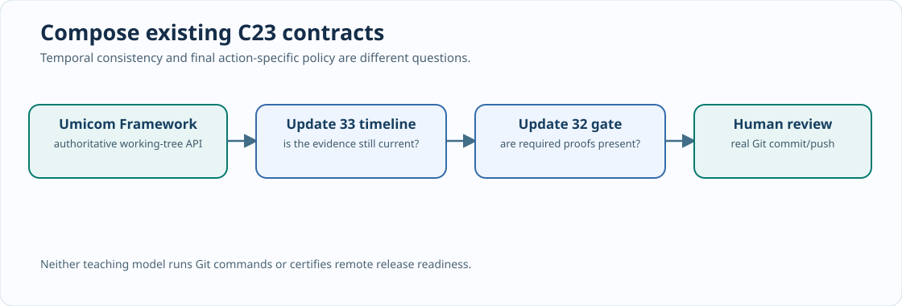

# Chapter 225 — Compose the existing C23 release gate instead of duplicating it

**Bits to Banking · Reuse and integration · Umicom Foundation**  
**Author:** Sammy Hegab · **Prerequisites:** Chapters 213–215 and 222–224.

## Why this matters

A development team can spend more time building competing validation tools than improving the application. Update 32 already introduced a teaching-only release-evidence gate. Update 33 should not produce a rival policy engine with different release meanings. Instead, it contributes one missing dimension: a timeline that rejects stale observations and stale build/test receipts. The two components answer different questions and therefore compose well.

`BtbReviewTimeline` asks whether the caller's sequence of observations and supplied evidence is internally consistent. `BtbGateEvaluate` asks whether a complete **action-specific** snapshot meets the release requirements for commit, push or parent gitlink staging. One does not replace the other.

## Read the two public contracts

Open `labs/native/git-review-timeline/review.h` and the previous `labs/native/git-release-evidence/gate.h`. Compare `BtbReviewReport` with `BtbGateReport`. Both APIs accept caller-owned inputs and return copied reports. Neither executes Git commands. The existing release gate should retain control of final action-specific policy; the timeline must not report a generic “approved to push” result.

## Follow the composition test

The new `test_gate_composition.c` links against the **unchanged** Update 32 source through its existing relative path. It constructs a clean observation, records build and test results, and evaluates the timeline with zero issues. Next, it passes a release-gate snapshot with documentation checking marked `NOT_RUN`.

The release gate correctly reports `BTB_GATE_DOCS_NOT_RUN` and blocks the action. Only after the documentation proof is changed to a passed value does the teaching gate reach `READY`. Neither result is an externally verified permission to publish: the caller supplied these facts.

This is a controlled example of **composition over duplication**. The ownership of source-history inspection remains in Umicom Framework. The educational timeline only validates sequence and consistency. The existing Update 32 gate retains release-policy evaluation. The real product can use Framework's repository-control and VCS services to supply observations and take explicitly approved actions.



## Run the named integration test

```powershell
Set-Location "C:\umicom\Umicom-Bits2Banking"
ctest --test-dir ".\output\learning-build\git-review-timeline" -R "release_gate_composition" --output-on-failure
```

If CTest says no such test exists, inspect CMake's configuration output. The target is registered only when Update 32's `gate.c` and `gate.h` are present under `labs/native/git-release-evidence`. This is an **honest unrun dependency**, not a silent green test. Merge the previous batch before claiming the integration regression passed.

## Connection to real Umicom release flow

A native CI or Studio workflow should request the authoritative Framework observation, obtain current remote ancestry separately, execute the correct build/test profiles, preserve the source revision and stage only reviewed changes. For an OS pin update, Framework's native `repo verify` previews the operation; `repo lock` stages the gitlink, then the developer reviews it using `git diff --cached --submodule=log`. The policy model cannot substitute for any of those real steps.

## Assessment

1. Which module owns Git's actual working-tree observation? **Umicom Framework.**
2. Why can a clear timeline coexist with a blocked release gate? The timeline does not check all release conditions.
3. Why must CMake report an absent Update 32 source rather than claim an integration test passed?
4. Why is the staged tree different from the last committed HEAD?
5. Explain one case in which a release-gate result may become stale after new work is staged.

**Next:** [Chapter 226 — Negative tests and proof boundaries](226-verify-100000-c23-evidence-transitions.md).
