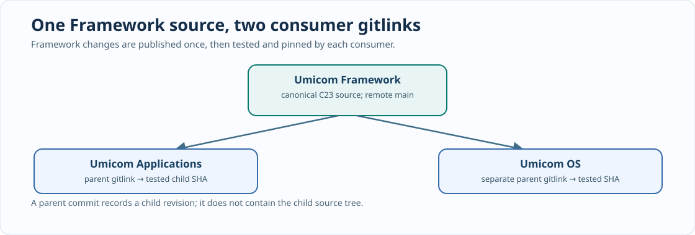

# Chapter 227 — Capstone: recover, qualify and publish an Umicom Framework integration

**Bits to Banking · Professional contributor assessment · Umicom Foundation**  
**Author:** Sammy Hegab · **Prerequisites:** Chapters 204–226.  
**Safety:** The instructions below are an assessment plan. Run write operations only against reviewed changes in repositories where you have permission.

## Business scenario

Umicom OS is pinned to a Framework revision that is behind the canonical Framework repository. A colleague reports that `git submodule update --init --remote framework` was blocked by tracked and untracked changes. After an attempted recovery, `git push` failed because the Framework child was in detached HEAD; `git push origin main` was then rejected because local `main` was behind the remote. No one has established whether the local changes were already present upstream or whether the OS integration tests passed.

Your mission is to preserve all source, identify the correct Framework commit, restore a reviewable Git state, run appropriate tests and publish only the repository pointers that are genuinely ready.



## Phase A — inspect without modifying anything

```powershell
Set-Location "C:\umicom\umicomOS"
git status
git branch --show-current
git ls-files --stage framework
git submodule status framework
git -C ".\framework" status --short
git -C ".\framework" branch -vv
git -C ".\framework" log --oneline origin/main..HEAD
git -C ".\framework" stash list
```

Submit a table of the OS parent HEAD, recorded Framework gitlink, checked-out Framework HEAD, local child branch, untracked count and any local-only commit SHA. A blank child branch name is not corruption. Do not push or switch branches yet.

## Phase B — preservation and ancestry decision

If there is uncommitted work, inspect and safely protect it before a checkout operation. If local-only commits exist, record and review their SHAs separately. When it is safe to compare the current remote history, fetch and inspect:

```powershell
git -C ".\framework" fetch origin main
git -C ".\framework" log --oneline --left-right HEAD...origin/main
```

Explain the difference between a fast-forward, a true divergence and a detached commit not present in remote `main`. Do not use hard resets, source-cleaning commands or force pushes as generic repair steps. If your evidence is incomplete, mark the phase **BLOCKED** and preserve the checkout rather than guessing.

## Phase C — correct Framework ownership

New reusable functionality belongs in the canonical `Umicom-Applications\framework` checkout. Compile and test there first. Only publish a Framework source commit if you have actually made and reviewed Framework changes. When Framework is already correct and published, skip that commit entirely. In a clean consumer checkout, align to the tested published child revision; do not manually copy Framework files into OS.

Then configure, build and test Umicom OS against its actual Framework checkout. The OS's `headless-debug` and `gtk4-debug` CMake presets are distinct acceptance steps; a diskless image or QEMU boot requires additional evidence if that layer changed. A missing or failed gate cannot be relabelled as passed.

## Phase D — review the gitlink and publish the parent

Use the already-built Framework CLI `umicom repo verify .` to preview and `umicom repo lock .` to stage the child reference. Inspect the staged gitlink. Only after the worktree, staged files, child publication and OS tests are understood should you commit the parent.

```powershell
Set-Location "C:\umicom\umicomOS"
git status
git branch --show-current
git diff --cached --submodule=log
git add -A
git diff --cached --check
git diff --cached --stat
git diff --cached --submodule=log
git commit -m "chore(os): pin validated Umicom Framework revision"
git push origin main
```

This is the normal requested command format, **not** a command to execute automatically during the assessment. `git add -A` stages every outstanding change in the OS repository; exclude or resolve unrelated changes before committing. If the push is rejected, return to ancestry inspection rather than forcing an update.

## Phase E — publish the learning update separately

Bits2Banking owns these Markdown chapters, diagrams, video scripts and the teaching laboratory. Its ZIP should be reviewed and merged using Beyond Compare, without mirroring over the existing repository. Build the lab and run CTest; check MkDocs navigation against the current `mkdocs.yml`. Record any missing Update 28–32 navigation separately instead of silently deleting links or renumbering lessons. Commit Bits2Banking in its own repository.

## Required capstone evidence

Produce (1) parent and child SHA inventory, (2) local/untracked changes inventory, (3) a recovery explanation, (4) the Framework publication decision, (5) OS build/test results, (6) staged gitlink review, (7) the Update 33 CTest results, (8) a note about documentation publication status, and (9) a precise description of every unverified condition. A safe assessment can conclude **NOT READY**. That is a valid professional result when evidence is missing.

## Further challenge

The repo shows clean working trees and no conflicts, but `origin/main` has not been fetched for a week. Are these sufficient grounds to publish? What if the Framework header bridge compiles but the OS GTK4 executable fails to start by double-click? What if native tests pass but the boot image has never been run in QEMU? Explain which authority and test must resolve each case.

**Next:** Major Update 34 — cross-platform Git recovery exercises, native release observations and further Framework-controlled integration.
