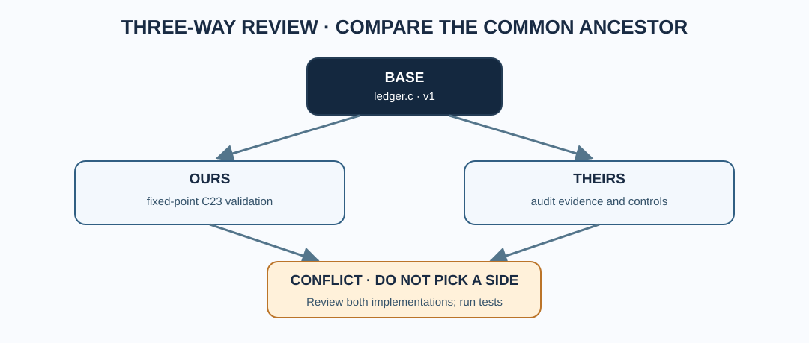

# Chapter 229 — Understand merge bases and divergent `main`

**Bits to Banking · Professional Git engineering · Umicom Foundation**  
**Prerequisite:** Chapter 228 · **Duration:** 45 minutes.

## Why a rejected push is useful

Suppose Framework's published `main` contains six new commits but your local `main` still references an older revision. A push is rejected because publication would otherwise replace the remote history rather than advance it. Do not interpret this as permission to force-push. First determine whether your local history is simply **behind**, whether you have **unpublished commits**, or whether both histories **diverged**.

Git commits form a directed acyclic graph (DAG): every normal commit points to one parent, while a merge commit usually has two. The **merge base** is the best common ancestor of two histories. The words **ours** and **theirs** in a merge concern the two sides being merged; they are not statements about which side is correct.



## Read-only commands in the Framework checkout

```powershell
Set-Location "C:\umicom\Umicom-Applications\framework"
git status
git branch -vv
git fetch origin main
git merge-base HEAD origin/main
git rev-list --left-right --count HEAD...origin/main
git log --graph --oneline --decorate --left-right HEAD...origin/main
```

The `rev-list` output contains **two integers**. The first counts commits reachable from HEAD but not from `origin/main`; the second counts commits reachable from `origin/main` but not HEAD. For example, `0 6` means the checked-out history is six commits behind without local-only commits. `2 3` means there are two local-only and three remote-only commits: a real divergence that needs investigation. When HEAD is detached, the check still compares the checked-out commit; your local `main` ref is a separate object.

## Distinguish the three outcomes

| History | Meaning | Sensible next decision |
|---|---|---|
| `0 6` | Local HEAD is behind | If clean, fast-forward the intended local branch or update a consumer submodule to a tested target commit. |
| `3 0` | Local HEAD has commits absent upstream | Confirm commits, authorship and tests before publication; detached commits must be preserved before checkout. |
| `2 3` | Both sides have unique commits | Review the common ancestor, changed files and possible conflicts; do not force-push to erase the remote's work. |

The output does not tell you whether a change is *correct*. It tells you its **ancestry relationship**.

## Normal maintainer workflow (when clean)

The Umicom owner workflow commits directly to `main`; it does not create development branches by default. Only when you have confirmed the checkout is clean and contains no detached unpublished commits should you switch to local main and fast-forward:

```powershell
git switch main
git pull --ff-only origin main
```

A failed `--ff-only` is a valuable safety signal: investigate instead of changing the command to an unconditional merge or rebase. Do not run this in an OS submodule until you have examined its parent gitlink and any local changes.

## A failure mode with submodules

The OS parent commit may point at `F1`, your OS `framework` directory may have HEAD at `F2`, and the remote Framework `main` may be at `F3`. These three states are independent. Use the parent command `git ls-files --stage framework` to inspect the pinned revision and the child command `git -C .\framework rev-parse HEAD` to see the working checkout. The native Framework `umicom repo verify .` reports prospective parent gitlink updates; it does not fetch GitHub for you.

## Assessment

A contributor has `HEAD...origin/main = 0 4`, a clean working tree and no unpublished commits. Which recovery is safer: `git reset --hard origin/main`, `git push --force`, or a reviewed `git switch main` then `git pull --ff-only`? Explain why the third operation is the only appropriate one in this situation. If a second contributor instead reports `2 4`, explain what additional information is needed before any integration.

**Next:** inspect unresolved merge entries using Git's index stages.
