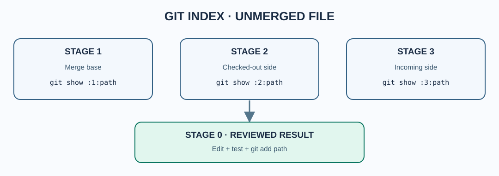

# Chapter 230 — Read Git index stages 1, 2 and 3

**Bits to Banking · Professional Git engineering · Umicom Foundation**  
**Prerequisite:** Chapters 228–229 · **Duration:** 60–75 minutes.

## The problem behind conflict markers

When two histories modify the same region differently, Git may refuse to produce a clean stage-0 version. Instead, it retains up to three *unmerged index entries* for the affected path: **stage 1** is the merge base, **stage 2** is ours (the checked-out side of the merge), and **stage 3** is theirs (the incoming side). Which history corresponds to ours/theirs depends on the operation; particularly during rebase, assumptions based on the words alone can mislead.



The working-tree file may also contain `<<<<<<<`, `=======` and `>>>>>>>` markers, but those markers are only one representation. The index entries preserve distinct committed versions for investigation.

## Safe inspection in a repository that already has a conflict

These commands are read-only:

```powershell
git status
git diff --name-only --diff-filter=U
git ls-files --unmerged
git diff --check
```

Choose one *actual* conflicted path from the output; never guess a filename. For example, if `src/finance/decimal_arithmetic.c` is listed:

```powershell
git show ":1:src/finance/decimal_arithmetic.c"
git show ":2:src/finance/decimal_arithmetic.c"
git show ":3:src/finance/decimal_arithmetic.c"
```

The colon syntax retrieves the base/ours/theirs index blobs without editing the working tree. During add/add conflicts, stage 1 can be absent; during delete/modify conflicts, one side's stage can be absent. An absent stage is evidence, not an error to hide.

## A controlled practice incident — never in a production checkout

For a reproducible demonstration using **only `main`**, create a disposable local bare remote and two independent working copies. Work under `$HOME\UmicomLearning` rather than `C:\umicom\Umicom-Applications`:

```powershell
New-Item -ItemType Directory -Force -Path "$HOME\UmicomLearning\GitConflictLab" | Out-Null
Set-Location "$HOME\UmicomLearning\GitConflictLab"
git init --bare --initial-branch=main central.git
git clone ".\central.git" author
Set-Location ".\author"
Set-Content README.md "Umicom account report version one"
git add -A
git commit -m "docs: create practice report"
git push -u origin main
Set-Location ".."
git clone ".\central.git" reviewer
Set-Location ".\author"
Set-Content README.md "Umicom account report with local checks"
git add -A
git commit -m "docs: add local account checks"
Set-Location "..\reviewer"
Set-Content README.md "Umicom account report with remote checks"
git add -A
git commit -m "docs: add remote account checks"
git push origin main
Set-Location "..\author"
git fetch origin main
git merge origin/main
```

The last command should report a conflict. **That is the intended learning result.** Both checkouts remain on `main`. The exercise has not created Python or PowerShell script files, and all Git writes stay in the disposable practice repositories. Make sure Git commit identity is configured before starting. Do not repeat these commands inside a real Umicom repository.

Inspect the three versions as shown above, but substitute `README.md`. End the practice merge with `git merge --abort` **only if a merge is currently in progress**. Before aborting, inspect `git status`; pre-existing uncommitted changes may complicate restoration.

## Questions

1. Which index stage is the merge base? (Stage 1.)
2. What does a missing stage in a delete/modify conflict indicate? (The version was absent on one side.)
3. Does `git add -A` preserve a conflict automatically? (No: staging a resolved file records your selected content. Review it carefully first.)
4. Can CTest passing on one branch prove the merged result compiles? (No; test the final merged state.)

**Next:** resolve carefully without discarding current source logic, authorship or comments.
