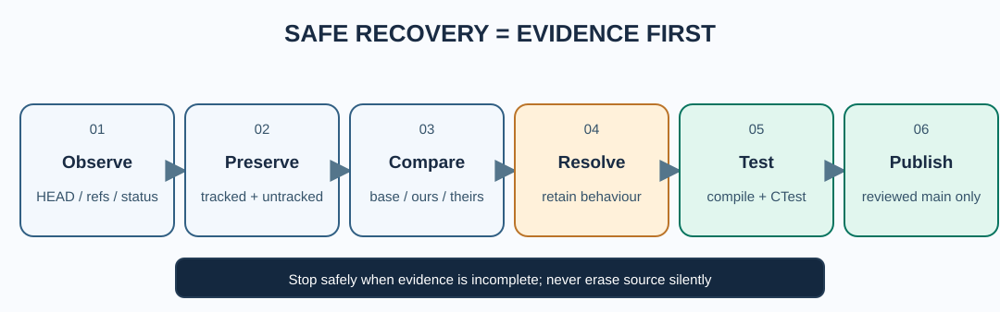

# Chapter 231 — Resolve conflicts without silently deleting functionality

**Bits to Banking · Professional Git engineering · Umicom Foundation**  
**Prerequisite:** Chapter 230 · **Duration:** 60 minutes.

## A banking example worth preserving

Two Umicom contributors independently changed a ledger validation routine. One added overflow protection for integer minor units. Another added audit evidence on rejected transfers. A simplistic "accept ours" or "accept theirs" action risks deleting an essential control. A merge conflict is not a contest: it means Git cannot prove how those changes should be combined.

The *right* merge is often a third implementation that preserves both requirements, builds, passes regression tests and is reviewed against the three historical versions.



## A disciplined resolution sequence

1. Record the current repository, branch/HEAD, exact conflicted filenames and parent commit IDs.
2. Inspect stages 1/2/3 with `git show :1:path`, `:2:path`, `:3:path`; compare in Beyond Compare when source is lengthy.
3. Extract requirements from **both** implementations. For the ledger example, record "checked arithmetic" and "audit evidence" separately.
4. Edit the working-tree file to implement both requirements. Preserve copyright headers, licences, educational comments, public ABI names and existing tooltips or features.
5. Where an implementation is genuinely superseded, retain it for review under an explained disabled section (for example `#if 0` in C) until the project owner authorises physical deletion. Avoid leaving conflicting symbol definitions active.
6. Compile and run focused tests, then broader integration tests. Examine the final staged patch before recording the resolution.

## Commands to confirm the result

```powershell
git status
git diff --name-only --diff-filter=U
git diff --check
git add -- "src/finance/decimal_arithmetic.c"
git diff --cached --check
git diff --cached -- "src/finance/decimal_arithmetic.c"
git status
```

Substitute an actual conflicted filename. If you run `git add -A` while other unrelated modifications exist, they will also be staged. For a deliberate merge resolution, stage each reviewed file individually first, then run a full staging review before the commit.

In Umicom C code, an explanatory comment should make architectural reasons explicit: **Framework owns this reusable service; the application consumes a public contract; the chosen path protects lifetime, transaction authority or auditability**. Do not merge source solely by counting lines.

## Example of preserving a superseded C path

```c
/* The original arithmetic path is retained for source review. It used an
 * unchecked addition. The approved replacement performs checked fixed-point
 * arithmetic before committing any ledger state. Do not delete until the
 * maintainer has signed off on the migration. */
#if 0
/* Original implementation retained here in the actual source tree. */
#endif

/* New implementation belongs in the existing Framework finance module,
 * not a duplicate ledger helper inside Umicom Bank. */
```

This block is **a pattern**, not a request to paste an empty disabled block into production. Retain the *actual original implementation* where the engineering decision requires it.

## Recovery if the merge is wrong

Until the resolution is committed, `git diff` and `git status` remain your first inspection tools. A merge in progress can often be aborted with `git merge --abort`, but first verify pre-merge modifications are preserved. After a merge has been published, reverting the reviewed change is normally safer than rewriting shared `main` history; reverting merge commits requires choosing a mainline parent (`-m`), so investigate before executing it.

Never use `git reset --hard`, `git clean -fd`, or force push as automatic conflict repair steps. These are destructive or history-rewriting operations.

## Exercises

A pending C23 merge changes `BtbLedgerPost` and adds a new `UmiAuditRecord` publication. List at least four tests you need before merging: integer overflow refusal, correct valid posting, exactly-once audit publication for accepted work, and failure-atomic state after a rejected input. Which module owns persistence? The Umicom Framework Data Server, under the system's defined contract.

**Next:** implement a small deterministic three-way *record* reconciliation model in C23 to see when conflicts must be preserved.
