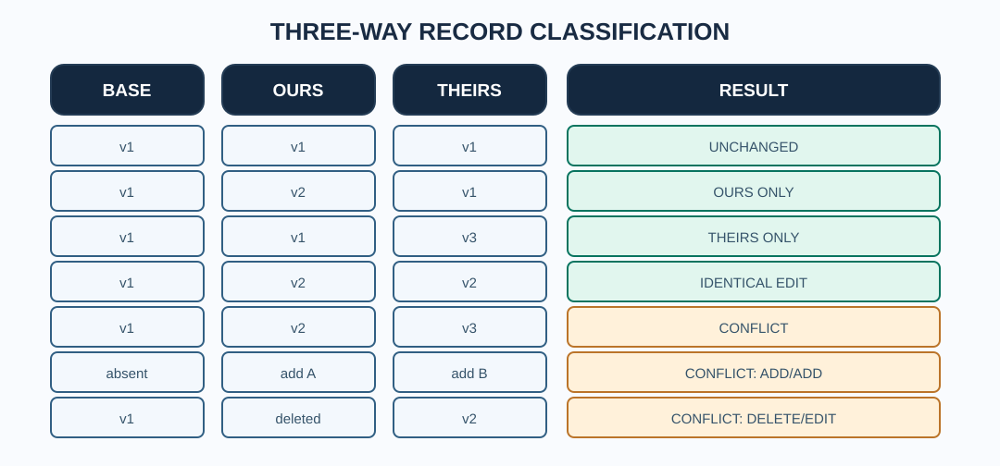

# Chapter 233 — Handle delete/edit and add/add conflicts without data loss

**Bits to Banking · Native C23 laboratory · Umicom Foundation**  
**Prerequisite:** Chapter 232 · **Source:** `labs/native/git-three-way`.

## Why a missing record is still evidence

Suppose Umicom Bank removes a transaction-report field in one workstream while Umicom Framework's shared reporting module extends that field with new audit metadata in another. Deletion and modification are two independent semantic decisions. A blind merge that simply accepts the modified text, or simply removes the record, could break downstream reconciliation. Git therefore reports a **modify/delete conflict** in analogous file-level situations.

Our model treats absence separately from the empty string. For a base value `v1`, `ours = absent`, `theirs = v2`, both sides differ from the base and from each other: the result is `BTB_MERGE_NEEDS_REVIEW`.



## Five cases to understand

**Identical edits:** Both sides changed `v1` to `v2`. Our model accepts `v2` once. This does **not** prove that the resulting application is correct; it means this record has no disagreement.

**One-sided deletion:** One side removed a record; the other left it unchanged. The deletion may be selected without a three-way disagreement. In a *real* Umicom source merge, deletion of a public API, comment or feature still requires project-owner approval; a mechanically clean merge is not a feature-preservation sign-off.

**Delete/edit:** One side removed a record while the other changed it. The decision stays unresolved, keeping base and surviving edit for review.

**Add/add:** The base had no such record. Two independently created records with the same key and different values conflict. Identical additions can be accepted once.

**Concurrent distinct additions:** If ours adds `studio/preview.c` and theirs adds `bank/audit.c`, both can be retained because they do not have the same symbolic identity.

## Resolve explicitly and audit the result

```c
BtbMergePlan plan;
BtbMergeSnapshot result;

/* First construct 'plan' using the three validated input snapshots. */
if (BtbMergeResolve(&plan, "bank/ledger.c", BTB_CHOOSE_THEIRS)
    != BTB_MERGE_OK) {
    /* Report that the selected conflict cannot be resolved. */
}
if (BtbMergeMaterialise(&plan, &result) != BTB_MERGE_OK) {
    /* Never consume a partially resolved result. */
}
```

The example shows the API flow, **not** a recommendation to choose theirs in actual finance code. Our classroom `BtbMergeResolve` deliberately requires a named conflict and a single explicit choice. A real source merge may need a new combined implementation that is neither original side. In that case, edit the real source manually, preserve superseded source for review as required, and run tests before staging.

## Exercise in the test suite

Run these focused CTest cases after building:

```powershell
ctest --test-dir ".\output\learning-build\git-three-way" -R "(delete_edit|edit_delete|different_adds|same_add|explicit_absent_choice)" --output-on-failure
```

For each test, write down the three input presences/values, expected conflict status, selected choice and final output. Contrast the result with `git ls-files --unmerged` in the disposable practice repo from Chapter 230.

## Failure and security boundaries

A record name is not trusted to be a filesystem path. `BtbMergeSnapshotAdd` only stores bounded text; it never opens a file. The laboratory cannot resolve Git rename conflicts, submodule mode `160000` entries, binary conflicts, or branch/rebase semantics. Use the Framework VCS API and Git CLI for real repository observation; use Beyond Compare and the project preservation policy for source decisions.

**Next:** prove that rejected operations leave caller-owned data untouched.
