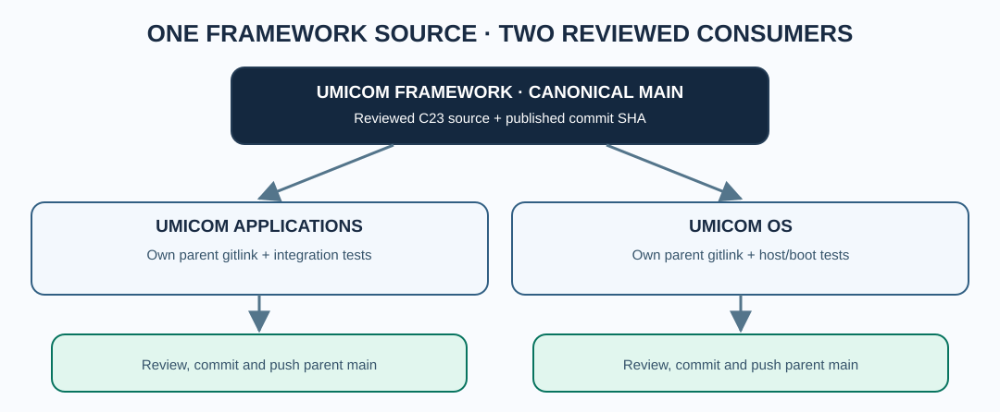

# Chapter 236 — Update Framework gitlinks without copying source

**Bits to Banking · Umicom OS integration · Umicom Foundation**  
**Prerequisites:** Chapters 228–235 · **Duration:** 75–90 minutes.

## Two checkouts, one authoritative repository

The same canonical `umicom-foundation/umicom-framework` source appears under `Umicom-Applications\framework` and `umicomOS\framework`. The former is the approved place to develop reusable Framework functionality; the latter is a **consumer checkout**. Updating a consumer is a Git revision operation, not a source-file copy.



A Git submodule pin consists of the **parent repository recording a particular child commit**. Even if you fetch the latest Framework in the OS child directory, the OS parent still records the old revision until you review, commit and publish a new gitlink.

## Phase A — record the state before writing

From the Umicom OS root, use only read-only commands:

```powershell
Set-Location "C:\umicom\umicomOS"
git status
git branch --show-current
git ls-files --stage framework
git submodule status framework
git -C ".\framework" status --short
git -C ".\framework" branch -vv
git -C ".\framework" log --oneline origin/main..HEAD
git -C ".\framework" stash list
```

If there are uncommitted changes **or** local-only commits, stop before any checkout. Preserve tracked and untracked edits (for example via a verified stash, if appropriate), record local-only SHAs, and compare those files with upstream before reapplying. A stash does not protect untracked files unless `--include-untracked` is requested; it also does not generally include ignored build artefacts. Do not drop the stash while recovery remains unverified.

## Phase B — publish Framework in its source-owner checkout

Only if the Framework code has genuinely changed, build and test it first in `C:\umicom\Umicom-Applications\framework`. Check that it is on `main` and that the upstream history is understood before publication:

```powershell
Set-Location "C:\umicom\Umicom-Applications\framework"
git status
git branch --show-current
git fetch origin main
git log --oneline --left-right HEAD...origin/main
```

After the reviewed change passes Framework and application tests, the maintainer's normal commit sequence is:

```powershell
git add -A
git diff --cached --check
git diff --cached --stat
git commit -m "feat(framework): improve shared repository inspection"
git push origin main
```

**Do not execute this merely to advance a submodule.** Skip the Framework commit when there is no new Framework code to publish. Never commit a duplicate copy of Framework source from the OS checkout.

## Phase C — align the clean OS consumer

After you have confirmed the OS child has no unpublished work and its worktree is clean, you can deliberately check out local `main` and fast-forward:

```powershell
Set-Location "C:\umicom\umicomOS\framework"
git switch main
git pull --ff-only origin main
git rev-parse HEAD
```

If `git switch main` reports conflicts or the branch is behind in a non-fast-forward way, stop and investigate. A detached HEAD is normal for submodules; switching to `main` is a deliberate maintainer operation and **must not** erase local-only commits.

## Phase D — qualify and pin OS

Build and test the OS against the selected child SHA. For user-space verification, the repository's `headless-debug` and `gtk4-debug` presets provide separate checks. A QEMU boot is an additional requirement if the boot layer changes. From the OS root, invoke the **existing Framework-owned CLI** from an installed/built Framework location:

```powershell
Set-Location "C:\umicom\umicomOS"
& "C:\umicom\Umicom-Applications\build\windows-ucrt64-all-debug\bin\umicom.exe" repo verify .
& "C:\umicom\Umicom-Applications\build\windows-ucrt64-all-debug\bin\umicom.exe" repo lock .
git diff --cached --submodule=log
```

`repo verify` is read-only. `repo lock` stages current checked-out child HEADs, **not** a remote update. Run it only once the intended child revision and tests are verified. If the native CLI has not been built or the path differs, build/locate it; do not introduce a PowerShell replacement script.

Finally, after reviewing all staged changes in OS, commit the parent gitlink. That step does not push Framework source again:

```powershell
git add -A
git diff --cached --check
git diff --cached --stat
git diff --cached --submodule=log
git commit -m "chore(os): pin tested Umicom Framework commit"
git push origin main
```

## Acceptance exercise

Produce a three-line table: canonical Framework remote `main` SHA, current OS child HEAD, and OS parent's recorded gitlink. Explain whether each SHA is tested and whether the parent is safe to publish. **Do not claim compatibility simply because the child Git status is clean.**

**Next:** use reflog and object inspection when a checkout appears to have lost commits.
