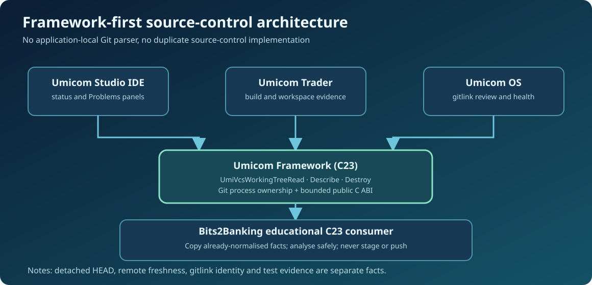

# Chapter 240 — Observe Git through Umicom Framework

**Bits to Banking · Engineering track · Umicom Foundation**  
**Primary language:** C23 · **Laboratory:** `labs/native/build-evidence`  
**Prerequisites:** Chapters 216–239, a local Git repository, and the distinction between a working tree and a commit.

## Why this matters

Umicom Studio, the Umicom OS Control Centre and a future Framework health dashboard all need to answer the same question: *what source revision is actually checked out, and what has changed since it was committed?* Building separate Git status parsers in each application would create three subtly different answers. The responsibility already belongs to **Umicom Framework**. In its existing public interface, `include/umicom/vcs/working_tree.h` defines `UmiVcsWorkingTreeRead`, `UmiVcsWorkingTreeDescribe`, `UmiVcsWorkingTreeEntryAt`, and `UmiVcsWorkingTreeDestroy`.

This chapter teaches the consumer boundary, not another Git client. The educational project does **not** execute Git or write the index. When an installed Framework SDK is available, the optional example can link the existing VCS target; the standalone lab uses fictional, caller-supplied evidence so every test is reproducible.

## Learning objectives

Explain the difference between a repository observation and a release decision; distinguish the checked-out `HEAD`, local `main`, and `origin/main`; inspect the Framework API without reading private implementation files; and describe when the returned snapshot becomes invalid.

## Prerequisite check: three names, three meanings

From PowerShell, in a repository you control, inspect:

```powershell
Set-Location "C:\umicom\Umicom-Applications\framework"
git status
git branch --show-current
git rev-parse HEAD
git rev-parse main
git rev-parse origin/main
```

`HEAD` identifies your current checkout. `main` is the local branch tip. `origin/main` is a remote-tracking reference that changes after a successful fetch. None of these commands proves a build passed. If the branch name is blank, the checkout may be detached; this is ordinary in a submodule and must not be confused with a clean, publishable branch.

## The Framework contract



The runtime observation follows a straightforward ownership sequence:

```c
#include "umicom/vcs/working_tree.h"

UmiVcsWorkingTreeRequest request = {
    .repository_root = repositoryRoot,
    .git_program = NULL,
    .timeout_ms = 30000U,
    .cancellation = NULL
};
UmiVcsWorkingTree *tree = NULL;
UmiVcsWorkingTreeSummary summary = {0};

UmiStatus status = UmiVcsWorkingTreeRead(&request, &tree);
if (status == UMI_STATUS_OK) {
    status = UmiVcsWorkingTreeDescribe(tree, &summary);
}
UmiVcsWorkingTreeDestroy(tree);
```

This illustrates the public API. `repositoryRoot` must be a valid path supplied by the caller. The example is **not** compiled by the standalone C23 target; it is exercised by the optional SDK-linked example once the installed Umicom Framework export targets are available. The read operation does not fetch remote history. A snapshot that reports `divergence_known == 0` must not be described as “up to date”.

The immutable `UmiVcsWorkingTree` object owns its observation. `UmiVcsWorkingTreeEntryAt` returns a borrowed entry that must not survive `UmiVcsWorkingTreeDestroy`. `UmiVcsWorkingTreeDescribe` copies the summary into caller-owned storage, which is suitable for transferring to another reviewed component.

## Guided investigation

1. Open `framework/include/umicom/vcs/working_tree.h` and identify the input timeout, cancellation token and output lifetime rules.
2. Find the `detached`, `unborn`, `branch_known`, `divergence_known`, `dirty_children` and `child_commits` fields. Record the meaning of each in a short table.
3. Run the read-only Git commands above in `Umicom-Applications\framework` and in `umicomOS\framework`. The commit IDs may differ because the parent repositories pin different revisions.
4. Look at the optional `framework_bridge.c` in this batch. It copies a **Framework-provided** SHA into a bounded educational identity. It never opens `.git` or parses command output itself.
5. Explain why an application must not stage, commit or push solely because a snapshot contains no modified paths.

## Failure analysis

A repository can appear clean while its tests are stale, a submodule points to an older Framework commit, `origin/main` has not been fetched, or the machine compiled a different build configuration. None of those facts is contradicted by a clean working tree. A status query returning `UMI_STATUS_TIMEOUT` or `UMI_STATUS_UNAVAILABLE` must result in an explicit unavailable state, **not** a fabricated clean result.

## Questions and assessment

**Recall:** Who owns Git observation in Umicom? **Answer:** Framework's VCS/repository services. **Application:** Can a Studio panel retain `UmiVcsWorkingTreeEntryAt` indefinitely? **Answer:** No, that pointer is borrowed from the observation. **Design:** Is `origin/main` automatically current? **Answer:** No; remote freshness requires a separately verified fetch and policy decision.

**Next:** Chapter 241 connects repository observations to submodule gitlinks and nested working-tree changes.
