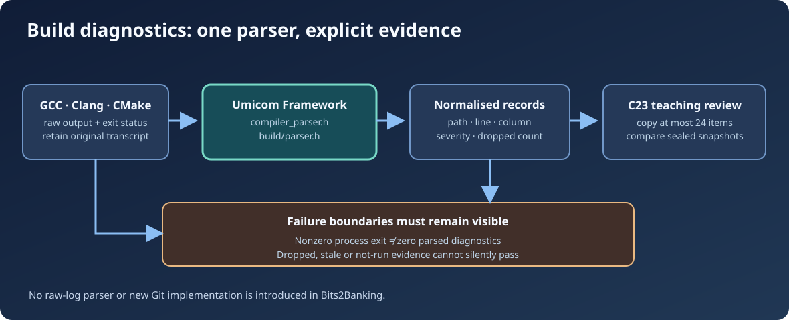

# Chapter 242 — Reuse Umicom Framework compiler diagnostics

**Bits to Banking · Engineering track · Umicom Foundation**  
**Primary language:** C23 · **Framework APIs:** `umicom/build/parser.h`, `umicom/diagnostics/compiler_parser.h`  
**Prerequisites:** Chapters 240–241 and basic C function declarations.

## Why this matters

A build prints lines such as `C:/umicom/.../notes.c:18:9: error: incompatible pointer type`. An editor wants a navigable source position; a build history wants a stable diagnostic record; a release review wants the number of errors and warnings. If Studio, Trader and educational tools each parse the line differently, one may navigate to the wrong file, especially when the Windows drive letter also contains a colon.

The Umicom Framework already solves the difficult part. `UmiCompilerDiagnosticParseText` recognises common GCC/Clang, MSVC and CMake diagnostics. `umi_build_parse_diagnostic_line` and `umi_build_parse_output` project the shared parser into build-domain records. The new Bits2Banking laboratory does **not** reproduce that parser; it consumes its owned, already-normalised results.

## Understand the two different contracts

`UmiCompilerDiagnosticFields` is a compiler-language extraction record: path, code, message, severity, line and column. `UmiBuildDiagnostic` represents the same information inside Framework's build subsystem. A list of the latter contains both a count and a **dropped** counter. Dropped diagnostics are important because a bounded parser may refuse an oversized message rather than silently shorten an error into misleading evidence.

The public API can be used as follows when the Framework SDK is installed:

```c
#include "umicom/build/parser.h"

UmiBuildDiagnostic problem;
UmiStatus status = umi_build_parse_diagnostic_line(
    "C:/umicom/Notes/src/main.c:17:8: error: missing declaration",
    &problem);
if (status != UMI_STATUS_OK) {
    /* Keep the raw log. Do not invent a problem location. */
}
```

Check the result status before using `problem`. Ordinary progress text is not an error. A message containing the word “error” does not necessarily match an actual compiler diagnostic. The parser cannot understand every vendor format or terminal control sequence; the original log remains the fallback for unsupported cases.

## One pipeline instead of several parsers



Our optional `framework_bridge.c` accepts a `UmiBuildDiagnosticList` that Framework already produced. It validates each fixed string field and copies acceptable entries into small educational `BtbEvidenceProblem` records. If an entry is too large, the operation rejects the projection and preserves the caller's existing output. This is preferable to cutting a file path to fit a small UI buffer, which could point to the wrong file.

The bridge's stage argument is separate from the diagnostic severity. For example, an `ERROR` severity might arise in *compile* or *link*. The classification belongs to the invoking build runner, because compiler text alone does not prove which execution phase was active.

## Practice: classify actual feedback

In PowerShell, after configuring an Umicom CMake build, execute:

```powershell
cmake --build --preset windows-ucrt64-all-debug --parallel 2
```

Read the **first actual failing command** and the first diagnostic related to it. Record the target being compiled, the source path, the exact error message, the command exit code and the current Framework SHA. Do not create a replacement compiler parser as an exercise. Instead, inspect the existing Framework example `framework/examples/build_diagnostics/main.c`, and identify which fields are copied and why the path capacity is larger than the Problems panel's display capacity.

## Failure and security boundaries

A build may finish with a nonzero exit code but provide no parseable error (tool crash, missing executable, lost network drive, or process termination). The absence of a parsed diagnostic is **not** evidence that the build passed. Likewise, a successful exit code with a nonzero dropped counter is an incomplete observation. The C23 review laboratory keeps these facts separate.

Do not execute text copied from a compiler log. It is data, not an authorised command. Display paths safely, retain the raw transcript and route opening a source file through the existing document/workspace coordinator.

## Assessment

**Recall:** Which library owns parsing GCC/Clang messages? **Answer:** Umicom Framework. **Debugging:** Why is splitting on the first colon unsafe? **Answer:** `C:` in a Windows path is not the line-number separator. **Design:** Why does the adapter reject an oversized diagnostic? **Answer:** Truncation could create a false source location or incomplete explanation.

**Next:** Chapter 243 separates configure, compile, link, test and packaging failures.
