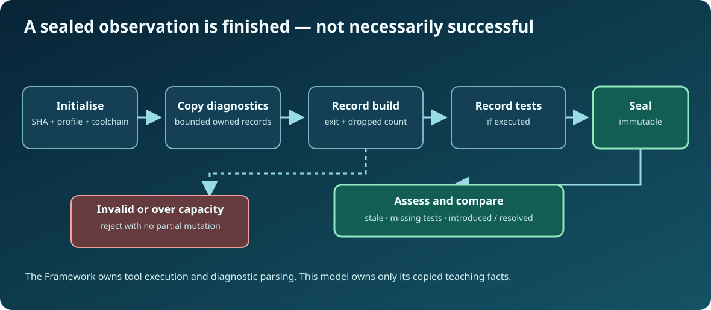

# Chapter 245 — Build a bounded C23 evidence snapshot

**Bits to Banking · Engineering track · Umicom Foundation**  
**Primary language:** ISO C23 · **Source:** `labs/native/build-evidence/evidence.h` and `evidence.c`  
**Prerequisites:** C23 structures, arrays, `size_t`, ownership and Chapters 240–244.

## Why this matters

A useful build review must preserve what the compiler actually reported, even after the temporary parser object has been released. In a long-lived IDE, pointers into an ephemeral output buffer are unsafe: a background build can replace the buffer while a Problems panel still displays its old contents. The educational implementation therefore copies each already-normalised diagnostic into a bounded caller-owned snapshot.

A production build may emit hundreds of diagnostics. This lesson deliberately holds only **24** records, making every edge case visible. Exceeding that capacity returns a named failure, never an apparently complete truncated list. Framework retains its own larger diagnostic history and raw logs; the teaching lab does not replace them.

## Understand storage and lifecycle



Open `evidence.h` and read `BtbEvidenceRun` from top to bottom. It owns an identity, up to 24 `BtbEvidenceProblem` values, an explicit dropped-diagnostic count, a process exit result, and test counts. The `sealed` flag marks the point after which the snapshot must not be mutated.

The permitted sequence is:

```text
Initialise → Add copied diagnostics → Record build outcome
           → Record test outcome (if executed) → Seal → Review / Compare
```

A compile error can prevent tests from running. In that case, record the nonzero build exit code and **do not fabricate tests**; the sealed run remains blocked because testing evidence is missing. Being sealed means the observation is finished, not successful.

## The public C23 calls

```c
BtbEvidenceRun run;
BtbEvidenceIdentity identity = { /* complete SHA, profile, compiler, sequence */ };
BtbEvidenceProblem problem = { /* normalised, caller-owned record */ };

BtbEvidenceResult result = BtbEvidenceRunInit(&run, &identity);
if (result == BTB_EVIDENCE_OK)
    result = BtbEvidenceAddProblem(&run, &problem);
if (result == BTB_EVIDENCE_OK)
    result = BtbEvidenceRecordBuild(&run, 0, 0U);
if (result == BTB_EVIDENCE_OK)
    result = BtbEvidenceRecordTests(&run, 12U, 0U, 0U, 0U);
if (result == BTB_EVIDENCE_OK)
    result = BtbEvidenceSeal(&run);
```

Fill the identity and problem with real data **before** executing. The braces above are deliberately descriptive placeholders, not a complete executable example; the complete runnable `evidence_demo.c` supplies all values.

## Failure-atomic design

`BtbEvidenceRunInit` assembles a local candidate and assigns it only after validation. `BtbEvidenceAddProblem` checks the input, current snapshot and capacity before copying a new entry. If a message lacks a NUL terminator, if a stage is invalid, or if capacity is exhausted, the old snapshot is byte-for-byte unchanged. `BtbEvidenceRecordTests` checks for arithmetic overflow before calculating a test total.

This is the same principle used in financial software: rejecting an invalid instruction must not partially alter an account balance, workflow record, approval state or evidence trail.

## Guided debugger exercise

Build the lab using the commands in the [build-evidence README](https://github.com/umicom-foundation/Bits2Banking/blob/main/labs/native/build-evidence/README.md). Run `btb-build-evidence-test copied_problem_ownership`, then put a breakpoint inside `BtbEvidenceAddProblem`. Watch `run.problemCount` before and after the copy. Run `full_failure_atomic`, fill all 24 slots, and confirm that the 25th attempted insert returns `BTB_EVIDENCE_FULL` without changing the original memory.

Next run `unterminated_message_atomic`. Explain why a fixed array without a terminating NUL cannot safely be passed to `strlen` or exposed as a path inside a GUI. Finally, inspect the comments above `BtbEvidenceRecordBuild`: they explain why no diagnostic can be appended after the recorded process outcome.

## Questions and answers

**What owns the bytes after Add?** `BtbEvidenceRun`, not the producer's temporary buffer. **Can a capacity failure be ignored?** No; the result indicates incomplete evidence. **Does Seal mean ready for release?** No, it only makes the teaching observation immutable. **Why avoid a hidden dynamic allocation?** Fixed capacity makes memory bounds and failure points explicit for this stage of the course.

**Next:** Chapter 246 compares two complete snapshots without losing repeated diagnostics.
