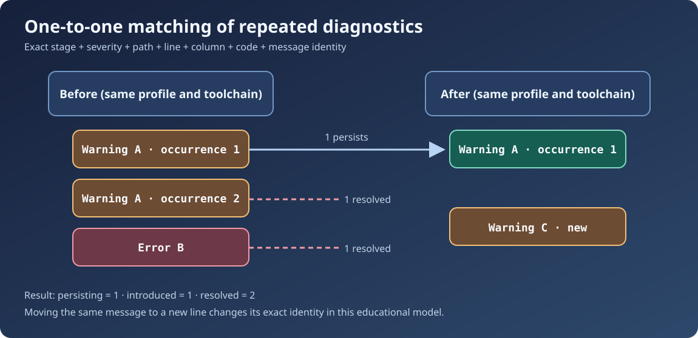

# Chapter 246 — Compare diagnostics across two builds

**Bits to Banking · Engineering track · Umicom Foundation**  
**Primary language:** C23 · **Source:** `BtbEvidenceCompare`  
**Prerequisites:** Chapters 244–245 and C arrays.

## Why this matters

A new batch may compile with fewer errors but still introduce a regression. Merely comparing total warning counts is insufficient. If the previous build had three warnings, and the new build also has three, two might have been fixed while two different warnings appeared. A maintainer needs an explicit record of **introduced, persisting and resolved occurrences**, not a flattering aggregate.

The educational laboratory compares two **sealed**, already-normalised `BtbEvidenceRun` values. It never reads the Git repository or parses compiler output. A higher-level Umicom application should obtain the source observations and diagnostic records through existing Framework services, then invoke this small teaching model only as a demonstration of comparison rules.

## Define an exact diagnostic identity

A problem matches an older one when stage, severity, path, line, column, code and message are equal. The comparison is deliberately exact. It does not guess that two messages with changed line numbers describe the same defect, nor merge different warnings because their message text looks similar.

This rule has a consequence: moving unchanged source down ten lines can count as one resolved and one introduced diagnostic. That is not an algorithm bug; it is a limitation of location-based identity. A mature Framework facility could add stable diagnostic IDs, semantic source ranges or audited suppression fingerprints. This lab makes no such claim.

## Multiset comparison, not set comparison



Sometimes a tool reports the same diagnostic more than once. If the old run contains two identical occurrences and the new run contains one, the correct result is one persisting plus one resolved. Treating duplicates as a set would incorrectly report no change.

`BtbEvidenceCompare` maintains a small array of booleans marking which previous occurrence has already been matched. Every current problem may consume at most one previous occurrence. The procedure is intentionally O(n²), but with a maximum of 24 entries it is deterministic and easily inspected. It needs no heap allocator or global index.

## Call the review function

```c
BtbEvidenceComparison report = {0};
BtbEvidenceResult status = BtbEvidenceCompare(&before, &after, &report);
if (status == BTB_EVIDENCE_OK) {
    /* report.introduced, report.resolved and report.persisting are valid. */
} else if (status == BTB_EVIDENCE_INCOMPARABLE) {
    /* Different build profiles or toolchains: establish a new baseline. */
}
```

`before` and `after` must contain sealed snapshots constructed previously. The output is assigned only on success; an invalid or incomparable pair does not partially erase an earlier report.

## Understand source and toolchain compatibility

Compare like with like. A `windows-ucrt64-all-debug` GCC run and a `gtk4-debug` Clang run may naturally emit different diagnostics and build different modules. They should not be reported as a direct regression pair. The lab explicitly rejects comparisons with a different profile or toolchain label. That refusal is information, not an error to override silently.

You may still run **two separate** comparisons: previous GCC to current GCC and previous Clang to current Clang. Store each result alongside its full source revision and build configuration. Umicom Framework's build history is the appropriate production authority for retaining that evidence.

## Practical exercise

Run the tests `compare_resolved`, `compare_introduced`, `compare_persisting`, `compare_duplicate_multiset`, `compare_line_shift` and `compare_toolchain_refused`. For each case, predict the three counts **before** running the executable. Examine the expected values in `test_evidence.c`. Then change only the local copy of the fixture line number and explain why a formerly matching problem is reclassified.

## Assessment

**Is fewer total warnings always progress?** No; some warnings may be newly introduced. **Why compare full messages rather than a hash?** Exact bounded bytes avoid accidental collisions in this small lab. **What if toolchain differs?** Return `INCOMPARABLE` and gather a comparable baseline, rather than fabricate a regression number.

**Next:** Chapter 247 explains how missing or truncated evidence blocks conclusions.
