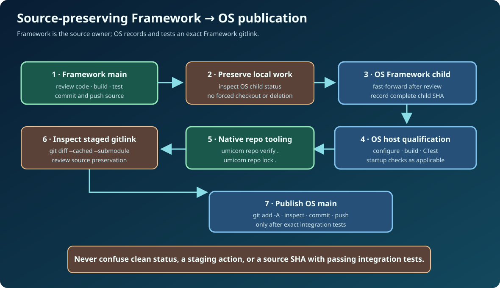

# Chapter 251 — Capstone: Framework-first Git and build review

**Bits to Banking · Engineering track · Umicom Foundation**  
**Primary language:** C23 · **Deliverable:** a reproducible engineering evidence note  
**Prerequisites:** Chapters 228–250.

## Scenario

A fictional Umicom Bank contributor reports a compiler warning in shared Framework finance code. Another contributor says the warning was fixed on `main`, but the Umicom OS integration still points to a previous Framework commit. The team must establish which source was actually tested, whether the warning persists, and whether it is safe to update a parent gitlink. **Do not use live banking code to simulate a defect.** The supplied native C23 demonstration already contains the complete fictional case.

Your task is to produce a professional, reviewable investigation that distinguishes repository truth, compiler diagnostics, test evidence and release decision. No part of the exercise needs to write or modify an actual Umicom repository through a program.

## Part A — Inspect, don't mutate



From the root of your local Umicom Applications checkout:

```powershell
Set-Location "C:\umicom\Umicom-Applications"
git status
git rev-parse HEAD
git -C ".\framework" rev-parse HEAD
git -C ".\framework" status --short
git diff --submodule=log -- framework
```

Next inspect the same Framework reference inside Umicom OS if its repository exists locally:

```powershell
Set-Location "C:\umicom\umicomOS"
git status
git ls-files --stage -- framework
git submodule status framework
git -C ".\framework" log -1 --oneline
```

Copy the observed SHAs into a private engineering note. Do not replace them with the fictional example SHAs in the laboratory. If a working tree contains uncommitted or untracked source, stop the update and preserve that work before any checkout operation.

## Part B — Build and verify a known educational source

Return to the Bits2Banking repository and build the new native C23 laboratory:

```powershell
Set-Location "C:\umicom\Umicom-Bits2Banking"
$env:Path = "C:\msys64\ucrt64\bin;$env:Path"
cmake -S ".\labs\native\build-evidence" `
  -B ".\output\learning-build\build-evidence" -G Ninja `
  -DCMAKE_C_COMPILER="C:\msys64\ucrt64\bin\gcc.exe" -DBUILD_TESTING=ON
cmake --build ".\output\learning-build\build-evidence" --parallel 2
ctest --test-dir ".\output\learning-build\build-evidence" --output-on-failure
& ".\output\learning-build\build-evidence\btb-build-evidence-demo.exe"
```

Verify that CTest actually executes each case. The demonstration prints a fictional regression comparison: an old error is resolved in the newer sample and twelve sample tests pass. Those labels are not observations about your real Bank or OS repositories.

## Part C — Classify evidence carefully

Open `evidence.h` and `evidence.c`. Explain why `BtbEvidenceRunInit` rejects an abbreviated commit, why `BtbEvidenceAddProblem` copies its bytes, why tests cannot be recorded before the build outcome, and why `BtbEvidenceCompare` refuses incompatible profile/toolchain pairs.

Run the named negative cases:

```powershell
& ".\output\learning-build\build-evidence\btb-build-evidence-test.exe" assessment_stale_sha
& ".\output\learning-build\build-evidence\btb-build-evidence-test.exe" assessment_dropped
& ".\output\learning-build\build-evidence\btb-build-evidence-test.exe" compare_toolchain_refused
```

A passing negative test means the component correctly **refused** misleading evidence. It does not mean a stale, truncated or incomparable build can be accepted.

## Part D — Use Framework when the SDK is available

If an installed Framework SDK exports `Umicom::vcs` and `Umicom::build`, configure the optional SDK target using Chapter 249. It must link Framework's actual libraries and reuse `UmiVcsWorkingTreeRead` and `umi_build_parse_diagnostic_line`. If you do not have a compatible installed SDK, record the optional integration gate as *not run* rather than inventing a passing result.

The read-only `--repo` example inspects the current checkout; it does not stage, commit or push any changes. A future production integration needs full test evidence, security policy, user approvals, and a Framework-owned repository action rather than expanding this educational model into an unreviewed Git client.

## Part E — Produce the review note

Your completed evidence note should include the following information in prose or a table: problem statement; source and repository owner; full Framework SHA; parent Umicom OS SHA and Framework gitlink; branch/detached state; local changes and whether they were preserved; build profile; compiler and ABI; first failing stage; full diagnostic; failed/not-run test counts; before/after comparison and its limitations; current outstanding gates; recommended minimal fix and rollback path.

A useful review can conclude **“not ready; further evidence required”**. That is a successful engineering judgement when the current evidence is incomplete.

## Part F — Publishing after actual acceptance

Only after reviewing the intended changes and completing the real required tests may the maintainer commit the affected repository directly on its established `main` branch:

```powershell
git status
git branch --show-current
git add -A
git diff --cached --check
git diff --cached --stat
git commit -m "fix(framework): correct reviewed build diagnostic integration"
git push origin main
```

**The example commit message is instructional.** Do not commit a fictional fix or stage unrelated work. In Umicom's multi-repository workflow, commit the actual Framework source first, then update and test each parent's gitlink, then commit that parent separately. No force pushes, hard resets, destructive cleaners or silent source removal.

## Instructor review and completion rubric

Award full credit only when the learner can: distinguish `HEAD` and `main`; interpret parent gitlinks; preserve dirty source; identify the earliest **observed** failing stage without claiming it proves the root cause; correctly handle malformed/stale diagnostic records; reproduce the standalone C23 tests; state which SDK/platform checks were not run; and produce correct direct-to-main Git commands with a staged review.

**Completion criterion:** a reproducible, source-preserving investigation with honest evidence boundaries. The goal is not to obtain a green badge at any cost; it is to explain exactly what the evidence establishes.

**Next major update:** extend real Framework SDK acceptance, non-destructive Git automation contracts and product-level build/launch qualification without introducing Python or PowerShell implementation scripts.
