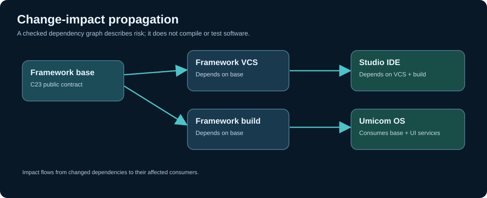

# Chapter 252 — Change impact is an engineering decision, not a filename search

**Bits to Banking · Engineering track · Umicom Foundation**  
**Primary implementation language:** ISO C23  
**Practical source:** `labs/native/change-impact/impact.h`  
**Prerequisites:** Chapters 240–251; basic Git; C structures and bitwise operations.

## The production problem

A developer changes `framework/src/vcs/working_tree.c` and the Framework tests pass. Is Umicom Studio IDE ready to publish? Is Umicom OS ready to update its Framework submodule? Neither conclusion follows. Framework tests establish something about a particular Framework source revision under a particular toolchain. They do not automatically prove that Studio can still display Git status, that an OS desktop launches, or that an installer includes the correct Framework libraries.

A **change-impact review** answers three separate questions: **What changed? Which consumers may be affected? Which verification results would justify proceeding?** These questions belong to different systems. Umicom Framework's VCS module can observe what Git says; its build and test services can capture actual execution. An impact policy decides which previously identified modules and tests matter for a proposed integration. Umicom Framework **already owns that production planning capability** through `include/umicom/build/automation.h`: `UmiBuildAutomation`. This chapter explains its underlying ideas using a deliberately small classroom model; do not introduce a competing application-local planner.

## Mental model: a dependency graph

A dependency graph contains *nodes* (modules) and *directed edges* (one module requires another). If `applications.studio` depends on `framework.vcs`, a change in `framework.vcs` can affect Studio even when no Studio source file changes. The **direction of impact** is therefore opposite to the direction of dependency.



The teaching graph contains `framework.base`, `framework.vcs`, `framework.build`, `framework.ui`, `applications.studio`, `applications.trader`, `applications.bank` and `os.desktop`. These are **illustrative nodes**, not an automatically discovered inventory of your live repositories. The executable laboratory displays a smaller, four-node example so its output can be checked by hand.

## Four distinct sources of truth

| Concern | Authoritative information | What it does not establish |
|---|---|---|
| Changed files | A Git observation from Umicom Framework VCS | Business significance, ABI risk or passing tests |
| Module dependency | Reviewed build metadata and module contracts | That the specific source revision compiled |
| Build and tests | Captured toolchain configuration and actual test outcomes | That upstream consumers or physical OS images work |
| Release decision | Reviewed evidence, controls and owner approval | Approval cannot be inferred from a green unit test alone |

For a real investigation, record the complete source commit identifier, status of tracked and untracked files, branch or detached-HEAD condition, and exact parent submodule pointer. A clean working tree is useful evidence; it is not the same thing as a successful build or a published commit.

## Check an actual repository without changing it

```powershell
Set-Location "C:\umicom\Umicom-Applications"
git status
git branch --show-current
git rev-parse HEAD
git -C ".\framework" rev-parse HEAD
git -C ".\framework" status --short
git diff --submodule=log -- framework
```

These commands inspect local state. `git rev-parse HEAD` in the parent and in the submodule returns two distinct commit identities. If the Framework directory is detached, its commit remains meaningful even though `git push` without a branch fails. Do not assume the parent's recorded pointer changed just because the submodule checkout advanced.

## Building the learning model

Open `impact.h`. `BtbImpactGraph` owns at most twelve module records. Each module stores an identifier, a bitset of dependencies and a bitset of required verification categories. `BtbImpactPlan` stores a copied full commit SHA, the original changed-module mask, the transitive affected-module mask and the union of required gates. No function reads the filesystem.

```c
BtbImpactGraph graph;
BtbImpactGraphInit(&graph);
size_t baseIndex = 0U;
size_t uiIndex = 0U;
BtbImpactAddModule(&graph, "framework.base", BTB_GATE_BUILD, &baseIndex);
BtbImpactAddModule(&graph, "framework.ui", BTB_GATE_BUILD | BTB_GATE_UI, &uiIndex);
BtbImpactAddDependency(&graph, uiIndex, baseIndex);
```

A consumer's dependency is recorded as a bit in its own record. When `framework.base` changes, the planner includes both `framework.base` and `framework.ui`. It does not automatically assign the same meaning to every file with the word `base` in its name: real ownership must be established separately.

## Failure and review boundaries

A file-path-only impact checker can miss generated headers, shared ABI contracts, build configuration, security policy, runtime resources and installed dependencies. A graph that omits a consumer will likewise produce an incomplete plan. That is why the teaching graph must be reviewed and cannot certify a production change. Its strict input validation is valuable, but cannot make incomplete source evidence complete.

**Practice:** Identify one real Framework header consumed by two Umicom applications. Record its dependants and three tests that would give stronger evidence than compiling the header alone. For each test, state the exact target and platform. Do not change any repository for this exercise.

**Review questions:** Why is dependency direction opposite to impact direction? Which source confirms an OS gitlink? Why can't a passing Framework CTest suite prove a GTK4 desktop or QEMU boot? What would make a change-impact inventory incomplete?

**Next:** use Framework's actual Git observation contract without adding another Git parser.
