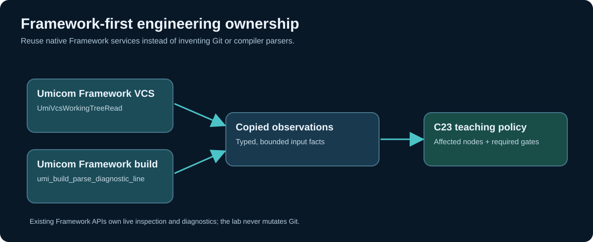

# Chapter 253 — Read repository state with existing Umicom Framework VCS

**Bits to Banking · Engineering track · Umicom Foundation**  
**Primary language:** C23 · **Existing owner:** `Umicom::vcs`  
**Relevant public header:** `framework/include/umicom/vcs/working_tree.h`.

## Start at the public contract

Umicom Framework already exposes `UmiVcsWorkingTreeRead`, `UmiVcsWorkingTreeDescribe`, `UmiVcsWorkingTreeEntryAt` and `UmiVcsWorkingTreeDestroy`. Before inventing a repository scanner, inspect these APIs in your actual Framework checkout. The API performs a bounded, read-only Git observation, reports status by `UmiStatus`, and returns an opaque tree whose entries remain borrowed until destruction. **Bits2Banking must not implement another production Git client.**



The `UmiVcsWorkingTreeSummary` model distinguishes `staged`, `untracked`, `conflicts`, `child_commits`, `dirty_children`, `detached` and `divergence_known`. These fields have separate meanings. For example, `detached` says how HEAD is currently attached, while `child_commits` describes changed gitlinks. An unknown ahead/behind count is not the same as zero divergence. A parent may be clean while an initialised child has uncommitted changes.

## Memory and lifetime walkthrough

```c
UmiVcsWorkingTree *tree = NULL;
UmiVcsWorkingTreeSummary summary = {0};
UmiVcsWorkingTreeRequest request = {
    .repository_root = "C:/umicom/Umicom-Applications",
    .git_program = "git",
    .timeout_ms = 30000U,
    .cancellation = NULL
};
UmiStatus status = UmiVcsWorkingTreeRead(&request, &tree);
if (status == UMI_STATUS_OK) {
    status = UmiVcsWorkingTreeDescribe(tree, &summary);
}
UmiVcsWorkingTreeDestroy(tree);
```

The returned `tree` is **owned** and must be destroyed once no more entries are needed. A pointer returned by `EntryAt` must not be saved into an asynchronous GTK4 callback after the tree is destroyed. Copy the required identifiers and state into an application-owned record instead. Never treat a formatted display string as a safe Git path: Framework retains original raw bytes because paths may contain control characters or whitespace.

The `timeout_ms` value is a bounded observation limit, not a guarantee that every possible Git remote operation finishes. The call does not stage or fetch anything. It must run on an appropriate worker if invoked by an interactive application; do not block the GTK4 UI thread waiting for a subprocess.

## Why `git status --short` alone can mislead

A human reading `git status --short` sees tracked and untracked changes, but a naive line parser can fail on filenames containing newlines, unusual bytes, renamed paths and submodules. Framework's structured VCS contracts avoid rebuilding such logic in each product. The native read path parses supported NUL-delimited porcelain records with explicit size limits. A record that cannot be safely represented is not silently treated as clean.

For human diagnosis, these commands remain valuable:

```powershell
Set-Location "C:\umicom\umicomOS"
git status
git submodule status framework
git ls-files --stage -- framework
git -C ".\framework" status --short
git -C ".\framework" branch --show-current
```

`git ls-files --stage -- framework` identifies the gitlink recorded in the parent index. `git submodule status framework` shows the checked-out child SHA and a leading marker when appropriate. Those are **different** from the remote `main` SHA; do not conflate them.

## Walkthrough: detached HEAD is not an error by itself

A submodule commonly checks out a specific commit in detached HEAD. `git push` with no branch therefore reports “not currently on a branch”. Pushing `origin main` from that directory instead targets the **local branch named `main`**, which may be behind remote `main`; a non-fast-forward rejection does not mean your detached commit was pushed. Inspect each identity before taking action:

```powershell
git -C ".\framework" rev-parse HEAD
git -C ".\framework" rev-parse main
git -C ".\framework" rev-parse origin/main
git -C ".\framework" log --oneline origin/main..HEAD
```

Do not switch, stash-pop or rebase when the last command reveals unpublished commits until their preservation is reviewed. Do not force a submodule update over local files. A safe synchronisation procedure is developed in Chapter 260.

## Framework integration exercise

Open the optional `framework_example.c` in the new lab and compare its types and function calls against the installed SDK. It links `Umicom::vcs` and `Umicom::build`; it does not compile private Framework implementation files. If the target SDK is not installed, do not claim the optional example passed. The C23 impact model itself remains independently testable.

**Questions:** What is an owned observation? What invalidates a borrowed entry? Why is `divergence_known` important? What does a gitlink represent? Why does the standard Framework CLI `umicom repo lock .` stage a parent pointer rather than run `git push`?

**Next:** follow module dependencies and determine which validation gates a change can affect.
