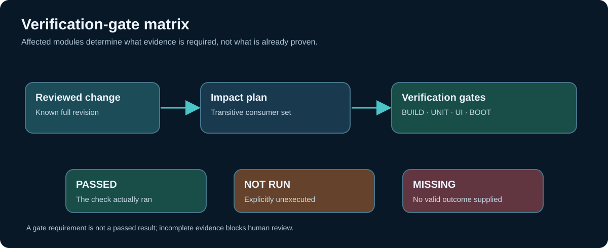

# Chapter 256 — Map affected modules to verification gates

**Bits to Banking · Engineering track · Umicom Foundation**  
**Lab:** `labs/native/change-impact` · **Required knowledge:** Chapter 255.

## A dependency list is not a test plan

A source change may propagate into Umicom Studio and Umicom OS, yet each consumer requires different evidence. A GUI consumer needs to open correctly and respond to interaction; a native library needs compilation, linkage and focused tests; a diskless OS image requires an actual QEMU boot before claiming boot readiness. Every gate must therefore represent a distinguishable kind of observation, not simply another name for “passed”.

In this batch, `BTB_GATE_BUILD`, `UNIT`, `INTEGRATION`, `UI`, `BOOT`, `SECURITY`, `PACKAGE` and `SMOKE` are **teaching categories** represented by bits. The exact test executables, platforms and profiles belong in a real Framework qualification plan. A bit says that evidence is required; it does not say which specific test proves the category was met.



## Work through a real-world-style example

Consider the fictional graph in `impact_demo.c`. `framework.base` provides common contracts. `framework.vcs` depends on it. `applications.studio` depends on the VCS node, while `os.desktop` depends directly on base. When base changes, the planner marks all four nodes as affected and combines their gates. It requires at least build, unit, integration, UI, boot and security checks where configured. The executable prints the exact bitmask so the reader can match it to `impact.h`.

The first fictional evidence record marks every required gate except `BOOT` as passed, and records `BOOT` as not run. The evaluator correctly blocks further review. The second fictional record marks `BOOT` passed and becomes *eligible for human review*. Neither record constitutes an actual QEMU run or an approval to publish a release.

## Three failure states that must remain distinct

| Evidence | Meaning | Correct response |
|---|---|---|
| Failed | A check executed and reported failure | Investigate the failing stage, preserve full output |
| Not run | The check was explicitly skipped or could not start | Do not claim completion; explain the prerequisite |
| Missing | No trustworthy outcome was supplied | Treat the gate as unverified, not as successful |

The code preserves these distinctions through `passedGates`, `failedGates` and `notRunGates`. A gate cannot be in more than one category. `BtbImpactAssess` refuses overlapping masks as malformed evidence. Valid masks are limited to `BTB_GATE_ALL`; unknown bits cannot silently become new tests.

## Why “all unit tests passed” is not enough

Some important problems are outside unit-test coverage. A GTK4 component may fail to find its runtime DLLs when double-clicked, even though its model unit tests pass. A customer-facing banking workflow may require maker-checker and audit checks before it can be used. An OS kernel image may compile but fail to reach the recovery prompt under QEMU. A Git submodule may be pinned to an older revision than the one built on the developer's workstation.

The correct plan makes these gaps explicit. This batch teaches the classification without inventing automatic tool orchestration or an unreviewed release manager.

## Hands-on verification

```powershell
Set-Location "C:\umicom\Umicom-Bits2Banking"
& ".\output\learning-build\change-impact\btb-change-impact-demo.exe"
& ".\output\learning-build\change-impact\btb-change-impact-test.exe" assess_not_run
& ".\output\learning-build\change-impact\btb-change-impact-test.exe" assess_missing
& ".\output\learning-build\change-impact\btb-change-impact-test.exe" assess_failed
```

Observe the demo's `reasons` before and after the fictional boot gate. Read the test source to confirm that **not run** and **missing** produce different reasons. Do not change the output just to make a red gate disappear; supply or acquire the real missing evidence.

## Exercises

Design a gate table for an Umicom Notes application, a GTK4 Studio editor and the OS boot image. Include the exact observable completion condition for each gate: e.g. “the Notes save/restore regression passed”, “the Studio window launched by double-click without missing DLL errors”, and “the QEMU guest reached the documented recovery prompt”. Which gates should run when a shared storage contract changes? Which are not justified when only a documentation typo changes?

**Review questions:** What is the difference between a gate requirement and a passed result? Why is `not run` not success? Why does a GUI integration require different evidence from a C23 unit library? Who approves the final production gate policy?

**Next:** attach the supplied results to the correct source revision and preserve evidence completeness.
