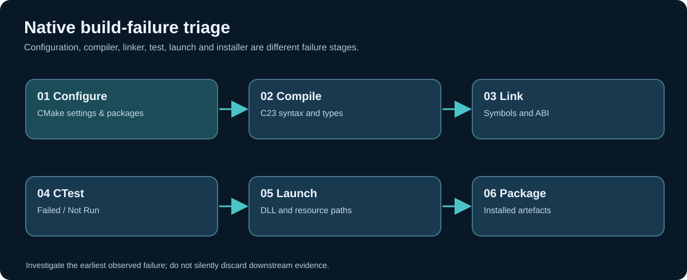

# Chapter 258 — Find the first failing CMake, compiler, linker or test stage

**Bits to Banking · Engineering track · Umicom Foundation**  
**Primary language:** C23 · **Reference Framework APIs:** `umi_build_parse_output`, `umi_build_parse_diagnostic_line`.

## Failures are a pipeline, not one generic red message

A native application passes through configure, compile, link, test, launch and packaging. Later stages may fail because an earlier stage was incomplete, because the produced artefact was incompatible, or because the environment changed. The first **observed** error is the best starting point for investigation; it is not automatically the **root cause**. An earlier incorrect configuration can lead to a later linker error, for example.



| Stage | Typical symptom | First evidence to inspect |
|---|---|---|
| Configure | CMake package or target not found | Full CMake error and cache variables |
| Compile | Missing declaration, incompatible type or warning | First compiler diagnostic, source path and flags |
| Link | Undefined symbol, wrong ABI, missing library | Command line, link order and exported symbols |
| Test | Assertion, exception, timeout, not run | Exact CTest case, log, exit code, dependencies |
| Launch | Missing DLL, incorrect CWD/resource path | Native process exit and installed runtime contents |
| Package | Missing resource or installer prerequisite | Staged component manifest and independent installation test |

## Use Framework's existing compiler parser

The current Umicom Framework has a public `UmiCompilerDiagnosticParseText` contract in `include/umicom/diagnostics/compiler_parser.h`. It recognises common GCC/Clang, MSVC and CMake locations. The `Umicom::build` API also provides `umi_build_parse_diagnostic_line` for a bounded `UmiBuildDiagnostic`. **Do not implement a new colon-splitting parser in Bits2Banking.** Windows paths contain a drive-letter colon, and compiler output may include ANSI control sequences, CMake paragraphs or unusual filenames.

```c
UmiBuildDiagnostic diagnostic = {0};
UmiStatus status = umi_build_parse_diagnostic_line(
    "C:/umicom/Umicom-Applications/framework/src/example.c:12:4: "
    "error: missing required declaration", &diagnostic);
if (status == UMI_STATUS_OK) {
    /* Inspect diagnostic.file, .line, .column and .message. */
}
```

The example is fictional and requires a compatible installed Framework SDK. A production Problems panel should consume normalized Framework diagnostics with stable identity rather than parsing its own copies of compiler text.

## A reproducible command sequence

To reproduce a build, start with the repository root, confirm the compiler and inspect the actual available presets. Do not invent a preset name; use what `cmake --list-presets` reports.

```powershell
Set-Location "C:\umicom\Umicom-Applications"
$env:Path = "C:\msys64\ucrt64\bin;$env:Path"
cmake --version
ninja --version
gcc --version
cmake --list-presets
```

For the established consolidated Windows configuration in this project, a known example is:

```powershell
cmake --build --preset windows-ucrt64-all-debug --parallel 2
ctest --preset windows-ucrt64-all-debug --parallel 2 --output-on-failure
```

Use it **only if that preset exists in the current checkout** and has been configured. The source of truth for exact preset names is the checked-out `CMakePresets.json` and its included files, not an old conversation or screenshot.

## Diagnose without suppressing failures

Do not delete the failing test, change a CTest return value or silence warnings without investigating them. If a new Framework module introduces an undefined reference, first establish the symbol's declaration, definition, export visibility and CMake target. If a source compile fails, retain the full file, credits, comments and old implementation while making a reviewed minimal correction. If a test reports `Not Run`, check whether its executable was built and whether a dependency failed; do not count it as passing.

**Guided lab:** Trigger the standalone test case `assess_failed` by direct execution (the case itself is expected to PASS because the gate is correctly blocked). Then explain how the real Framework compiler parser would produce a normalized record and which data must be retained for investigation.

**Exercises:** Design a triage table for a missing GTK4 DLL and for a C23 undefined symbol. Which is a launch failure, and which is a link failure? Explain how stale build outputs can produce misleading test evidence. Identify two cases in which the first diagnostic is secondary to an earlier configuration defect.

**Next:** inspect crashes, aborts, timeouts and CTest 'Not Run' outcomes as distinct classes of failures.
