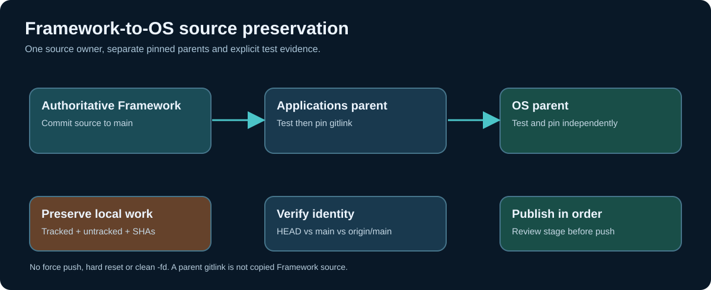

# Chapter 260 — Recover a blocked Framework submodule without losing source

**Bits to Banking · Engineering track · Umicom Foundation**  
**Primary language for project software:** C23 / Assembly · **Operator interface:** interactive PowerShell commands.

## The failure we are preparing for

A contributor runs `git submodule update --init --remote framework` under `C:\umicom\umicomOS`. Git refuses to proceed: dozens of tracked files have edits and newly created files would be overwritten by checkout. The correct response is **not** `git reset --hard`, `git clean -fd` or `git submodule update --force`. Git is protecting the worktree from a destructive checkout. The problem is repository state, not a compiler bug.

Umicom's authoritative Framework repository is shared by the **Applications** and **OS** checkouts. These two directories are separate Git working trees of the same underlying remote repository. Editing/copying Framework implementation independently into each checkout creates competing sources of truth. The established workflow is to change and commit Framework in `Umicom-Applications\framework`, then update the OS Framework pin after verifying that the child has no unpublished changes.



## Step 1 — Inspect before touching history

```powershell
Set-Location "C:\umicom\umicomOS"
git status
git -C ".\framework" status
git -C ".\framework" branch -vv
git -C ".\framework" rev-parse HEAD
git -C ".\framework" log --oneline origin/main..HEAD
git -C ".\framework" stash list
```

Look for three independent risks: uncommitted tracked edits, untracked files and unpublished commits reachable from detached HEAD. A stash does **not** by itself preserve commits that only exist on an unreferenced detached HEAD. If `origin/main..HEAD` contains commits, retain their full SHAs and stop for a recovery review before switching. Do not assume a clean worktree means all work is published.

## Step 2 — Preserve uncommitted changes deliberately

If the child contains uncommitted work and you have reviewed what it includes, save it without discarding it:

```powershell
git -C ".\framework" stash push --include-untracked `
    -m "backup: review Framework changes before OS synchronisation"
git -C ".\framework" stash list
git -C ".\framework" status --short
```

The command saves tracked changes and **ordinary untracked** files. Ignored build outputs are not included. A stash failure, remaining changes or unexpected ignored source requires manual review; do not continue on the assumption of safety. Keep a second independent backup for particularly valuable unpublished work.

The stored stash is local to **that Framework checkout**. It does not belong to the OS parent and does not automatically appear in `Umicom-Applications\framework`.

## Step 3 — Synchronise only a clean, reviewed checkout

First fetch and inspect:

```powershell
git -C ".\framework" fetch origin main
git -C ".\framework" log -1 --oneline origin/main
git -C ".\framework" log --oneline origin/main..HEAD
```

**Continue only if** the working tree is clean and you have established that no unpublished child commits would be abandoned. A clean child that is currently detached at a recorded parent SHA can use `git submodule update --init --remote framework`; alternatively, explicitly switch to a locally maintained `main` after the same safety review and use `git pull --ff-only origin main`. Never combine either operation with force. A fast-forward refusal is useful evidence that histories diverge.

```powershell
Set-Location "C:\umicom\umicomOS"
git submodule update --init --remote framework
git -C ".\framework" rev-parse HEAD
git submodule status framework
```

If a checkout complains about overwritten files again, stop. Recover the missing work before retrying.

## Step 4 — Review the stash against upstream, do not blindly pop it

```powershell
git -C ".\framework" stash list
git -C ".\framework" stash show --include-untracked --stat 'stash@{0}'
git -C ".\framework" diff --stat 'stash@{0}' HEAD
```

The last comparison does not by itself prove that every untracked file has been incorporated. Inspect the stash's complete contents and review the actual changes in Beyond Compare against current Framework. Do not delete the stash until any unique work has been deliberately recovered and verified. If the stash was created after additional changes, `stash@{0}` may no longer be the intended entry — select it by message and commit identity.

## Step 5 — Update the OS parent gitlink only after acceptance

Once Framework source is complete, run the required OS build and tests. The existing **Framework-owned** `umicom repo verify .` command can give a read-only parent-pointer preview, and `umicom repo lock .` stages checked-out submodule SHAs, not new remote commits. The OS does not need another custom Git script.

```powershell
Set-Location "C:\umicom\umicomOS"
git status
git diff --submodule=log -- framework
git add framework
git diff --cached --check
git diff --cached --submodule=log
```

After real tests pass and the staged gitlink points to the reviewed Framework revision, commit and push **the OS parent** on `main`. Do not push the Framework child again merely because a parent pointer changed.

```powershell
git branch --show-current
git commit -m "chore(os): synchronise tested Framework gitlink"
git push origin main
git status
```

## Completion and questions

The expected deliverable is a two-column evidence note: parent SHA and child SHA; worktree states; stash identity and recovery status; remote divergence; exact Framework gitlink before/after; build and test outcomes; and any blocked checks. Completing the safety review is more important than forcing the command to succeed.

**Review questions:** Why does `git stash` not automatically protect detached commits? Why can the parent Git repository be clean while the child is dirty? Which command stages a gitlink? Why must `git push origin main` be run from the correct repository? What evidence permits removing a saved stash?

**Next:** inspect native Framework VCS and build APIs directly with the optional C23 SDK example.
