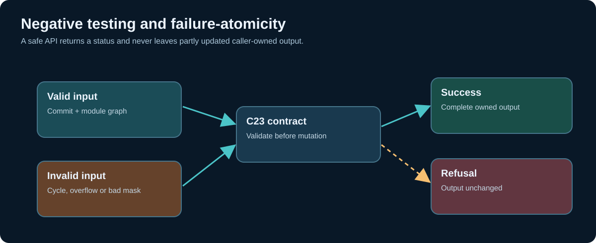

# Chapter 262 — Verify a C23 impact planner with negative and mutation tests

**Bits to Banking · Engineering track · Umicom Foundation**  
**Lab:** `labs/native/change-impact` · **Tests:** 43 named CTest registrations.

## The purpose of negative tests

A reliable systems component must do more than succeed on valid input. It must refuse malformed data, remain within memory limits and leave caller-owned output unchanged when an operation cannot be completed. A Git review tool is particularly sensitive to false success: a missing dependency or silently truncated error can make incomplete verification appear green.

This batch tests the teaching model through 42 named focused cases and one executable demonstration, registered by CMake/CTest. It uses one C23 test binary with a named case argument so a learner can run and debug a single scenario without spawning many custom wrappers. There are no Python test scripts or PowerShell implementation scripts.

## Configure, build and run on Windows

```powershell
Set-Location "C:\umicom\Umicom-Bits2Banking"
$env:Path = "C:\msys64\ucrt64\bin;$env:Path"
cmake -S ".\labs\native\change-impact" `
    -B ".\output\learning-build\change-impact" -G Ninja `
    -DCMAKE_C_COMPILER="C:\msys64\ucrt64\bin\gcc.exe" `
    -DBUILD_TESTING=ON
cmake --build ".\output\learning-build\change-impact" --parallel 2
ctest --test-dir ".\output\learning-build\change-impact" --output-on-failure
```

Expected on a compatible toolchain after merging: **43/43** tests. The reported Linux validation in this batch covers GCC and Clang ASan/UBSan, but those results are not a substitute for your Windows UCRT64 acceptance.

## Inspect the individual cases

```powershell
& ".\output\learning-build\change-impact\btb-change-impact-test.exe" cycle_indirect
& ".\output\learning-build\change-impact\btb-change-impact-test.exe" plan_atomic
& ".\output\learning-build\change-impact\btb-change-impact-test.exe" assess_overlap
& ".\output\learning-build\change-impact\btb-change-impact-test.exe" assess_atomic
& ".\output\learning-build\change-impact\btb-change-impact-test.exe" deterministic_mutations
```

- `cycle_indirect` attempts to introduce a dependency that would loop back to itself. It expects a cycle result and proves the existing graph bytes are unchanged.
- `plan_atomic` passes an invalid source revision and verifies that the output plan retains its previous contents.
- `assess_overlap` attempts to mark the same gate both passed and failed; the evaluator must reject contradictory evidence.
- `assess_atomic` supplies a malformed Boolean state and verifies that the previous assessment output has not been modified.
- `deterministic_mutations` uses a fixed xorshift seed for **50,000** plan/evaluation iterations. Every generated plan includes the changed modules, its gate bits stay in range, and intentionally stale revisions are blocked.

These are invariants, not a claim of exhaustive fuzz coverage. The test binary is single-threaded, and no external repository is accessed. AddressSanitizer and UndefinedBehaviorSanitizer provide additional checks where supported, but they cannot prove absent bugs outside exercised paths.

## Investigate one failure step by step

If a test unexpectedly fails, preserve the failing case name and output. Run just that case directly. Open `test_impact.c` at the reported line and identify the assumption that failed. Check the relevant public contract in `impact.h`, then inspect the production function in `impact.c`. Do not change test expectations simply to obtain a pass; either correct the implementation or document an approved contract change.

The tests use standard C23 with the compiler options `-Wall -Wextra -Wpedantic -Wconversion -Wshadow` on GCC/Clang. The laboratory CMake file also provides a separate optional Framework SDK target; it is **not** part of the 43 baseline tests because the SDK is not guaranteed to be present in an isolated educational ZIP.

## Draw the failure matrix



Construct a table pairing each API with at least one valid result, one malformed argument, one capacity edge and one output-preservation assertion. Verify that `BtbImpactAddModule` does not change the output index on failure, `BtbImpactAddDependency` does not add a cycle, and `BtbImpactAssess` returns a blocking result (rather than success) for stale but otherwise well-formed evidence.

**Exercises:** Add a targeted negative test for `BTB_GATE_PACKAGE` being omitted from a changed install target. Design a larger model that could support more than 64 modules without undefined shifts. Specify how you would test 0, 1, full capacity and overflow; do not simply increase the fixed array sizes without reviewing the memory contract.

**Review questions:** Why does a rejected API call preserve output? Why is deterministic mutation testing useful for reproducing failures? What does 43/43 actually prove? Which additional Windows and Framework SDK acceptance gates remain outstanding?

**Next:** complete a cross-repository release-impact review that explicitly separates evidence from assumptions.
