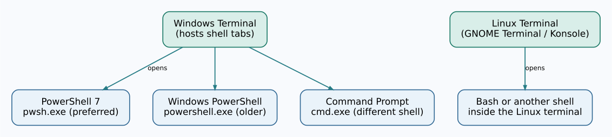

# Chapter 264 — Open a terminal and choose the correct PowerShell

**Bits to Banking · Absolute Beginner Course · Unit 1: Starting confidently**  
**Time:** 20–30 minutes · **Requirements:** a Windows 11 or Windows 10 computer; no developer account required.

## Why start here?

Before we use GitHub, build Umicom Framework or learn C23, we need a reliable place to type instructions. This place is called a **command-line shell**. You type a command and press **Enter**. The computer runs it and displays a result or a useful error. A command is not something mysterious: opening a folder, listing files and asking for the computer's name are ordinary examples.

The word **terminal** usually means the window that displays the shell. **Windows Terminal** is an application that can host several shells in tabs. **PowerShell** is one of those shells. **Command Prompt (CMD)** is another. On Linux, a terminal window commonly hosts Bash or another shell. A window and the programme running inside it are different things.

## The Windows search screenshot


The screenshot above shows why new users can be confused. **Windows PowerShell** is the older Windows edition, normally version 5.1. **PowerShell 7** is the newer cross-platform edition and starts with `pwsh`. **Windows PowerShell ISE** is an older editor for Windows PowerShell scripts; it is not the PowerShell 7 terminal we use in this course. **Windows PowerShell (x86)** is a 32-bit variant and is not appropriate for our default development setup. **Developer PowerShell for VS 2022** preconfigures Visual Studio compiler tools; we do not need it for the initial lessons. A result labelled **PowerShell** may be the newer application, but always check the version rather than guessing from the icon.



## Practice: open a shell from the Start menu

1. Save any unsaved work in other programmes.
2. Click the **Start** button, or press the **Windows** key on your keyboard.
3. Type **PowerShell** into the search box. Do not type a command yet.
4. If you have an entry called **PowerShell 7** or **PowerShell** under Apps, select it. If you only see **Windows PowerShell**, open that for now; Chapter 265 shows how to install PowerShell 7.
5. A window opens with a line ending in `>` (the **prompt**). That line is where the next command goes. Type the following **without copying the word `PS` or any example prompt text**:

```powershell
Get-Location
```

Press **Enter**. You should see a path, for example `C:\Users\Student`. Yours will be different. A path tells you where you are in the folder system; it is not your GitHub identity.

Now check your shell version:

```powershell
$PSVersionTable.PSVersion
```

If the major number is **7**, you are using PowerShell 7. If it is **5**, you are probably using Windows PowerShell 5.1. Both can run the basic commands in this chapter; for the remaining Windows lessons we prefer PowerShell 7.

## Start PowerShell 7 explicitly

If PowerShell 7 is already installed, type this inside your current PowerShell window:

```powershell
pwsh
```

A new PowerShell session starts. Run `$PSVersionTable.PSVersion` again to confirm version 7. If you see an error saying `pwsh` was not found, do not panic or start changing the PATH. The next chapter explains how to install it correctly. Use `exit` to leave the inner PowerShell session and return to the previous one.

## Command Prompt, DOS and PowerShell: a useful comparison

`cmd.exe` (Command Prompt) looks familiar to people who used DOS. Both accept textual instructions, but modern CMD runs on Windows, not on MS-DOS. PowerShell also accepts commands, but returns **structured objects** for many operations and has different quoting and pipeline rules. For example, `Get-Process` returns process objects with names, IDs and memory properties; it is not merely a block of display text. Knowing CMD is helpful, but do not assume every DOS command works identically in PowerShell.

On Linux, open the application normally named **Terminal**, **Konsole** or **GNOME Terminal**. Type `pwd` and press Enter to show the current directory. Chapter 271 introduces Linux alongside the equivalent Windows operations.

## Practice and review

Run `Get-Location` twice. Did your location change? Explain why not. Run `$PSVersionTable.PSVersion` and record whether you have version 5 or 7. Point at the screenshot and identify the *terminal window*, *shell*, *older ISE* and *32-bit shell* concepts. Finally, close the window using its close button; it will not uninstall anything.

**If something differs from the example:** report the exact command and the error text. Do not run unknown administrative commands merely to make the display match another person's computer.

**Next:** [Install the essential Windows tools](265-install-powershell-git-github-cli-and-editor.md).
