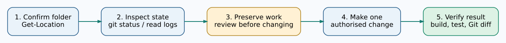

# Chapter 268 — Users, administrators, permissions and responsible changes

**Bits to Banking · Absolute Beginner Course · Unit 2**  
**Time:** 25–35 minutes. All mandatory exercises are read-only.

## One computer can have more than one authority level

A **user account** identifies the person or service acting on the computer. A **permission** controls which resources that account can read or change. An **administrator** can perform some system-wide changes that a standard user cannot. On Linux, a command prefixed with `sudo` can run with elevated privileges if the account is authorised. That extra authority is not required for browsing documentation, editing files in your home directory, creating a practice Git repository or running most learning tests.

Treat administrator privileges as a controlled exception, not a shortcut for fixing errors. A compiler build that unexpectedly requires administrator access may simply be writing to the wrong folder. First correct the workspace location; do not disable security controls.

## Identify the current account

In PowerShell:

```powershell
whoami
```

The output will normally contain a computer or domain name and a user name. That is **not** your GitHub account and does not need to match your Git author name. You can learn more about the current process's Windows access token using:

```powershell
whoami /groups
```

This produces a long list of Windows groups; some groups may be disabled for the current process. Do not assume membership means all privileges are currently enabled.

## Inspect permissions on your practice folder

```powershell
Get-Acl "$HOME\UmicomLearning" | Select-Object Path, Owner
```

An **ACL** (access-control list) records permissions associated with a resource. We are displaying the owner rather than modifying any ACL. Windows can inherit permissions from parent directories; changing them without understanding inheritance can block legitimate access.

## Why we avoid “Run as Administrator” for ordinary lessons

The screenshot in Chapter 264 shows a **Run as Administrator** option. It starts a shell with higher privileges after approval. Do not use it for Git commits or normal C23 builds. Elevated shells are more dangerous because a mistaken path can affect the whole computer. Some installations may legitimately prompt for elevation; follow the signed installer and your organisation's policy, then return to an ordinary PowerShell session.

## Think about Git access separately

Git can record local commits without connecting to GitHub. GitHub authentication allows the CLI to act on an online account. A **repository permission** determines whether an account may push to a particular remote repository. Signing into GitHub does not grant permission to push into every Umicom Foundation repository.

In future chapters, avoid putting passwords, API keys, access tokens or personal identifiers in Markdown files. A `.gitignore` file may keep a local file out of new commits, but once a secret has already been committed, ignoring the file does not remove it from history.



## Safe operating routine

Before changing any system or repository setting: identify the current folder; state what should change; inspect the current state; make a small change; verify the result; record how to reverse it. On financial and operating-system projects, additionally identify who owns the mutable state and what audit evidence will be retained.

**Practice:** Explain the difference between a Windows user, local administrator, Git commit author and GitHub account. Check your current account and folder owner. No permissions need to be changed.

**Next:** [Inspect processes, services and system events](269-processes-services-and-event-logs.md).
