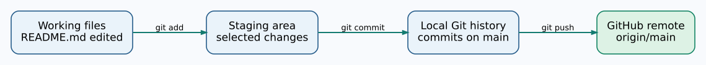

# Chapter 273 — Create a local Git repository and make two commits

**Bits to Banking · Absolute Beginner Course · Unit 3**  
**Time:** 35–50 minutes · **Mode:** local, no internet needed. The exercise uses your own practice folder only.

## What is version control?

Imagine editing the Umicom Notes guide each day. Without version control you might copy it into files called `README-final.md`, `README-final-2.md` and `README-final-really.md`, then lose track of which one is correct. **Git** records changes as commits with identifiers, authors and messages. You can inspect the history and compare versions without making a copy of the entire project each time.

A **repository** is a folder that Git tracks. A **working tree** is the set of files you are editing. The **staging area** records exactly which changes you intend to put in the next commit. A **commit** creates a history entry from those staged changes. A **branch**, such as `main`, names a line of history.



## Step 1 — Go to your practice Notes project

```powershell
Set-Location "$HOME\UmicomLearning\notes-practice"
Get-Location
Get-ChildItem
```

If the folder is missing, return to Chapter 266 and create it. You should see `README.md`. **Do not run these steps in `C:\umicom\Umicom-Applications`, `framework`, `umicomOS` or any real shared project.**

## Step 2 — Start local version control

```powershell
git init -b main
```

`git init` creates a hidden `.git` directory holding local history and configuration. `-b main` makes the initial branch `main`. This is an ordinary local operation. It does not create a repository on GitHub.

```powershell
git status
```

Git should report that you are on `main` and that `README.md` is not yet tracked. The exact message may differ if you previously practised here.

## Step 3 — See which file would enter history

```powershell
git add README.md
git diff --cached
git diff --cached --check
```

`git add` copies the current file content into the staging area. `git diff --cached` displays the proposed commit changes; `--check` reports certain whitespace problems. Confirm that the staged file contains only the text you expect.

Now commit:

```powershell
git commit -m "docs: add Notes project introduction"
```

The message describes **what changed**, not whether the author is pleased with it. The exact commit identifier is not important; every learner will get a different one.

## Step 4 — Edit and commit again

```powershell
Add-Content -LiteralPath ".\README.md" -Value "The Notes project will later be built in C23."
git diff
git status
```

`git diff` now shows the **unstaged** edit. When you are ready, stage everything in this *practice repository*:

```powershell
git add -A
git diff --cached --check
git diff --cached --stat
git commit -m "docs: describe the future C23 Notes lab"
```

`git add -A` includes file additions, edits and deletions throughout the current repository. It is convenient only after inspecting `git status` and verifying you are in the intended repository. The command does not create a commit by itself.

## Step 5 — Read your local history

```powershell
git log --oneline -5
git status
git branch --show-current
```

You should see two commits and the branch `main`. If Git says “nothing to commit, working tree clean”, that is expected. It means the files on disk match your latest local commit; it does **not** mean anything has been uploaded online.

## Exercise: observe the three locations

Change one word in `README.md` using Notepad, then run `git diff`. Stage it and compare `git diff` with `git diff --cached`. What changed? Did the commit history grow merely because you staged it? Finish with an explanatory commit. Do not use `reset --hard`, `clean -fd`, force push, or deletion commands while learning.

**Common issue:** “Author identity unknown” means the name or email is not configured. Return to Chapter 272. “Not a git repository” means you are outside your intended folder; use `Get-Location`.

**Next:** [Publish the repository using GitHub CLI](274-publish-the-repository-with-github-cli.md).
