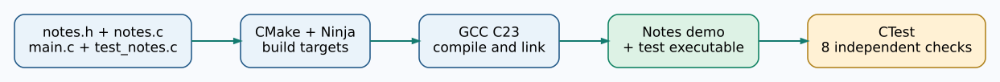

# Chapter 277 — Build and test a real C23 Umicom Notes programme

**Bits to Banking · Absolute Beginner Course · Unit 4**  
**Time:** 45–65 minutes · **Source:** `labs/native/contributor-notes`. This is a professional but intentionally small teaching laboratory.

## Start with a useful application, not a meaningless greeting

Our first compiled example is a simple Umicom Notes component. It can add, read and update short notes held **in memory**. It helps a new contributor understand source files, header contracts, libraries, executables and tests. It does **not** save notes to disk and does **not** replace the production document services in Umicom Framework. A banking or financial programme would additionally require durable storage, authorisation, audit, error recovery and domain controls.



## Step 1 — Open the correct repository and check tools

This chapter assumes you have already downloaded and **review-merged Update 37** into your Bits2Banking repository as described in the batch's root-level build guide.

```powershell
Set-Location "C:\umicom\Umicom-Bits2Banking"
Get-Location
$env:Path = "C:\msys64\ucrt64\bin;$env:Path"
gcc --version
cmake --version
ninja --version
```

Do not run the configure command from an arbitrary folder and then assume its relative paths will work. If you are using a personal clone elsewhere, change the `Set-Location` path to the exact location of that clone.

## Step 2 — Read the four core files

Open `labs/native/contributor-notes/notes.h`. A **header** publishes function declarations and types. `notes.c` defines the functions. `main.c` is the runnable example. `test_notes.c` contains independent checks. `CMakeLists.txt` describes how the compiled parts fit together.

Read the public function declaration:

```c
BtbNotesResult BtbNotesAdd(BtbNoteStore *store,
                           const char *text, uint32_t *outId);
```

This function receives a caller-owned Notes store, copies a text value into it, and provides the new identifier through an output pointer. The result tells the caller whether the operation succeeded. An invalid or full request must not silently change the existing Notes data.

## Step 3 — Configure the build

Copy this command into PowerShell as one complete command (the backticks continue a line):

```powershell
cmake -S ".\labs\native\contributor-notes" `
    -B ".\output\learning-build\contributor-notes" `
    -G Ninja `
    -DCMAKE_C_COMPILER="C:\msys64\ucrt64\bin\gcc.exe" `
    -DBUILD_TESTING=ON
```

`-S` points to source, `-B` to the generated build directory. `-G Ninja` selects the generator. `-DCMAKE_C_COMPILER` chooses the actual compiler. `-DBUILD_TESTING=ON` registers the tests. The build directory is separate from the source so we do not scatter object files through the lessons.

## Step 4 — Compile and test

```powershell
cmake --build ".\output\learning-build\contributor-notes" --parallel 2
```

The compiler converts the C23 files into object files. The linker makes a library and two programmes: a demonstration and a test runner. **A successful build does not guarantee correct behaviour**, so run CTest:

```powershell
ctest --test-dir ".\output\learning-build\contributor-notes" --output-on-failure
```

Expected: **8/8 tests passing**, including add, update, too-long input, capacity, missing record, invalid argument, copied ownership and the demo. This count is for the default standalone lab; an optional Framework SDK example can add another test if enabled.

## Step 5 — Run the programme

```powershell
& ".\output\learning-build\contributor-notes\btb-contributor-notes-demo.exe"
```

It should print two contributor Notes. The changed text of the first note demonstrates an edit. When the programme exits the notes disappear, because they were never written to permanent storage.

## Step 6 — Safe code exploration

Make a reviewed copy of the source if necessary. Edit **only the first note text in `main.c`**, leaving function signatures unchanged. Rebuild; notice which C file was recompiled. Rerun CTest and the programme. Compare with Git using `git diff -- labs/native/contributor-notes/main.c`, and do not accidentally stage changes to unrelated files. If you want to return to the delivered version, use your editor's undo or Beyond Compare review rather than forcing a reset.

**Review:** What is the difference between a `.h` file and a `.c` file? Which stage creates the `.exe`? Why does an output pointer need a validity check? What does 8/8 passing establish, and what does it not establish about saving bank records?

**Next:** [Read build errors and recover safely](278-diagnose-first-errors-without-deleting.md).
