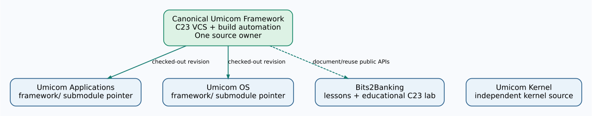

# Chapter 280 — Use Umicom Framework's native repository verification

**Bits to Banking · Optional Advanced Unit · Git and Framework integration**  
**Time:** 35–50 minutes · **Prerequisite:** Chapters 272–279 and a real Umicom checkout that you are authorised to inspect.

## Why we do not invent another Git automation script

Umicom Framework already contains native repository and version-control capabilities. Its built `umicom` command includes repository verification and controlled gitlink locking. A separate PowerShell script that parses Git output, stages submodules or constructs Git commands would duplicate this reusable implementation and introduce an additional maintenance risk. PowerShell remains useful for **typing individual build and Git commands interactively**; it does not own Umicom repository functionality.

**Important distinction:** `repo verify` previews actions; `repo lock` can stage a gitlink, changing the parent's Git index. Neither command fetches remote commits, commits a repository, pushes to GitHub or proves that any GUI or OS boot works.



## Step 1 — Know the actual repository layout

An Umicom Applications checkout may have `framework/` as a submodule. Umicom OS also has a `framework/` submodule pointing to the **same canonical Framework repository**, but each parent records its own tested revision. The Kernel is independent and does not use a Framework submodule in the same way. **Do not copy Framework source files between the two checkouts to synchronise them.**

## Step 2 — Inspect, without changing anything

Open PowerShell, then:

```powershell
Set-Location "C:\umicom\Umicom-Applications"
Get-Location
git status
git branch --show-current
git submodule status framework
git -C ".\framework" status --short
git -C ".\framework" rev-parse HEAD
```

If any output suggests local modifications, an unknown branch or unpublished changes, **stop**. Preserve the source and ask for a review before switching revisions. The parent Git history and submodule history are not the same.

## Step 3 — Run Framework-owned read-only verification

If your Framework native CLI has already been built, locate it at your actual build path. For the established Applications build preset, a common path is:

```powershell
$umicom = "C:\umicom\Umicom-Applications\build\windows-ucrt64-all-debug\bin\umicom.exe"
Test-Path $umicom
```

Continue only if the result is `True` and the binary is the reviewed tool from your own build:

```powershell
& $umicom repo verify .
```

This operation reports the intended gitlink state without staging it. Read every warning. If the executable is missing, build the native Framework tool through your approved CMake preset rather than downloading an unknown replacement.

## Step 4 — Understand the *write* boundary (do not execute in this exercise)

The corresponding staged operation is:

```powershell
# For an authorised, reviewed integration AFTER full build and tests only:
# & $umicom repo lock .
```

The leading `#` makes these lines **comments** so they will not change your repository when pasted. Actual release work requires separate evidence that the intended Framework commit has been built and tested with the parent application. Review `git diff --cached --submodule=log` before committing. The project owner decides when to stage and publish the updated pointer.

## Read Git's recorded pointer

```powershell
git ls-files --stage framework
```

A submodule entry uses mode **160000** and stores a commit identifier. That identifier is not a copy of Framework source. It is a reference to a commit in a separate repository. Checking out a newer Framework commit inside the child does not automatically update and publish the parent pointer.

**Review:** Why is the native `repo verify` preferable to a new script? What does `repo lock` change? What must pass before a parent gitlink is published? What does mode `160000` mean?

**Next:** [Call Framework's existing build planner from C23](281-call-existing-framework-build-planner.md).
