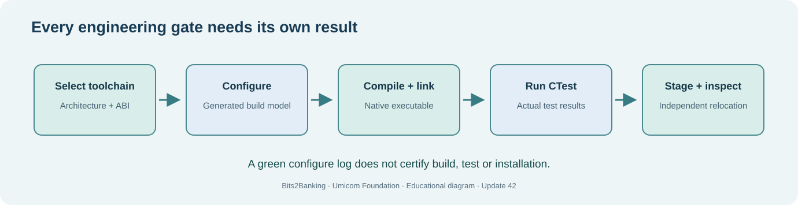

# Chapter 300 — Reproducible C23 builds and private installation staging

**Bits to Banking · Native engineering · Umicom Foundation**  
**Prerequisites:** System Administration Chapters 61–68; Engineering Chapters 296–299.  
**Laboratory:** `labs/native/deployment-rehearsal`  
**Implementation:** ISO C23, CMake declarations; interactive PowerShell or shell commands only.

## The problem

A program compiling is not the same as a trustworthy release. It may use the wrong compiler, accidentally depend on files in the build directory, or require a DLL that was available only in the developer's PowerShell session. A robust workflow records exactly what source was used, which build configuration was selected, whether automated tests passed, and which files were copied into a controlled installation directory.

The new laboratory is **additive**. Updates 39, 40 and 41 still own evidence, service readiness and maintenance transitions respectively. Update 42 owns only the *new* educational stage review and one CMake `install()` declaration for its demonstration executable. We do not rewrite a service manager, deploy a production service or add another Git client.



## Read the build definition

Open `labs/native/deployment-rehearsal/CMakeLists.txt`. It declares C23, enables CTest, adds the previous maintenance laboratory as a separate CMake subdirectory, links the new `btb-deployment-review-lib` against `btb-maintenance-review-lib`, and registers focused tests. The dependency chain is:

```text
sysadmin-evidence (Update 39)
    -> service-readiness (Update 40)
        -> maintenance-review (Update 41)
            -> deployment-rehearsal (Update 42)
```

This is composition: reuse one implementation through a target, not copy its `.c` files to a new project. Every link has a reason: the deployment review needs the earlier maintenance state, and the maintenance state depends on verified service observations.

The final lines include:

```cmake
install(TARGETS btb-deployment-review-demo RUNTIME DESTINATION bin)
```

This is a **declarative build rule**, not an additional scripting-language application. It means the demonstration executable can be staged under an explicitly selected prefix. It does not create a Windows service, change the registry or modify permissions on a system directory.

## Build on Windows using PowerShell 7

```powershell
Set-Location "C:\umicom\Umicom-Bits2Banking"
$env:Path = "C:\msys64\ucrt64\bin;$env:Path"
cmake -S ".\labs\native\deployment-rehearsal" `
  -B ".\output\learning-build\deployment-rehearsal" `
  -G Ninja `
  -DCMAKE_C_COMPILER="C:\msys64\ucrt64\bin\gcc.exe" `
  -DBUILD_TESTING=ON
cmake --build ".\output\learning-build\deployment-rehearsal" --parallel 2
ctest --test-dir ".\output\learning-build\deployment-rehearsal" --no-tests=error --output-on-failure
```

Read the CTest summary. If any test fails, **stop** rather than proceeding to installation. On a fresh checkout with Updates 39–42 merged, the test list includes inherited tests; count how many were discovered on your own host rather than quoting another computer's result.

## Stage into a private destination

Before installing, review the intended prefix. A private learning folder is safer than `C:\Program Files` or Linux `/usr/local` because no elevation should be necessary.

```powershell
Test-Path "C:\umicom\learning-stage-update42"
cmake --install ".\output\learning-build\deployment-rehearsal" `
  --prefix "C:\umicom\learning-stage-update42"
Get-ChildItem "C:\umicom\learning-stage-update42\bin"
& "C:\umicom\learning-stage-update42\bin\btb-deployment-review-demo.exe"
```

If the prefix exists and holds important files, choose a different empty location. `cmake --install` **does write files**; the lesson confines that write to the training prefix. The executable should print fictional gate decisions, not attempt a real deployment.

## Repeat on Linux

```bash
cmake -S labs/native/deployment-rehearsal -B output/learning-build/deployment-rehearsal -G Ninja -DBUILD_TESTING=ON
cmake --build output/learning-build/deployment-rehearsal --parallel 2
ctest --test-dir output/learning-build/deployment-rehearsal --no-tests=error --output-on-failure
cmake --install output/learning-build/deployment-rehearsal --prefix "$HOME/umicom-learning-stage"
"$HOME/umicom-learning-stage/bin/btb-deployment-review-demo"
```

No `sudo`, packaging framework or service-manager command is required.

## Diagnostic exercise: the difference between four successes

Assume CMake configuration succeeds and Ninja compilation succeeds, but one CTest case fails. Can the release be staged? Technically, the install rule might still run, but the **learning workflow** says stop and diagnose. Now assume all tests pass and `cmake --install` completes, but the relocated executable fails to start. The stage copy exists; runtime acceptance did not pass. Finally, assume the demonstration prints QUALIFIED. That output refers only to *fictional supplied evidence* inside the C23 teaching model; it is **not** evidence that Umicom Studio, Umicom Trader or Umicom OS is production-ready.

## Exercises and answers

1. **Where is code compiled?** In the designated build directory, not the source tree.
2. **What does `-G Ninja` select?** The build-system generator for CMake.
3. **Why use `--prefix`?** To confine staging to a known destination.
4. **What should be done after a failed test?** Record the failure, preserve source and investigate before staging.
5. **What is still not proven after the staged demo runs?** Cross-machine portability, production permissions, installer behaviour, cryptographic signing and real service readiness.

**Next:** Chapter 301, model stage evidence without duplicating Umicom Framework functionality.
