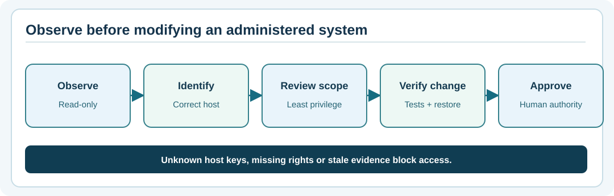

# Chapter 304 — Remote access is an authorisation boundary, not a socket feature

**Bits to Banking · Native engineering track · Umicom Foundation**  
**Implementation:** ISO C23; public Umicom Framework contracts govern reusable production behaviour.  
**Prerequisite:** System Administration Chapters 73–80 and engineering Chapters 300–303.

## The engineering problem

A desktop IDE can connect to a remote build host, a financial gateway can reach a venue, and an operations dashboard can query an Umicom OS service. Each looks superficially like “open a socket”, but the trusted operation is larger: verify the destination, authenticate the caller, enforce least-privilege policies, bind actions to an approved request, record traceable evidence, enforce time limits and provide a recovery path. A connection that succeeds technically may remain impermissible or operationally unsafe.

Developers must separate **transport establishment**, **remote identity**, **caller identity**, **capability authorisation**, **business state** and **review evidence**. A TCP connection is only one layer. Code that returns `success` because a socket opened has omitted most of the access decision.



## Framework ownership

The Umicom architecture delegates lifecycle through the Master Controller and domain Slave Controllers while keeping shared security, repository and observability contracts in Framework. Applications must consume those services rather than introduce their own SSH client, firewall editor or credential store. This batch remains in Bits2Banking and does **not** modify Framework or OS.

Update 42 already provided a pure C23 `BtbDeploymentReview` which classifies a staged, fictional release. Update 43 composes that proven object inside `BtbRemoteReview`. It does not parse credentials or establish a connection. This is a **teaching adapter**, not an access-control implementation. The distinction prevents learners from mistaking a classroom green light for security certification.

## Read the header before the implementation

Open `labs/native/remote-access-review/remote_access_review.h` and locate:

```c
BtbRemoteResult BtbRemoteInit(BtbRemoteReview *review,
                              const BtbRemotePlan *plan,
                              const BtbDeploymentReview *deployment);
BtbRemoteResult BtbRemoteAttach(BtbRemoteReview *review,
                                const BtbRemoteEvidence *evidence);
BtbRemoteResult BtbRemoteEvaluate(const BtbRemoteReview *review,
                                  BtbRemoteDecision *outDecision);
```

The caller owns all pointers. `Init` copies the plan and deployment. `Attach` copies one fictional evidence record and refuses a second attachment. `Evaluate` derives a result without changing state. All three operations return explicit result codes. Malformed records must not leave half-written outputs.

### Why no network code?

This lab asks a *policy* question: “If these externally supplied observations are valid, which review obligations remain unmet?” It must not silently turn that question into a live action. Real SSH or TLS needs host verification, credential handling, OS APIs, threading policy, sandboxing and audit; these are existing Framework responsibility areas subject to separate integration review.

## Worked scenario

A trainee supplies a plan for `notes-demo` with approved owner and reviewer labels. The learning deployment review reports `QUALIFIED`, but the operator did not independently verify the remote host key. `BtbRemoteEvaluate` returns `BLOCKED` with `BTB_REMOTE_MISSING_HOST_IDENTITY`. Even with all flags set, the most it returns is `REVIEWABLE`—meaning a human can inspect the fictional evidence, **not** that a real SSH login has been authorised.

The plan's host string is a label, not an automatically dialled address. No private keys, passwords, tokens, SSH banners or real identities are stored. This conservative boundary is intentional.

## Build in PowerShell

```powershell
Set-Location "C:\umicom\Umicom-Bits2Banking"
$env:Path = "C:\msys64\ucrt64\bin;$env:Path"
cmake -S ".\labs\native\remote-access-review" -B ".\output\learning-build\remote-access-review" -G Ninja -DCMAKE_C_COMPILER="C:\msys64\ucrt64\bin\gcc.exe" -DBUILD_TESTING=ON
cmake --build ".\output\learning-build\remote-access-review" --parallel 2
ctest --test-dir ".\output\learning-build\remote-access-review" --no-tests=error --output-on-failure
```

These are interactive PowerShell commands. **There is no new `.ps1` or `.py` implementation.** If the Update 39–42 libraries are absent, CMake deliberately stops and tells you which prior batch is needed.

## Questions and answers

1. Why is `REVIEWABLE` weaker than “authorised”? Because the lab has not authenticated an actual identity, verified a real host key or consulted a real policy owner.
2. Why store a source revision in both plan and deployment? It prevents a review for one revision from being presented as evidence for another.
3. Why is `BtbDeploymentEvaluate` called rather than copied? One implementation owns deployment review semantics and associated regression tests.

**Next:** Chapter 305 — applying fail-closed review logic in C23.
