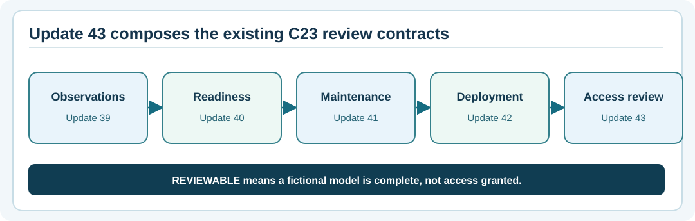

# Chapter 307 — Capstone: source-linked Umicom remote-support review

**Bits to Banking · Engineering track · Umicom Foundation**  
**Prerequisite:** Chapters 300–306 and System Administration Chapters 73–84.

## The goal

Produce a repeatable, well-evidenced C23 test run for an offline remote-access policy review, then write a change note explaining **exactly what that evidence can and cannot prove**. The goal is not to establish SSH connectivity. It is to practise the professional review process before a team would consider integrating reusable policy into Umicom Framework.

The source is in `labs/native/remote-access-review`. The latest package contains only its own `.c`, `.h` and CMake definitions. It inherits real prior C23 libraries through `add_subdirectory` and links their targets; no duplicate production VCS, deployment, recovery or authentication implementation is introduced.



## Step 1 — identify the exact source and build environment

In Windows PowerShell 7:

```powershell
Set-Location "C:\umicom\Umicom-Bits2Banking"
git status
git rev-parse HEAD
$env:Path = "C:\msys64\ucrt64\bin;$env:Path"
& "C:\msys64\ucrt64\bin\gcc.exe" --version
cmake --version
ninja --version
```

Write down the current commit ID, whether the working tree is clean and which compiler is active. A hash from `git rev-parse HEAD` describes the committed revision, **not** any new uncommitted lab files. If there are local changes, report them.

## Step 2 — configure and build

```powershell
cmake -S ".\labs\native\remote-access-review" `
    -B ".\output\learning-build\remote-access-review" `
    -G Ninja `
    -DCMAKE_C_COMPILER="C:\msys64\ucrt64\bin\gcc.exe" `
    -DBUILD_TESTING=ON
cmake --build ".\output\learning-build\remote-access-review" --parallel 2
```

Stop if CMake reports a missing prior batch. Merge Updates 39–42 first and preserve their existing files. Do not copy their source into the new library or replace a previous CMake file.

## Step 3 — run the tests

```powershell
ctest --test-dir ".\output\learning-build\remote-access-review" --no-tests=error --output-on-failure
& ".\output\learning-build\remote-access-review\btb-remote-access-review-demo.exe"
```

The inherited tests cover the service-evidence/deployment chain. The new tests separately cover invalid flags, missing host-key observations, source-revision mismatches, out-of-window observations and restoration without false promotion. Write down the actual CTest result on **your own machine**, including failing or not-run cases. The published validation report is reference evidence for the Linux build environment, not a substitute for Windows UCRT64 acceptance.

## Step 4 — inspect architecture and ownership

Review these exact symbols:

```c
BtbDeploymentEvaluate(...);  /* existing Update 42 policy */
BtbRemoteInit(...);          /* new teaching adapter */
BtbRemoteAttach(...);        /* copies one claimed observation */
BtbRemoteEvaluate(...);      /* read-only review decision */
```

Identify which function owns each decision. The new adapter never examines a local `.ssh` folder or receives an actual private key. Its review result is not authorised access. A production integration design would first inventory existing Umicom Framework security, VCS, configuration, service lifecycle and observability capabilities, agree API ownership and gain explicit project-owner approval for Framework changes.

## Step 5 — write an engineering report

Use this small structure:

| Field | Your evidence |
|---|---|
| Tested source revision and modified-file status | `git rev-parse HEAD`; `git status` |
| Host platform and compiler | Actual commands and outputs |
| CMake configuration | Selected build folder and options |
| Automated result | Observed passed/failed/not-run counts |
| Negative case checked | Case name and expected failure behaviour |
| Service/network changes | **None** (this lab is offline) |
| Production access authorised | **No** |
| Further work | Windows qualification, Framework integration design, authenticated evidence sources |

The report must not invent an approval or claim that the exercise has verified a real server identity. Store only non-sensitive local learning outputs; do not commit personal/private diagnostic logs to a public repository without review.

## End-of-stage examination

1. **Architecture:** Which repository owns reusable remote access and security services? **Umicom Framework**, after an approved design; an application uses its contracts.
2. **Evidence:** What does `REVIEWABLE` mean here? A fictional policy evaluation is complete; it is not an access grant.
3. **Testing:** What do you do when a Windows-only test fails? Retain the log, source revision, environment and first failure; do not delete code to make the count green.
4. **Git:** What must be checked before `git add -A`? The intended repository, current branch, staging diff and unrelated local work.
5. **Recovery:** Why is `RESTORED_ONLY` not `QUALIFIED`? The previous state may have been recovered after a failed change; the new release remains unsuccessful.

**Next learning theme:** Observability, role-scoped service deployment and rigorous operations evidence in practical Umicom applications, without shortcutting the Framework ownership model.
