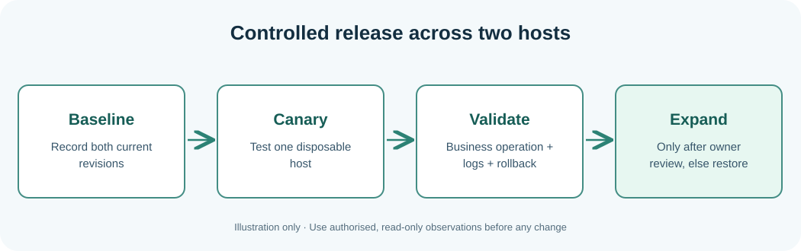

# Chapter 319 — Capstone: Framework-first multi-host support and release review

**Bits to Banking · C23 engineering track · Umicom Foundation**  
**Prerequisites:** Chapters 316–318 and System Administration Chapters 109–120.

## The architectural hand-off

Bits2Banking owns the **teaching curriculum and isolated native laboratory**. Umicom Framework owns reusable VCS observations, process execution, build diagnostics, change-impact planning, security and lifecycle capabilities. Umicom OS owns OS-specific integration and boot behaviour. The Kernel has separate privileged and boot acceptance tests. Do not copy the simulated `BtbFleetReview` implementation into each product; for a genuine feature, start by reviewing existing Framework services and extend them in C23 or Assembly only when a reusable capability is missing and the owner approves the change.

The Framework currently provides `UmiVcsWorkingTreeRead` and `UmiVcsWorkingTreeDescribe` for read-only Git status observations, `UmiCompilerDiagnosticParseText` for common compiler output, and `umi_build_automation_evaluate` for change-impact planning. These APIs can help identify source revision and verification scope. They **do not** automatically prove which binary has been deployed or which real host has completed a Notes business operation. Additional authorised evidence sources would be required.



## Capstone input

A fictional Umicom release process reports: `notes-gateway` runs revision A and its service answers HTTP; `notes-storage` claims revision A but its package checksum differs; the Notes save fails; the last independent storage restore drill is beyond policy; clocks disagree; an attempted revision B was rolled back. An engineer wants to run `git push` because the repository is clean. Explain why this cannot repair the service and why a clean repository is unrelated to production release qualification.

Prepare an evidence review with the four state names and a separate status for each host. If a host is unobserved, report PENDING. If a hard service failure is observed, report BLOCKED. If previous software was independently restored after a failed update, record RESTORED_ONLY and preserve the original Failed outcome. REVIEWABLE is available only for complete fictional evidence; a real release would still need authorised approval and business-facing acceptance.

## Practical PowerShell workflow

```powershell
Set-Location "C:\umicom\Umicom-Bits2Banking"
git status
git branch --show-current
cmake --build ".\output\learning-build\fleet-readiness" --parallel 2
ctest --test-dir ".\output\learning-build\fleet-readiness" --no-tests=error --output-on-failure
& ".\output\learning-build\fleet-readiness\btb-fleet-readiness-demo.exe"
```

These operations read the learning repository, build the lab and run deterministic fictional tests; they do not push code, create a Windows service or contact a remote host. To make a real Umicom Framework change, follow the approved Framework-first repository workflow: review changes, build and test the Framework, commit/push Framework on `main`, update and test the Applications and OS gitlinks separately, and only then publish their parent repositories. Avoid hard resets and force pushes that could remove unpublished work.

## Written deliverables

1. A source and dependency diagram showing Framework, Studio, the Notes gateway and Notes storage.
2. A table that separates **Git source revision**, **built artifact digest**, **OS version**, **service observation** and **Notes save result**.
3. A list of at least five missing or failed controls, with owners and safe next actions.
4. A full native CTest result and a clear statement of whether Windows UCRT64 and the published MkDocs website have been verified.
5. A concluding paragraph distinguishing **engineering evidence** from **deployment permission**.

## Completion standard

A correct submission preserves all previous evidence and does not claim that deterministic laboratory tests certify a real Umicom deployment. The next advanced exercise can add a Framework-owned adapter for authorised observations only after public contracts, security permissions and host-level acceptance tests have been reviewed. No Python/PowerShell executable automation is introduced.
