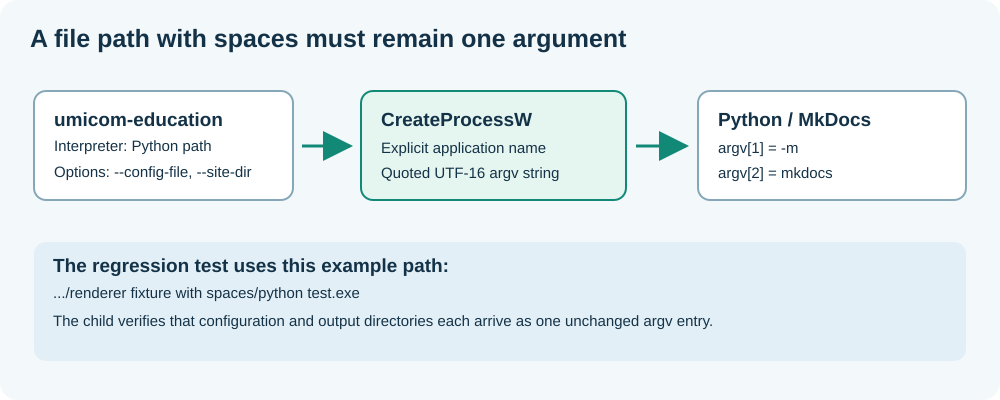

# 56. Diagnose a Windows program path containing spaces

A programme can compile correctly and still fail when it starts another executable. The failure may be in its **process launch** rather than in the executable it is trying to run. This lesson follows a real issue in the native Umicom Education utility and shows how to test the correct boundary.



## 1. Identify the actual failed operation

The Umicom Education utility finds a Python installation, checks that it contains MkDocs and starts it to build the Bits2Banking website. Its tests use a small C executable in place of Python, so the test does not need a Python package installation or an internet connection.

One Windows test places the fake interpreter at a path resembling:

```text
C:/.../education-renderer-test/renderer fixture with spaces/python test.exe
```

When `UmicomEducationCheckRenderer` attempts to run that executable, it must pass the complete filename as one executable path. The earlier implementation relied on a C-runtime spawn function whose handling of this path failed in the user's MSYS2 UCRT64 test environment. The other five CTest cases passed.

This evidence narrows the problem. It does not show that MkDocs is missing, that the web server is broken or that the entire Framework test suite is failing. The failure concerns one Windows process-launch boundary.

## 2. Understand why spaces matter on Windows

Operating systems receive a programme name and arguments. Windows has an important distinction: the underlying process creation API accepts an explicit executable path, but the new process receives its other arguments through a command-line string. Programs then interpret that string using their runtime's argument-parsing rules.

A naive command string such as:

```text
C:\Learning Tools\python test.exe -m mkdocs build
```

could be misread as several words rather than one executable path. The correct solution is **not** to remove the spaces from the filename. A usable development tool must support ordinary filenames and directories.

The native Windows process API, `CreateProcessW`, accepts an explicit Unicode executable path (`lpApplicationName`) and a writable Unicode command line. Correctly quoting each argument in the command line ensures that a path such as `C:\Learning Tools\website\mkdocs.yml` is received by the child as one argument.

Quotation marks are not the only detail. Backslashes immediately preceding a quotation mark or the end of a quoted argument have special rules in the Windows C-runtime convention. Therefore, placing quotation marks around a whole command without considering its individual arguments is not a complete solution.

## 3. Follow the Framework source

Open [`site_renderer.c`](https://github.com/umicom-foundation/umicom-framework/blob/main/src/education/site_renderer.c). The launcher is part of the Framework-owned education support code, not a Python script in Bits2Banking.

The corrected Windows path is designed to:

1. Convert the selected UTF-8 executable path and argument values to UTF-16.
2. Encode each argument so a child using the Windows C-runtime argument convention receives its intended bytes.
3. Supply a named executable separately from the command line when the developer selected an explicit path.
4. Launch the child without invoking PowerShell or a command shell.
5. Wait for its completion and inspect the process exit code.
6. Verify that the expected generated `site/index.html` actually exists before reporting a completed website build.

The broad Framework process service is [`umi_process_execute`](https://github.com/umicom-foundation/umicom-framework/blob/main/include/umicom/platform/process.h). The education bootstrap tool currently has a small local launch path because its standalone CMake target does not link the complete platform process library. General-purpose application features should use the shared Framework service rather than copy this launch implementation.

## 4. Test an interpreter and a configuration path independently

The regression fixture has two jobs. First, it checks that a path with spaces can be used as the programme filename. Next, it performs a simulated MkDocs build whose `--config-file` and `--site-dir` argument values also contain spaces.

The fake Python programme checks the exact number and order of the arguments. Merely returning success for any command line would hide an argument-splitting defect. The test also checks negative cases: an interpreter that does not exist, a child that fails, and a child that returns zero but does not create the expected home page.

These tests are deliberately deterministic. They can run in CTest without downloading MkDocs. They are not a replacement for running the real site build once the native test passes.

## 5. Run the focused Windows test

From PowerShell:

```powershell
Set-Location "C:\umicom\Umicom-Applications"
$env:Path = "C:\msys64\ucrt64\bin;$env:Path"

cmake -S ".\framework\tools\umicom-education" `
    -B ".\build\umicom-education" -G Ninja `
    -DCMAKE_C_COMPILER="C:\msys64\ucrt64\bin\gcc.exe" `
    -DBUILD_TESTING=ON

cmake --build ".\build\umicom-education" --parallel 2

ctest --test-dir ".\build\umicom-education" `
    -R "^framework\.education\.renderer$" -V
```

The expected result after applying the verified correction is **one passing test**. If the test fails, read the first `[FAIL]` line and the preceding child diagnostics. It is not necessary to erase the build directory or reinstall Python for a failing test-double scenario.

Then run the complete six-test suite:

```powershell
ctest --test-dir ".\build\umicom-education" --output-on-failure
```

## 6. Validate the real website separately

The native renderer tests do not execute a real MkDocs build. Once they pass, check the real Python environment and site:

```powershell
Set-Location "C:\umicom\Umicom-Bits2Banking"
& ".\.venv\Scripts\python.exe" -m mkdocs --version
& ".\.venv\Scripts\python.exe" -m mkdocs build --strict
```

Only after this build succeeds should you try the native web preview. This helps identify whether a later failure belongs to the website content, the Python environment or the standalone HTTP service.

## 7. Questions and next step

What part of the command line identifies the executable? Why do Windows paths with spaces require special attention? Why should a test-double validate the *arguments* it receives rather than only return zero? Why does `site/index.html` still need to be checked after a successful exit code?

For the next exercise, build the [Assembly function lab](https://github.com/umicom-foundation/Bits2Banking/tree/main/labs/native/assembly-functions). Both lessons concern contracts at a boundary: calling conventions join compiled functions, while process arguments join independently running programs.
