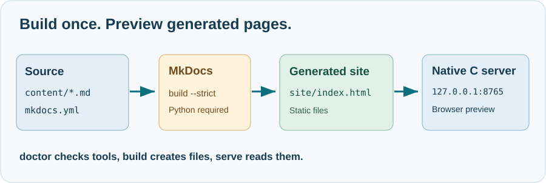

# 62. Build the educational website before serving it

A browser displays HTML. Our learning chapters are written in Markdown, so a website generator must first convert the source lessons into an HTML site. The C web server then reads those generated HTML files and sends them to your browser.

**Checking that MkDocs is installed is not the same as generating a website.** You need to build the pages before a server can serve them.

## 1. Understand the two operations



The project has two relevant directories:

```text
C:\umicom\Umicom-Bits2Banking\
├── content\       Editable Markdown lessons and illustrations
├── mkdocs.yml     Website configuration and chapter navigation
└── site\          Generated HTML files (created by the build)
```

A missing `site/index.html` means the website's home page has not been produced in that location. A successful C compilation does not create that file; the website build does.

## 2. Check your existing Python environment

Open PowerShell:

```powershell
Set-Location "C:\umicom\Umicom-Bits2Banking"
& ".\.venv\Scripts\python.exe" -m mkdocs --version
```

This verifies that the selected Python installation can run MkDocs. If the command fails, install the repository's website dependencies:

```powershell
& ".\.venv\Scripts\python.exe" -m pip install -r ".\requirements-docs.txt"
```

Do not reinstall the packages when the version check already succeeds.

## 3. Build the website

Return to Umicom Applications and select the native tool:

```powershell
Set-Location "C:\umicom\Umicom-Applications"

$Education = ".\build\umicom-education\bin\umicom-education.exe"
$Books = "C:\umicom\Umicom-Bits2Banking"
$Python = "$Books\.venv\Scripts\python.exe"

& $Education build --repo $Books --python $Python
if ($LASTEXITCODE -ne 0) { throw "Website build failed; check the MkDocs diagnostics." }
```

MkDocs reads `mkdocs.yml`, processes the Markdown and creates the generated site. Its output should include `site/index.html`.

Check the actual result:

```powershell
Test-Path "$Books\site\index.html"
```

The expected output is `True`. If it is `False`, do not start the web server yet. Read the MkDocs error and correct the referenced page, image or configuration first.

## 4. Start the native web server

```powershell
& $Education serve --repo $Books --port 8765
```

Open [http://127.0.0.1:8765/](http://127.0.0.1:8765/) in a browser. The server reads the HTML site already on disk. Stop it with Ctrl+C when you finish.

You can also ask the updated native command to **build and then start the preview**, in one explicit operation:

```powershell
& $Education serve --repo $Books --build --python $Python --port 8765
```

The `--build` option calls the same MkDocs build service as the separate command. If MkDocs fails, the HTTP server is not started. Without `--build`, `serve` deliberately refuses a missing generated site and prints the exact path it expected.

The option `--directory` is for previewing an already-generated export. It cannot be combined with `--build`, which always uses the repository's configured website output directory.

## 5. Check and change one lesson

Open this chapter in your editor. Correct a small spelling mistake or add a short sentence explaining the difference between source and generated files. Rebuild the website and refresh the browser. Your change should appear on the generated page.

Do not edit a generated HTML page under `site/` as the permanent source of a lesson. The next website build will regenerate that HTML from `content/`.

**Check your understanding:** What does `doctor` check? What creates `site/index.html`? Why does serving Markdown source directly not produce the same site? What does `--build` do, and what happens if the build fails?

### How it connects to Umicom

The [native education tool](https://github.com/umicom-foundation/umicom-framework/tree/main/tools/umicom-education) is written in C23. Its local preview server is not a public hosting service. It binds to `127.0.0.1`, serves read-only files and has no TLS, user authentication or application API. The production and reusable networking services are part of Umicom Framework's wider web platform.
