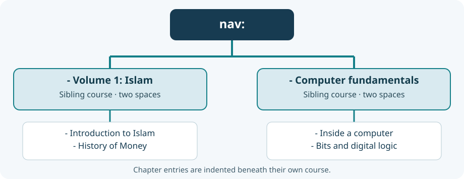

# 63. Fix a broken MkDocs website configuration

A website can contain every lesson and still refuse to open. Before a browser can display the pages, the website builder reads a configuration file that tells it where the pages are and how to arrange them. In Bits2Banking, that file is `mkdocs.yml`.

This chapter repairs a real type of configuration error: a course name was inserted at the wrong indentation level. The C web server started behaving correctly by **refusing to serve a website that had not been built**. The error occurred earlier, when MkDocs attempted to read YAML.

## 1. Find the configuration file

Open PowerShell and enter:

```powershell
Set-Location "C:\umicom\Umicom-Bits2Banking"
Get-Item ".\mkdocs.yml"
```

`mkdocs.yml` contains a set of named settings. `docs_dir: content` tells MkDocs where to find the editable Markdown pages. `site_dir: site` tells it where to put the generated HTML. `nav:` introduces the chapter navigation.

The generated `site` folder is **not** the source of the lessons. If it is missing, a successful build should recreate it from the Markdown files.

## 2. Understand a YAML list

YAML uses spaces to group information. Consider two top-level courses:

```yaml
nav:
  - "Volume 1 — Islam: Blueprint for Life":
      - Overview: v001_islam_blueprint_for_life/index.md
      - History of Money: v001_islam_blueprint_for_life/history_of_money.md
  - "Computer fundamentals":
      - Overview: lessons/01-computers/index.md
      - Inside a computer: lessons/01-computers/01-inside-a-computer.md
```

Both course titles start with **two spaces**, followed by `- `. Their chapters start with **six spaces**, followed by `- `. The two courses are siblings in the top-level list; neither is a chapter of the other.



Now consider an incorrectly indented second course:

```yaml
nav:
  - "Volume 1 — Islam: Blueprint for Life":
      - Overview: v001_islam_blueprint_for_life/index.md
    - "Computer fundamentals":
      - Overview: lessons/01-computers/index.md
```

The extra spaces before the second course break the expected list structure. A YAML parser may report **`expected <block end>, but found '?'`** at or near that point. The line it reports is where parsing became impossible, not necessarily the first line with the mistake.

## 3. Look at the affected lines

The reported Bits2Banking failure mentioned lines 65 and 78. Display that area without editing:

```powershell
Set-Location "C:\umicom\Umicom-Bits2Banking"
Get-Content ".\mkdocs.yml" | Select-Object -Skip 59 -First 28
```

Check that the *Volume 1 — Islam: Blueprint for Life* block ends with its last chapter, and that `- "Computer fundamentals":` aligns with `- "Volume 1 — Islam: Blueprint for Life":`.

Avoid deleting the Islam block to make the error disappear. Its ten historical chapters, including *Introduction to Islam* and *History of Money*, remain part of the learning website.

## 4. Run the configuration checker

Bits2Banking includes a Python virtual environment with MkDocs installed. Use **that** Python, not whichever Python happens to appear first on the compiler's `PATH`:

```powershell
Set-Location "C:\umicom\Umicom-Bits2Banking"
$Python = ".\.venv\Scripts\python.exe"
& $Python ".\tools\check_mkdocs_config.py" --syntax-only
```

The syntax-only check does not need the historical books to have been copied into the website directory. A successful result begins with `[OK] YAML syntax`.

After syntax passes, check the complete navigation and referenced pages:

```powershell
& $Python ".\tools\check_mkdocs_config.py"
```

This second check confirms that the navigation paths exist, are not repeated, and retain the ten original Islam chapters in order. If it reports a missing historical chapter, use the existing site preparation tool rather than inventing a replacement:

```powershell
& $Python ".\tools\prepare_learning_site.py"
```

## 5. Build the actual website

The checker verifies the configuration and selected Markdown pages. MkDocs still needs to render the complete site:

```powershell
& $Python -m mkdocs build --strict
```

A successful build creates `site/index.html`. Confirm the result:

```powershell
Test-Path ".\site\index.html"
```

PowerShell should print `True`. A syntax check passing is **not** the same as a successful website build: MkDocs might still find a broken relative link or a missing image.

## 6. Serve the generated website with Umicom

Return to the Umicom Applications directory:

```powershell
Set-Location "C:\umicom\Umicom-Applications"
$Education = ".\build\umicom-education\bin\umicom-education.exe"
$Books = "C:\umicom\Umicom-Bits2Banking"
& $Education serve --repo $Books --port 8765
```

Open `http://127.0.0.1:8765/` in your browser. Check the computing chapters and the original Islam volume. Stop the server with **Ctrl+C**.

The `serve --build --python PATH` form can do the build first. Its behaviour is intentionally strict: if the build fails, it does not start the server and pretend the old website is current.

## 7. Try a safe editing exercise

Open a **copy** of `mkdocs.yml` in your editor, not the authoritative file. Change the indentation of one top-level course. Run:

```powershell
& $Python ".\tools\check_mkdocs_config.py" --config "C:\path\to\your\copy.yml" --syntax-only
```

Observe the error line and its surrounding context. Restore the two-space indentation and try again. Nothing in the real book manuscripts needs to change.

**Check your understanding:** What is the difference between `content/` and `site/`? Why do sibling navigation entries have equal indentation? What is the difference between a YAML syntax check and a full website build? Why should the web server refuse to start after a failed build?

Continue with [Lesson 64: Make allocations fail on purpose](../03-native-code/64-test-allocation-failures.md).
