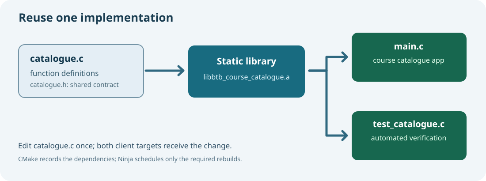

# 73. Build a reusable C23 library with CMake and Ninja

Umicom Framework is useful because applications share reusable services. The same idea appears in a much smaller programme: write a library that owns one job, then use it from several applications without copying the implementation.

Our exercise is a catalogue of learning modules. A console application displays the modules; a separate test executable checks the catalogue's rules. Both link to the same C23 library.



## 1. Separate a declaration from a definition

A header declares a function so that another source file knows how to call it. Open `labs/native/course-catalogue-library/catalogue.h` and find:

```c
void BtbCatalogueInit(BtbCourseCatalogue *catalogue);
```

This tells the compiler the function name, parameter type and return type. It does **not** contain the instructions that initialise a catalogue.

Open `catalogue.c` and find the function definition:

```c
void BtbCatalogueInit(BtbCourseCatalogue *catalogue)
{
    if (catalogue != NULL)
        *catalogue = (BtbCourseCatalogue){0};
}
```

The definition performs the work. Both the declaration and definition must agree. If the implementation were renamed while callers retained the old name, the compiler could accept the caller's source but the linker would report an unresolved symbol.

## 2. Understand the data being protected

A catalogue can hold up to eight named modules. Each module stores a title and a lesson count. The `BtbCatalogueAdd` operation performs validation before changing the catalogue:

- The pointer and title must be valid, and the lesson count must be positive.
- The title must fit the fixed-size field and must not contain control characters.
- The title must not already exist.
- The catalogue must have room for one more module.
- Adding the count must not overflow a 32-bit unsigned total.

For example, if the catalogue holds `4` lessons and someone tries to add `UINT32_MAX`, the addition is rejected **without modifying the existing records**. This failure-atomic behaviour is a practical example of safer C23.

## 3. Ask CMake to create the library

Open the supplied `CMakeLists.txt`. It includes these commands:

```cmake
add_library(btb_course_catalogue STATIC catalogue.c)
target_include_directories(btb_course_catalogue PUBLIC "${CMAKE_CURRENT_SOURCE_DIR}")
```

`add_library` instructs the build system to turn `catalogue.c` into a static library. A **static library** is a collection of compiled object files that a linker can use when producing an executable.

`target_include_directories` tells a client where to find the public header. `PUBLIC` indicates that the include path is also needed by targets that link against this library.

The programme then declares its dependency:

```cmake
add_executable(btb-course-catalogue main.c)
target_link_libraries(btb-course-catalogue PRIVATE btb_course_catalogue)
```

CMake knows which files to rebuild when `catalogue.c`, the header or a client changes. You do not need to copy or edit the library source in the client application.

## 4. Configure, build and test

Open PowerShell in `C:\umicom\Umicom-Bits2Banking`:

```powershell
$env:Path = "C:\msys64\ucrt64\bin;$env:Path"
cmake -S ".\labs\native\course-catalogue-library" `
    -B ".\output\learning-build\course-catalogue-library" `
    -G Ninja -DCMAKE_C_COMPILER="C:\msys64\ucrt64\bin\gcc.exe"
cmake --build ".\output\learning-build\course-catalogue-library" --parallel 2
ctest --test-dir ".\output\learning-build\course-catalogue-library" --output-on-failure
```

You should see **two passing tests**. One test exercises the catalogue contract; the other launches the example and checks for `Total lessons: 21`.

Run the executable yourself:

```powershell
& ".\output\learning-build\course-catalogue-library\btb-course-catalogue.exe"
```

## 5. Inspect the archive and exported symbols

For the GCC UCRT64 build, look for an archive called `libbtb_course_catalogue.a`. CMake may place it in the build directory. Then run:

```powershell
& "C:\msys64\ucrt64\bin\nm.exe" `
    ".\output\learning-build\course-catalogue-library\libbtb_course_catalogue.a"
```

Look for `BtbCatalogueInit`, `BtbCatalogueAdd` and `BtbCatalogueAt`. Symbols allow the linker to connect the client to the library implementation.

## 6. Diagnose an unresolved external symbol

The laboratory contains `examples/undefined_reference.c`. It calls `BtbCatalogueInit` but does not supply or link the function definition. Its source is intentionally **excluded from the normal CMake build**.

Read that file first. Then compile it alone using the command in the laboratory README. The compiler knows the function prototype from `catalogue.h`, but the linker cannot find the implementation and refuses to create a working programme.

The solution is not to duplicate `BtbCatalogueInit` in `main.c`. Link against the library, as the working CMake target does.

## 7. Install the library for use elsewhere

CMake also knows how to stage the public header and archive. From the repository root:

```powershell
cmake --install ".\output\learning-build\course-catalogue-library" `
    --prefix ".\output\learning-install\course-catalogue"
```

Inspect `output/learning-install/course-catalogue/lib`, `include/bits2banking` and `bin`. This is a local training installation, not an operating-system package manager. Later we will use package metadata to make dependencies and versions explicit.

## 8. Apply the design to Umicom

The [Framework headers](https://github.com/umicom-foundation/umicom-framework/tree/main/include/umicom) publish reusable contracts; implementations live under [Framework source](https://github.com/umicom-foundation/umicom-framework/tree/main/src). Umicom Studio IDE, Bank and Trader should link to these services instead of maintaining competing copies of the implementation.

Our course catalogue is small enough to inspect fully. The architectural principle remains the same when the library grows to include events, documents, banking calculations or GUI widgets.

**Exercise:** Explain why `catalogue.h` must be available to both clients, but `catalogue.c` should be compiled once into the library target. Add a new module and predict the total before rebuilding.

**Continue:** [Lesson 74 — inspect ELF, PE and COFF headers](74-read-elf-pe-coff-with-c23.md).
